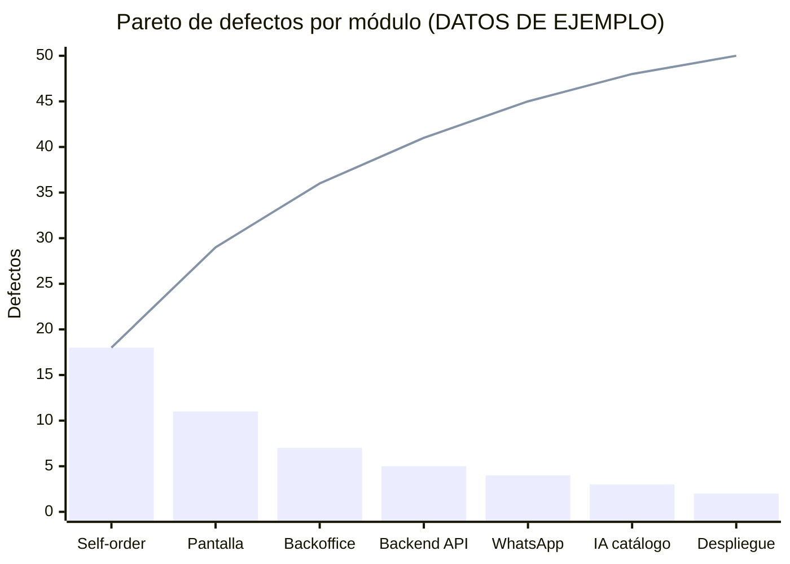
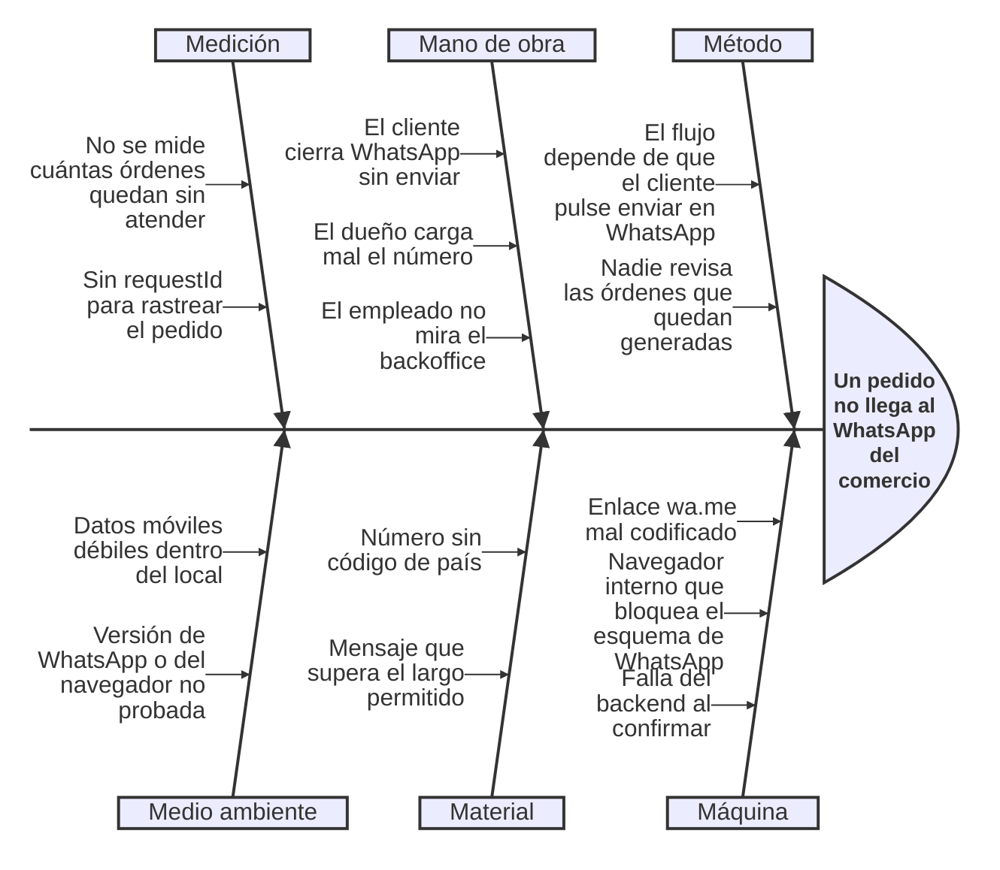
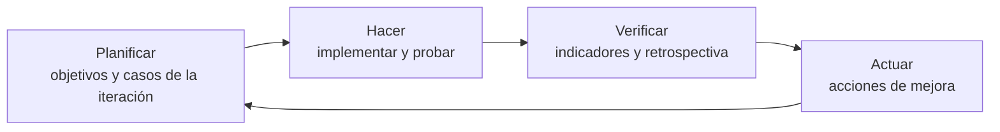

# Mostrador: indicadores de calidad y mejora continua

Los identificadores RF-xxx y RNF-xxx coinciden con `docs/requerimientos.xlsx`. Las metas que vienen de un RNF figuran en `docs/no-funcional.md`; las marcadas como "propuesta" son metas del equipo que se revisan al cierre de cada iteración. Los casos de prueba están en `docs/testing.md`.

Reglas de oro del documento:

1. **Medir desde el primer día:** los indicadores se calculan con datos que el proyecto ya genera (GitHub Issues, GitHub Projects, CI), sin herramientas nuevas.
2. **Eliminar desperdicio:** no se mide lo que nadie usa para decidir.
3. **Equilibrar los atributos:** mejorar uno (por ejemplo rendimiento) no puede degradar otro (por ejemplo seguridad o mantenibilidad).

## Indicadores por atributo de calidad (ISO/IEC 25010)

El curso lista siete atributos; se agrega Compatibilidad porque el proyecto tiene un RNF específico (RNF-006).

| Atributo | Indicador | Meta | Origen de la meta | Herramienta | Frecuencia | RNF |
| --- | --- | --- | --- | --- | --- | --- |
| Adecuación funcional | % de RF con al menos un caso aprobado (cobertura de requisitos) | 100% al cierre | Propuesta | RTM de `docs/testing.md` | Por iteración | RNF-001 |
| Adecuación funcional | % de coincidencia entre carrito, orden y mensaje de WhatsApp | 100% en 50 pedidos | RNF | Jest | Por PR | RNF-001 |
| Eficiencia de desempeño | Latencia p95 de la API con 50 usuarios virtuales | < 500 ms; errores < 1% | RNF | k6 | Semanal en staging | RNF-003 |
| Eficiencia de desempeño | Tiempo de carga y LCP del autopedido en 4G | < 3 s; LCP ≤ 2,5 s | RNF | Lighthouse | Por entrega | RNF-002 |
| Eficiencia de desempeño | Uso de CPU y memoria del backend durante la carga; rendimiento (solicitudes por segundo) | Sin saturación de CPU ni crecimiento sostenido de memoria en 5 min | Propuesta | k6 y métricas del servidor | Semanal en staging | RNF-003 |
| Eficiencia de desempeño | Latencia p95 y errores bajo estrés: 200 usuarios virtuales en catálogo y QR, 100 pantallas consultando cada 30 s | p95 < 500 ms; errores < 1% | RNF | k6 (JMeter como alternativa) | Semanal en staging y por entrega | RNF-003, RNF-004 |
| Eficiencia de desempeño | Punto de quiebre y recuperación: escalada 50, 100, 200 y 400 usuarios virtuales | Sin caída del proceso; vuelve a p95 < 500 ms en menos de 2 min | Propuesta | k6 y métricas del servidor | Por entrega | RNF-003 |
| Eficiencia de desempeño | Latencia de actualización de la pantalla | ≤ 60 s en el 95% de las pruebas | RNF | Playwright | Por entrega | RNF-004 |
| Eficiencia de desempeño | Rechazo de archivos fuera de límite | 100% con 413 | RNF | supertest | Por PR | RNF-005 |
| Compatibilidad | Defectos bloqueantes en la matriz de navegadores y sistemas | 0 | RNF | Playwright y pruebas manuales | Por entrega | RNF-006 |
| Usabilidad | Tasa de éxito de tarea: clientes que completan el pedido sin ayuda | ≥ 90% | Propuesta | UAT con el comercio piloto | Una vez, con el MVP | RNF-007, RNF-009 |
| Usabilidad | Tasa de error: pedidos abandonados tras un mensaje de error | ≤ 10% | Propuesta | Registro de la UAT | Una vez, con el MVP | RNF-007 |
| Usabilidad | Puntaje SUS (System Usability Scale) | ≥ 68 (promedio de referencia) | Propuesta | Cuestionario SUS al dueño y empleados | Una vez, con el MVP | RNF-008 |
| Usabilidad | Lectura del QR a 1,5 m | ≥ 95% de 20 intentos | RNF | Prueba manual con televisor | Por entrega | RNF-009 |
| Usabilidad | Sin scroll horizontal; contraste y axe | 0 violaciones críticas; contraste ≥ 4,5:1 | RNF | Playwright con axe | Por entrega | RNF-007, RNF-008 |
| Fiabilidad | Disponibilidad (uptime) mensual de la API | ≥ 99% | Propuesta | Monitoreo del endpoint de salud | Mensual | RNF-010, RNF-011 |
| Fiabilidad | MTBF (tiempo medio entre fallas) en staging | Registrar desde el día 1; tendencia creciente | Propuesta | Logs estructurados | Mensual | RNF-017 |
| Fiabilidad | Defectos por KLOC en el backend | ≤ 5 al cierre | Propuesta | GitHub Issues y conteo de líneas | Por entrega | RNF-016 |
| Fiabilidad | Reproducción sin red; RPO y tiempo de restauración | 24 h sin red; RPO ≤ 24 h; restauración ≤ 1 h | RNF | Playwright; simulacro de restauración | Por entrega | RNF-010, RNF-011 |
| Seguridad | Accesos entre tenants | 0 | RNF | Jest e2e (batería de autorización) | Por PR | RNF-012 |
| Seguridad | Vulnerabilidades abiertas por severidad CVSS | 0 con CVSS ≥ 7 | Propuesta | `npm audit` y dependabot | Semanal | RNF-012, RNF-015 |
| Seguridad | Tiempo de parche de una vulnerabilidad crítica | ≤ 48 h | Propuesta | GitHub Issues (fechas) | Por evento | RNF-015 |
| Seguridad | HTTPS y secretos | SSL Labs ≥ A; 0 secretos | RNF | SSL Labs; gitleaks | Por entrega; por PR | RNF-013, RNF-014, RNF-015 |
| Mantenibilidad | Complejidad ciclomática de McCabe por función | ≤ 10 | Propuesta | Regla `complexity` de ESLint | Por PR | RNF-016 |
| Mantenibilidad | Cobertura de líneas en casos de uso | ≥ 70% | RNF | Jest con `--coverage` | Por PR | RNF-016 |
| Mantenibilidad | Índice de mantenibilidad (MI) | ≥ 65 | Propuesta | Análisis estático (ESLint y revisión) | Por entrega | RNF-016, RNF-017 |
| Mantenibilidad | Logs en JSON con requestId y tenantId | 100% | RNF | Revisión de logs | Por entrega | RNF-017 |
| Portabilidad | Código compartido entre Android y web | ≥ 90% | RNF | Análisis de la estructura del repositorio | Por entrega | RNF-018 |
| Portabilidad | Tiempo de los builds de APK y web | ≤ 30 min | RNF | Tiempos de CI | Por PR | RNF-018 |
| Portabilidad | % de despliegues automatizados exitosos | ≥ 95% | Propuesta | GitHub Actions | Mensual | RNF-018 |

## Indicadores por etapa del ciclo de desarrollo

| Etapa | Indicador | Meta del proyecto | Cómo se calcula |
| --- | --- | --- | --- |
| Requisitos | % de requisitos ambiguos (sin criterio de aceptación medible) | 0% al aprobar un RF | RF sin escenario Gherkin o RNF sin meta numérica, sobre el total |
| Requisitos | Volatilidad de requisitos | ≤ 10% por iteración | Requisitos aprobados que cambian, sobre el total aprobado |
| Diseño | Acoplamiento entre módulos NestJS | Sin dependencias circulares | Análisis de dependencias (por ejemplo `madge`) |
| Diseño | Cohesión de módulos | Cada módulo NestJS responde a un solo módulo funcional del xlsx | Revisión de diseño por PR |
| Código | Cobertura de pruebas | ≥ 70% en casos de uso | Jest con `--coverage` |
| Código | Trabajo en curso (WIP) | ≤ 2 issues por persona | Columna "En curso" de GitHub Projects |
| Código | Deuda técnica | ≤ 10% del backlog | Issues con etiqueta `deuda`, sobre el total abierto |
| QA (shift-left) | DDP, porcentaje de detección de defectos | ≥ 90% | Defectos hallados antes del release / (antes + después) |
| QA (shift-left) | Tasa de reapertura de defectos | ≤ 10% | Defectos que pasaron por "Reabierto" / defectos cerrados |
| QA (shift-left) | % de requerimientos con caso feliz, negativo y de estrés | 100% (53 de 53) | Requerimientos con al menos un caso de cada tipo, sobre el total, según la RTM de `docs/testing.md` (regla del plan: mínimo 3 casos por requerimiento) |
| QA (shift-left) | Cobertura de regresión | ≥ 80% de los casos automatizados | Casos automatizados / casos totales de `docs/testing.md` |
| Operación | DORA: frecuencia de despliegue | ≥ 1 por semana a staging | Despliegues de GitHub Actions |
| Operación | DORA: lead time de cambios | ≤ 2 días | Del primer commit a su despliegue |
| Operación | DORA: tiempo medio de recuperación (MTTR) | ≤ 4 h | De la detección a la restauración del servicio |
| Operación | DORA: tasa de fallo de cambios | ≤ 15% | Despliegues que requieren corrección o reversión / total |

Las metas DORA son de referencia para un MVP con un equipo chico; no se comparan con los niveles de la industria hasta tener al menos 10 despliegues medidos.

## Pareto de defectos

Principio 80/20: un pequeño número de módulos concentra la mayor parte de los defectos. El Pareto indica dónde reforzar pruebas, refactorizar o capacitar primero.

**Cómo se clasifican los defectos.** Cada issue de defecto lleva una etiqueta `modulo:` con el paquete de la EDT (Backend, Backoffice, Pantalla, Self-order, WhatsApp, IA catálogo, Despliegue) y el RF afectado en el campo "RF/HU" de la plantilla. Al cierre de cada iteración se exporta el conteo por módulo, se ordena de mayor a menor y se calcula el porcentaje acumulado. Los módulos que suman el 80% reciben prioridad en la siguiente iteración: casos nuevos, revisión de código y análisis de causa raíz.

**Datos de ejemplo (ilustrativos, no son resultados reales):**

| Módulo | Defectos | % | % acumulado |
| --- | --- | --- | --- |
| Self-order | 18 | 36% | 36% |
| Pantalla | 11 | 22% | 58% |
| Backoffice | 7 | 14% | 72% |
| Backend API | 5 | 10% | 82% |
| WhatsApp | 4 | 8% | 90% |
| IA catálogo | 3 | 6% | 96% |
| Despliegue | 2 | 4% | 100% |
| **Total** | **50** | **100%** | |

Gráfico con los **datos de ejemplo**: barras de defectos por módulo y línea del acumulado (el 80% de 50 defectos es 40).

Lectura del ejemplo: cuatro módulos (Self-order, Pantalla, Backoffice y Backend API) explican el 82% de los defectos. Se reforzarían allí las pruebas de interfaz y de sincronización de la pantalla antes que en Despliegue o IA.

## Análisis de causa raíz con Ishikawa (6M)

Escenario de ejemplo: **"un pedido no llega al WhatsApp del comercio"**. El diagrama es de ejemplo y sirve para guiar el análisis cuando el defecto aparece; las causas se confirman con evidencia (logs con `requestId`, orden en el backoffice) antes de actuar.

| Categoría (6M) | Causa posible | Cómo se confirma | Acción propuesta | Requisito / caso |
| --- | --- | --- | --- | --- |
| Método | `wa.me` no confirma el envío; el cliente puede no enviar | Orden en estado "generada" sin respuesta del cliente | Mostrar en el backoffice las órdenes "generada" con antigüedad y avisar al comercio | RF-031, TC de HU-23 (cliente no envía) |
| Máquina | Enlace mal codificado | Decodificar el enlace de la orden | Prueba de caracteres especiales y de largo máximo | RF-034, RNF-001 |
| Mano de obra | El dueño carga un número erróneo | Revisar el número configurado | Validación E.164 y mensaje de prueba al guardar | RF-033 |
| Material | Número sin código de país | Formato del número guardado | Rechazar números sin `+` ni código de país | RF-033 |
| Medición | No hay indicador de órdenes sin atender | Revisar los indicadores actuales | Agregar el indicador "órdenes generadas sin cambio de estado en 15 min" | RF-032 |
| Medio ambiente | Conexión débil en el local | Pruebas con red 3G simulada | Probar el autopedido en red lenta | RNF-002 |

## LEAN: desperdicios (muda) del proyecto

| Muda | Cómo aparece en Mostrador | Cómo se evita |
| --- | --- | --- |
| Sobreproducción | Funciones que nadie pidió (pagos, stock, upselling) | Lista de exclusiones y solicitud de cambio (`docs/planificacion.md`) |
| Espera | Un RF bloqueado por su dependencia o un PR sin revisar | Revisión de PR en menos de 24 h; límite de WIP; fast tracking con contrato de API |
| Transporte | Traspasos entre backend y frontend sin contrato claro | Contrato OpenAPI antes de implementar y pruebas de contrato en Postman |
| Sobreprocesamiento | Documentos duplicados; pruebas de código trivial | Un solo documento por tema; TDD solo en lógica de negocio |
| Inventario | Ramas largas, PRs enormes y backlog inflado | PRs chicos (referencia de 400 líneas) y backlog limitado a la iteración |
| Movimiento | Despliegues y pruebas manuales repetitivas; cambio de contexto | CI/CD y suite automatizada |
| Defectos | Retrabajo por requisitos ambiguos o errores tardíos | Gherkin antes de implementar, casos revisados por pares y shift-left |
| Talento no aprovechado | Conocimiento en una sola persona | Revisión por pares y documentación en el repositorio |

## Ciclo de mejora continua (PDCA) por iteración

| Fase | Qué se hace en cada iteración | Resultado |
| --- | --- | --- |
| Planificar | Elegir los RF de la iteración desde el camino crítico; definir sus casos de prueba y las metas de los indicadores | Tablero y casos listos |
| Hacer | Implementar, ejecutar las pruebas, registrar defectos | Código, pruebas y defectos registrados |
| Verificar | Calcular los indicadores (cobertura, DDP, reapertura, SPI, DORA); actualizar el Pareto; revisar la RTM | Informe de la iteración |
| Actuar | Elegir como máximo dos acciones de mejora (por ejemplo: reforzar pruebas del módulo con más defectos) y anotarlas como issues con la etiqueta `mejora` | Acciones asignadas para la siguiente iteración |

Un indicador que cae fuera de su meta dos iteraciones seguidas dispara un análisis de causa raíz (5 porqués o Ishikawa) y una acción concreta, no solo un registro del valor.
