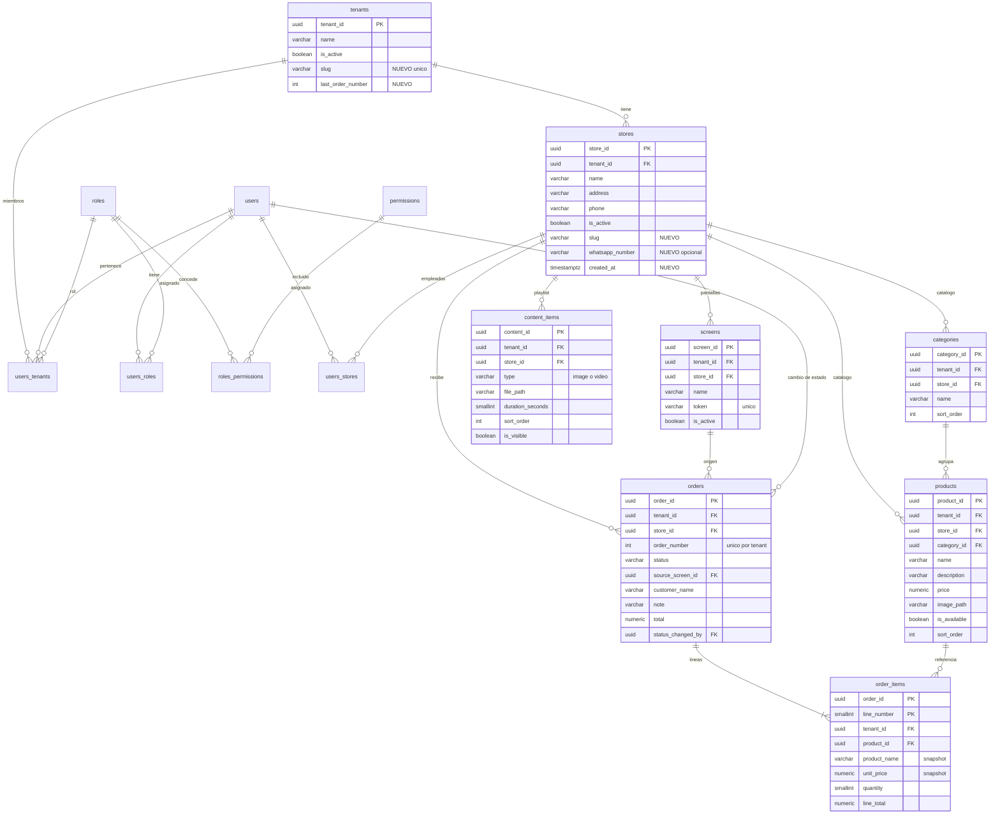

# Mostrador: modelo de datos (R1)

Contrato de base de datos para el MVP del 02/11/2026 (R1). Complementa a `docs/api.md` (nombres de campos idénticos a las columnas) y a `docs/funcional.md`. Los identificadores RF-xxx son los de `docs/requerimientos.xlsx`.

Convenciones: PostgreSQL; claves primarias `UUID` con `gen_random_uuid()` (igual que las tablas existentes); dinero `NUMERIC(12,2)`; fechas `TIMESTAMPTZ`; nombres en inglés `snake_case`. Los textos visibles al usuario viajan en español.

## 1. Cambios por ámbito de entrega

| Ámbito | Contenido |
| --- | --- |
| Existente (no se renombra nada) | `users`, `roles`, `users_roles`, `tenants`, `stores`, `users_tenants`, `users_stores`, `permissions`, `roles_permissions` |
| Cambia en R1 | `tenants` (columnas `slug`, `last_order_number`), `stores` (columnas `slug`, `whatsapp_number`, `created_at`) |
| Nuevas en R1 | `categories`, `products`, `content_items`, `screens`, `orders`, `order_items` |
| Fuera de R1 | ver sección 9 |

## 2. Diagrama entidad-relación

Todas las tablas de negocio llevan además `tenant_id` (FK a `tenants`); no se dibuja cada línea para no saturar el diagrama.

## 3. Decisiones de diseño no obvias

| Decisión | Motivo | Cómo evoluciona en R2 |
| --- | --- | --- |
| El catálogo (categorías y productos) y la playlist cuelgan del **local** (`store_id`), no solo del tenant | RF-010 pide nombre de categoría único por local y RF-014 devuelve el catálogo de un local. | Varios locales por tenant ya funcionan sin cambios. |
| **No existe `screen_content`**: la playlist es una sola por local (`content_items`) y todas las pantallas del local la reproducen | RF-019 pide orden, duración y ocultar, pero ningún RF exige playlists distintas por pantalla. Ahorra una tabla y un endpoint. | Si se piden playlists por pantalla, se agrega `screen_content (screen_id, content_id, sort_order)` y `content_items.sort_order` pasa a ser el orden por defecto. |
| `content_items.duration_seconds` es una sola columna: tiempo en pantalla de la imagen (3 a 60) o duración real del video (1 a 60) | Evita dos columnas mutuamente excluyentes; el reproductor siempre suma `duration_seconds`. | Sin cambios. |
| No hay columna `version` de la playlist: se calcula en cada consulta (hash del contenido) | Una columna almacenada se desincroniza al borrar o cambiar filas; la playlist tiene pocas filas. | Si hubiera cientos de ítems, se cachea el hash. |
| Número público del pedido por tenant con `tenants.last_order_number` incrementado dentro de la transacción de alta | El `UPDATE ... RETURNING` toma un bloqueo de fila: dos pedidos simultáneos del mismo tenant nunca obtienen el mismo número, sin secuencias por tenant. | Sin cambios. |
| `order_items` guarda `product_name` y `unit_price` (snapshot) y `product_id` con `ON DELETE SET NULL` | El pedido debe seguir siendo correcto aunque el producto se edite o se borre después. | Sin cambios. |
| Quién y cuándo cambió el estado se guarda como última modificación en `orders` (`status_changed_by`, `status_changed_at`) | RF-032 exige quién y cuándo; no exige historial completo. | Si se pide auditoría completa, tabla `order_status_history`. |
| Las pantallas no se borran, solo se desactivan (`is_active`) | `orders.source_screen_id` debe seguir apuntando al origen del pedido. | La regeneración del token (R2) cambia `token` sin tocar `screen_id`. |
| Los estados se guardan como códigos `snake_case` sin acento (`en_preparacion`) | Evita acentos en claves y en CHECK; la etiqueta en español la pone el cliente. | Sin cambios. |

## 4. Regla de aislamiento multi-tenant (RNF-012)

1. Toda tabla de negocio nueva lleva `tenant_id UUID NOT NULL REFERENCES tenants(tenant_id)`, también `order_items` (aunque se deduzca de `orders`), para poder filtrar sin joins.
2. El `tenant_id` de cada consulta sale **únicamente** del tenant resuelto por el backend desde el subdominio (ver `docs/api.md`, sección 1). Nunca del body, de la query ni del JWT (el JWT solo trae `sub` y `email`).
3. Toda lectura, actualización o borrado por identificador se escribe con ambos predicados: `WHERE <pk> = :id AND tenant_id = :tenantId`. Un identificador de otro tenant se comporta como inexistente (404).
4. Toda lista filtra por `tenant_id` y, cuando corresponde, por `store_id`. El `store_id` recibido del cliente se valida antes: `SELECT 1 FROM stores WHERE store_id = :id AND tenant_id = :tenantId`.
5. Toda inserción toma `tenant_id` del contexto y verifica que las referencias (`store_id`, `category_id`, `product_id`, `source_screen_id`) pertenezcan al mismo tenant.
6. Los repositorios reciben `tenantId` como primer parámetro obligatorio: no existe método que consulte tablas de negocio sin él.
7. Las rutas públicas (catálogo, alta de pedido, reproductor) aplican la misma regla con el tenant del Host.
8. La batería de pruebas de RNF-012 recorre cada endpoint con un identificador de otro tenant y espera 404 (o 403 si el usuario no es miembro del tenant del Host).

## 5. Tablas existentes que cambian

### 5.1 `tenants` (cambia)

| Columna | Tipo | Nulo | Default | Restricción | Por qué existe |
| --- | --- | --- | --- | --- | --- |
| `tenant_id` | UUID | no | `gen_random_uuid()` | PK | |
| `name` | VARCHAR(150) | no | | | Ya existe. |
| `is_active` | BOOLEAN | no | `TRUE` | | Ya existe. En R1 un tenant inactivo se trata como inexistente (404); el mensaje de mantenimiento es R2. |
| `slug` | VARCHAR(30) | no | | UNIQUE `uq_tenants_slug`; CHECK `ck_tenants_slug_format`: `slug ~ '^[a-z0-9][a-z0-9-]{1,28}[a-z0-9]$'`; CHECK `ck_tenants_slug_reserved`: `slug NOT IN ('www','api','app','admin')` | Es el subdominio (`local1.mostrador.io`). El patrón exige 3 a 30 caracteres en minúscula, solo letras, números y guion (RF-001) y además no empieza ni termina en guion porque un subdominio DNS no lo admite. |
| `last_order_number` | INTEGER | no | `0` | CHECK `>= 0` | Contador del número público de pedido por tenant; se incrementa con `UPDATE ... RETURNING` dentro de la transacción del pedido. |

Índices:

| Índice | Definición | Por qué existe |
| --- | --- | --- |
| `uq_tenants_slug` | UNIQUE (`slug`) | Resuelve el tenant desde el subdominio en cada solicitud y garantiza slug único (RF-001, RF-002). |

### 5.2 `stores` (cambia)

| Columna | Tipo | Nulo | Default | Restricción | Por qué existe |
| --- | --- | --- | --- | --- | --- |
| `store_id` | UUID | no | `gen_random_uuid()` | PK | |
| `tenant_id`, `name`, `address`, `phone`, `is_active` | | | | | Ya existen sin cambios. `phone` es el teléfono de contacto del local y **no** es el número de WhatsApp. `is_active = FALSE` impide recibir pedidos (RF-003). |
| `slug` | VARCHAR(30) | no | | CHECK `ck_stores_slug_format` (mismo patrón que el del tenant); CHECK `ck_stores_slug_reserved`: `slug NOT IN ('screen','media','api')`; UNIQUE (`tenant_id`, `slug`) | Es el segmento de la URL del autopedido (`local1.mostrador.io/palermo`, RF-004). Se reservan los segmentos que usa la propia web. |
| `whatsapp_number` | VARCHAR(16) | sí | `NULL` | CHECK `ck_stores_whatsapp_e164`: `whatsapp_number IS NULL OR whatsapp_number ~ '^\+[1-9][0-9]{7,14}$'` | Número que recibe los pedidos por `wa.me`, formato E.164 (RF-033). `NULL` significa "sin WhatsApp": el pedido se registra igual y solo se omite el paso de `wa.me`. |
| `created_at` | TIMESTAMPTZ | no | `CURRENT_TIMESTAMP` | | Orden estable de la lista de locales. |

Índices:

| Índice | Definición | Por qué existe |
| --- | --- | --- |
| `uq_stores_tenant_slug` | UNIQUE (`tenant_id`, `slug`) | Resuelve el local por su slug dentro del tenant (`/palermo`), garantiza slug único por tenant y sirve el listado de locales de un tenant (RF-003, RF-004). |

## 6. Tablas nuevas

Todas las columnas `created_at` y `updated_at` son `TIMESTAMPTZ NOT NULL DEFAULT CURRENT_TIMESTAMP`; `updated_at` lo actualiza la aplicación en cada modificación.

### 6.1 `categories`

| Columna | Tipo | Nulo | Default | Restricción | Por qué existe |
| --- | --- | --- | --- | --- | --- |
| `category_id` | UUID | no | `gen_random_uuid()` | PK | |
| `tenant_id` | UUID | no | | FK `tenants` | Aislamiento. |
| `store_id` | UUID | no | | FK `stores` | El catálogo es por local. |
| `name` | VARCHAR(80) | no | | CHECK `length(btrim(name)) >= 1` | Nombre visible; único por local sin distinguir mayúsculas (ver índice). |
| `sort_order` | INTEGER | no | `0` | | Orden de aparición en el catálogo público; empate se resuelve por `name`. |
| `created_at`, `updated_at` | TIMESTAMPTZ | no | `CURRENT_TIMESTAMP` | | |

Índices:

| Índice | Definición | Por qué existe |
| --- | --- | --- |
| `uq_categories_store_name` | UNIQUE (`store_id`, `lower(name)`) | Impone "nombre único por local" (RF-010) y sirve el listado de categorías de un local. |

### 6.2 `products`

| Columna | Tipo | Nulo | Default | Restricción | Por qué existe |
| --- | --- | --- | --- | --- | --- |
| `product_id` | UUID | no | `gen_random_uuid()` | PK | |
| `tenant_id` | UUID | no | | FK `tenants` | Aislamiento. |
| `store_id` | UUID | no | | FK `stores` | El catálogo es por local. |
| `category_id` | UUID | no | | FK `categories` `ON DELETE RESTRICT` | `RESTRICT` implementa "no se elimina una categoría con productos" (RF-010); la API lo traduce a 409. La categoría debe ser del mismo local (lo valida la aplicación). |
| `name` | VARCHAR(80) | no | | CHECK `length(btrim(name)) >= 1` | Máximo 80 caracteres (RF-011). |
| `description` | VARCHAR(500) | sí | `NULL` | | Texto opcional del catálogo. |
| `price` | NUMERIC(12,2) | no | | CHECK `price > 0` | Precio vigente; es la única fuente de precio al crear un pedido (RF-011, RF-030). |
| `image_path` | VARCHAR(255) | sí | `NULL` | | Ruta relativa dentro de `UPLOADS_DIR` (`<tenant_id>/products/<uuid>.<ext>`); `NULL` usa la imagen por defecto (RF-012, RF-026). Se guarda ruta y no URL para poder cambiar el origen de archivos sin migrar datos. |
| `is_available` | BOOLEAN | no | `TRUE` | | `FALSE` oculta el producto del catálogo público y bloquea su alta en pedidos (RF-013). |
| `sort_order` | INTEGER | no | `0` | | Orden dentro de la categoría; empate por `name`. |
| `created_at`, `updated_at` | TIMESTAMPTZ | no | `CURRENT_TIMESTAMP` | | |

Índices:

| Índice | Definición | Por qué existe |
| --- | --- | --- |
| `ix_products_store_available` | (`store_id`, `is_available`) | Consulta caliente del catálogo público: productos disponibles de un local (RF-014); también sirve el listado del backoffice por local. |
| `ix_products_category` | (`category_id`) | Hace barata la comprobación `RESTRICT` al borrar una categoría y el filtro por categoría. |

### 6.3 `content_items`

Contenido (imagen o video) de la playlist de un local.

| Columna | Tipo | Nulo | Default | Restricción | Por qué existe |
| --- | --- | --- | --- | --- | --- |
| `content_id` | UUID | no | `gen_random_uuid()` | PK | |
| `tenant_id` | UUID | no | | FK `tenants` | Aislamiento. |
| `store_id` | UUID | no | | FK `stores` | Cada local tiene su playlist. |
| `type` | VARCHAR(10) | no | | CHECK `type IN ('image','video')` | Decide cómo lo reproduce el player. |
| `file_path` | VARCHAR(255) | no | | | Ruta relativa dentro de `UPLOADS_DIR` (`<tenant_id>/content/<uuid>.<ext>`). El nombre es un UUID: la URL no se adivina y nunca cambia, por lo que el player puede cachearla (RF-024). |
| `original_name` | VARCHAR(255) | no | | | Nombre que subió el usuario; solo se muestra en el backoffice. |
| `mime_type` | VARCHAR(50) | no | | CHECK `mime_type IN ('image/jpeg','image/png','image/webp','video/mp4')` | Tipo validado por contenido real del archivo (no por el encabezado del cliente). |
| `size_bytes` | BIGINT | no | | CHECK `size_bytes > 0` AND ((`type`='image' AND `size_bytes` <= 5242880) OR (`type`='video' AND `size_bytes` <= 52428800)) | Respaldo en base de los límites de 5 MB y 50 MB (RF-018, RNF-005). |
| `duration_seconds` | SMALLINT | no | | CHECK (`type`='image' AND `duration_seconds` BETWEEN 3 AND 60) OR (`type`='video' AND `duration_seconds` BETWEEN 1 AND 60) | Imagen: segundos en pantalla (3 a 60, RF-019). Video: duración real medida al subir, redondeada hacia arriba, máximo 60 s (RF-018). |
| `sort_order` | INTEGER | no | | | Posición en la playlist; la API siempre lo deja consecutivo (1, 2, 3...). Al subir se agrega al final. |
| `is_visible` | BOOLEAN | no | `TRUE` | | Permite ocultar un contenido sin borrarlo (RF-019). |
| `created_at`, `updated_at` | TIMESTAMPTZ | no | `CURRENT_TIMESTAMP` | | `updated_at` entra en el cálculo de `version` de la playlist. |

Índices:

| Índice | Definición | Por qué existe |
| --- | --- | --- |
| `ix_content_items_store_order` | (`store_id`, `sort_order`) | Camino caliente: cada pantalla consulta la playlist ordenada de su local cada 30 s (RF-023). |

### 6.4 `screens`

| Columna | Tipo | Nulo | Default | Restricción | Por qué existe |
| --- | --- | --- | --- | --- | --- |
| `screen_id` | UUID | no | `gen_random_uuid()` | PK | Identifica el origen del pedido; viaja en el QR (`?src=`). No es secreto. |
| `tenant_id` | UUID | no | | FK `tenants` | Aislamiento. |
| `store_id` | UUID | no | | FK `stores` | Una pantalla pertenece a un local (RF-020). |
| `name` | VARCHAR(80) | no | | | Nombre para distinguirla en el backoffice ("Entrada"). |
| `token` | VARCHAR(64) | no | | UNIQUE `uq_screens_token` | Credencial de la pantalla: 32 bytes aleatorios en base64url (43 caracteres), generados con `crypto.randomBytes`. Va en la URL `/screen/:token`. Se guarda en claro porque el backoffice debe poder mostrar de nuevo la URL. |
| `is_active` | BOOLEAN | no | `TRUE` | | Desactivar revoca el acceso sin borrar la pantalla (se conserva el origen de los pedidos). |
| `created_at`, `updated_at` | TIMESTAMPTZ | no | `CURRENT_TIMESTAMP` | | |

Índices:

| Índice | Definición | Por qué existe |
| --- | --- | --- |
| `uq_screens_token` | UNIQUE (`token`) | Garantiza tokens únicos y sirve la búsqueda por token que hace cada consulta del player (camino caliente, RF-021, RF-023). |

### 6.5 `orders`

| Columna | Tipo | Nulo | Default | Restricción | Por qué existe |
| --- | --- | --- | --- | --- | --- |
| `order_id` | UUID | no | `gen_random_uuid()` | PK | |
| `tenant_id` | UUID | no | | FK `tenants` | Aislamiento. |
| `store_id` | UUID | no | | FK `stores` | Local que recibe el pedido. |
| `order_number` | INTEGER | no | | UNIQUE (`tenant_id`, `order_number`) | Número corto y legible que el cliente y el local usan en WhatsApp ("Pedido #123"). Consecutivo por tenant, asignado desde `tenants.last_order_number`. |
| `status` | VARCHAR(20) | no | `'generada'` | CHECK `status IN ('generada','en_preparacion','lista','entregada','cancelada')` | Estado del pedido (RF-030). Las transiciones válidas las controla la aplicación (ver `docs/api.md`, sección 9.4). |
| `source_screen_id` | UUID | sí | `NULL` | FK `screens` | Pantalla desde cuyo QR se originó el pedido (RF-025, RF-030). `NULL` si se entró sin QR o con un origen inválido. |
| `customer_name` | VARCHAR(50) | sí | `NULL` | | Nombre opcional del cliente (RF-028). |
| `note` | VARCHAR(200) | sí | `NULL` | | Nota opcional (RF-028). |
| `total` | NUMERIC(12,2) | no | | CHECK `total > 0` | Suma de `order_items.line_total` calculada **en el servidor** con los precios vigentes (RF-030, RNF-001). |
| `status_changed_at` | TIMESTAMPTZ | no | `CURRENT_TIMESTAMP` | | Cuándo cambió el estado por última vez (RF-032). Al crear, igual a `created_at`. |
| `status_changed_by` | UUID | sí | `NULL` | FK `users` | Quién cambió el estado por última vez (RF-032). `NULL` mientras el pedido siga en el estado inicial (lo crea un cliente anónimo). |
| `created_at`, `updated_at` | TIMESTAMPTZ | no | `CURRENT_TIMESTAMP` | | |

Índices:

| Índice | Definición | Por qué existe |
| --- | --- | --- |
| `uq_orders_tenant_number` | UNIQUE (`tenant_id`, `order_number`) | Impide números repetidos dentro del tenant y permite buscar un pedido por su número. |
| `ix_orders_store_created` | (`tenant_id`, `store_id`, `created_at` DESC) | Listado del backoffice, más recientes primero, por local y rango de fechas (RF-031). |
| `ix_orders_store_status_created` | (`tenant_id`, `store_id`, `status`, `created_at` DESC) | Mismo listado filtrado por estado, que es el filtro más usado por el local (RF-031). |

### 6.6 `order_items`

Clave primaria compuesta (`order_id`, `line_number`).

| Columna | Tipo | Nulo | Default | Restricción | Por qué existe |
| --- | --- | --- | --- | --- | --- |
| `order_id` | UUID | no | | PK (parte 1), FK `orders` `ON DELETE CASCADE` | Pedido al que pertenece la línea. |
| `line_number` | SMALLINT | no | | PK (parte 2), CHECK `line_number >= 1` | Posición de la línea (1, 2, 3...). Junto con `order_id` identifica la fila y fija el orden en que se muestra y se arma el mensaje. Evita una clave sustituta que nadie consulta. |
| `tenant_id` | UUID | no | | FK `tenants` | Aislamiento sin join a `orders`. |
| `product_id` | UUID | sí | | FK `products` `ON DELETE SET NULL` | Referencia al producto de origen; pasa a `NULL` si se borra el producto. El pedido se lee con los campos de snapshot. |
| `product_name` | VARCHAR(80) | no | | | Snapshot del nombre al momento del pedido. |
| `unit_price` | NUMERIC(12,2) | no | | CHECK `unit_price > 0` | Snapshot del precio vigente que usó el servidor; el precio enviado por el cliente se ignora (RF-030). |
| `quantity` | SMALLINT | no | | CHECK `quantity BETWEEN 1 AND 50` | Límite por producto del carrito (RF-027). |
| `line_total` | NUMERIC(12,2) | no | | `GENERATED ALWAYS AS (unit_price * quantity) STORED` | Subtotal que nunca puede desfasarse de precio y cantidad. |

Índices:

| Índice | Definición | Por qué existe |
| --- | --- | --- |
| `order_items_pkey` | PK (`order_id`, `line_number`) | Garantiza líneas únicas por pedido y sirve la lectura de las líneas de un pedido en orden (también es el índice de la FK a `orders`). |

## 7. Índices: resumen y comentarios en base

Todo índice nuevo lleva `COMMENT ON INDEX ... IS '<motivo>'` en el script SQL, con el texto de la columna "Por qué existe" de arriba (la base ya sigue esta práctica con `uq_permissions_code`). Lista completa de índices que agrega R1:

`uq_tenants_slug`, `uq_stores_tenant_slug`, `uq_categories_store_name`, `ix_products_store_available`, `ix_products_category`, `ix_content_items_store_order`, `uq_screens_token`, `uq_orders_tenant_number`, `ix_orders_store_created`, `ix_orders_store_status_created`, `order_items_pkey`.

El motivo de cada uno está en la tabla "Índices" de su entidad (secciones 5.1, 5.2 y 6.1 a 6.6); el script debe copiar ese texto al comentario. Las claves primarias de una sola columna y las FK simples no llevan comentario ni índice propio salvo los listados arriba; las tablas existentes conservan sus comentarios.

## 8. Cómo se aplican los cambios (solo scripts SQL idempotentes)

- Los cambios de esquema se aplican **únicamente** con scripts SQL idempotentes en `database/scripts/`, ejecutados en orden por el runner `npm run db:apply` de `backend/scripts/db/`, que registra cada script en la tabla `schema_versions` (`version` = nombre del archivo sin `.sql`, `checksum` sha256, `applied_at`), lo corre dentro de una transacción y falla si cambió el checksum de un script ya aplicado.
- **Están prohibidas las migraciones** de TypeORM, EF o cualquier otra herramienta. `synchronize` queda en `false` (como hoy en `app.module.ts`). Los ORM entities solo mapean las tablas.
- **Estado actual del repositorio:** el runner `npm run db:apply` y el esquema completo (identidad, tenants y locales, catálogo, playlist, pantallas, pedidos, roles y permisos) viven en un único script, `database/scripts/001_schema.sql`, que se reescribe en estado final mientras el proyecto está en desarrollo (la base se recrea desde cero). Debe ser idempotente por sí mismo (`IF NOT EXISTS`, `ON CONFLICT DO NOTHING`, bloques `DO $$` que consultan `pg_constraint` antes de agregar un CHECK) y contiene, en este orden:
  1. Tablas de identidad y acceso (`users`, `roles`, `users_roles`, `permissions`, `roles_permissions`).
  2. `tenants` y `stores` con `slug`, `last_order_number`, `whatsapp_number`, `created_at` y los CHECK de formato, reservadas y E.164 ya dentro del `CREATE TABLE`; `users_tenants` y `users_stores`.
  3. `CREATE TABLE IF NOT EXISTS` de `categories`, `products`, `content_items`, `screens`, `orders`, `order_items`, con todas sus restricciones.
  4. `CREATE [UNIQUE] INDEX IF NOT EXISTS` de los índices de la sección 7.
  5. `COMMENT ON TABLE/COLUMN/INDEX` de las tablas, columnas importantes e índices (sin comentar las columnas obvias).
  6. Semillas de permisos y roles (ver `docs/api.md`, sección 12): `INSERT ... ON CONFLICT DO NOTHING` de los códigos de permiso (incluidos `tenants:*`), de los roles `root`, `owner` y `employee`, y de `roles_permissions` (`root` todos; `owner` todos salvo `tenants:*`; `employee` el subconjunto de lectura y órdenes).
- Cada script nuevo se verifica ejecutándolo dos veces sobre una base limpia y una base con datos: la segunda corrida no cambia nada.

## 9. Fuera de R1

Quedan para R2 y **no** se crean en `001_schema.sql`:

- Catálogo desde foto con IA (RF-015 a RF-017): sin tabla persistente; el borrador se confirma o se descarta.
- Varios locales con empleados (RF-003 ampliado, RF-008): `users_stores` ya existe; faltan endpoints y el filtro por locales asignados.
- Regeneración de token de pantalla: `screens.token` se reemplaza; `screen_id` no cambia.
- Tenant suspendido con mensaje de mantenimiento (RF-035): puede requerir columna `suspended_at` o un estado en `tenants`.
- Panel root, métricas y despliegue productivo.
- Playlists por pantalla (`screen_content`) e historial de estados (`order_status_history`), solo si el requerimiento lo exige.

## 10. Trazabilidad tabla a requerimiento

Requerimientos de R1: RF-001 a RF-007, RF-009 a RF-014, RF-018 a RF-034. En R2: RF-008, RF-015 a RF-017 y RF-035. Los RF que no tienen tabla propia se indican con el documento donde se cubren.

| Tabla / columna | RF que soporta |
| --- | --- |
| `tenants.slug`, `tenants.is_active` | RF-001, RF-002 |
| `tenants.last_order_number` | RF-030, RF-034 (número "Pedido #N") |
| `stores`, `stores.slug` | RF-003, RF-004, RF-025 |
| `stores.whatsapp_number` | RF-033, RF-029, RF-034 |
| `users`, `users_tenants`, `users_roles`, `users_stores` (existentes) | RF-005, RF-006, RF-009 (y RF-008 en R2) |
| `roles`, `permissions`, `roles_permissions` (existentes + semillas) | RF-007 |
| `categories` | RF-010, RF-026 |
| `products` | RF-011, RF-012, RF-013, RF-014, RF-026 |
| `content_items` | RF-018, RF-019, RF-023 (la versión se calcula desde sus filas), RF-024 |
| `screens` | RF-020, RF-021, RF-022, RF-023, RF-025 |
| `orders` | RF-025, RF-028, RF-029, RF-030, RF-031, RF-032 |
| `order_items` | RF-027, RF-030, RF-034 |
| Sin tabla propia | RF-027 (el carrito vive en el cliente; se valida al crear el pedido, ver `docs/api.md`), RF-034 (el mensaje se arma al crear el pedido y no se guarda) |

## 11. Modelo anterior (EduKit) reemplazado

`database/modelo_relacional.sql` llegó desde `main` (PR #67) y modela el producto anterior: librerías, bibliotecas, productos con stock, órdenes de compra y donación, subpedidos, pagos, donaciones, comprobantes y auditoría.

Decisión: **queda reemplazado por este modelo en R1**.

- No se aplica ni se convierte a script versionado; nunca formó parte de `database/scripts/`, así que ninguna base lo tiene registrado en `schema_versions`.
- Las tablas equivalentes de Mostrador son `products`, `orders` y `order_items`, con `tenant_id` y sin stock, pagos ni donaciones (fuera de alcance).
- Se elimina del repositorio en el mismo cambio que agrega `001_schema.sql`.
- Si alguna base de desarrollo ya lo aplicó a mano, sus tablas (nombres en español) no chocan con las de R1 (nombres en inglés), pero conviene recrear esa base.
