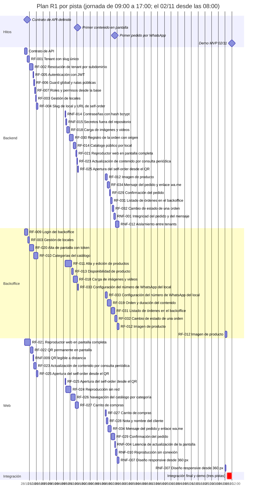
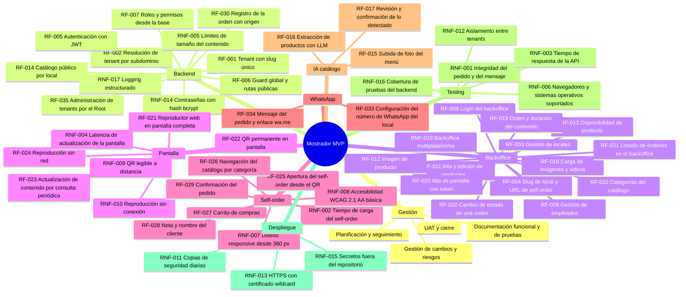
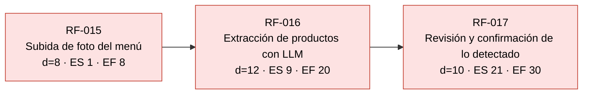
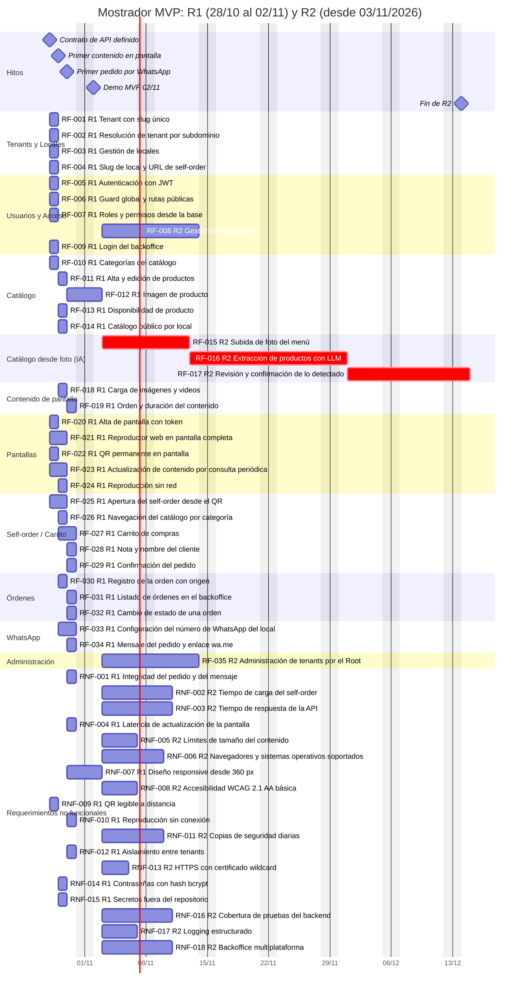

# Mostrador: planificación

Documento de planificación del MVP. Los identificadores RF-xxx y RNF-xxx coinciden con `docs/requerimientos.xlsx` (fuente de las estimaciones PERT, las horas con IA, las fechas y las dependencias) y con `docs/funcional.md` y `docs/no-funcional.md`. Todos los cálculos de este documento se obtienen con un script que lee el xlsx; no hay cifras escritas a mano.

## Releases

El MVP se entrega en dos releases. La fecha de entrega de R1 está fija: **lunes 02/11/2026**. El desarrollo se hace 100% con asistentes de IA, por eso R1 se planifica en **horas** y por **pistas** de trabajo, y R2 conserva la planificación PERT en días del curso.

| Release | Fecha | Contenido | Requerimientos |
| --- | --- | --- | --- |
| **R1** (demo del MVP) | 28/10 al 02/11/2026 | Tenant con slug y subdominio (`local1.localhost` en local), autenticación y roles, backoffice (categorías, productos, contenido de pantalla, pantallas con token, órdenes con estado, WhatsApp del local), reproductor de pantalla con QR y consulta de cambios, autopedido (catálogo, carrito de 1 a 50 por producto, confirmación, orden guardada, enlace `wa.me` en partes), local sin número de WhatsApp con orden visible en el backoffice | 30 RF y 8 RNF: RF-001, RF-002, RF-003, RF-004, RF-005, RF-006, RF-007, RF-009, RF-010, RF-011, RF-012, RF-013, RF-014, RF-018, RF-019, RF-020, RF-021, RF-022, RF-023, RF-024, RF-025, RF-026, RF-027, RF-028, RF-029, RF-030, RF-031, RF-032, RF-033, RF-034; RNF-001, RNF-004, RNF-007, RNF-009, RNF-010, RNF-012, RNF-014, RNF-015 |
| **R2** (hoja de ruta) | 03/11 al 14/12/2026 | Catálogo desde una foto con IA, varios locales por tenant con empleados asignados, regeneración del token de pantalla, tenant suspendido, panel Root, métricas, despliegue de producción con certificado wildcard y todo lo que no hace falta para la demostración de punta a punta de R1 | 5 RF y 10 RNF: RF-008, RF-015, RF-016, RF-017, RF-035; RNF-002, RNF-003, RNF-005, RNF-006, RNF-008, RNF-011, RNF-013, RNF-016, RNF-017, RNF-018 |

**Por qué esta división.**

1. **Fecha de entrega.** Quedan cuatro días hábiles (28/10, 29/10, 30/10 y 02/11) y el lunes por la mañana (08:00 a 12:00) se reserva para integración final y demo. Con tres pistas en paralelo y 8 h productivas por pista y día la capacidad de 28/10 a 30/10 es de 72 h; todo lo que no es imprescindible para la demostración del flujo completo pasa a R2.
2. **Desarrollo con IA.** El cuello de botella ya no es escribir código sino definir el contrato de API, revisar lo generado y correr los tres casos de prueba de cada requerimiento. Por eso R1 se mide en horas y con pistas que arrancan juntas apenas existe el contrato de API (`docs/api.md`).
3. **Criterio para los RNF.** Un RNF es R1 solo si se puede verificar en la demo local (aislamiento entre tenants, hash de contraseñas, límites del carrito, integridad del pedido, QR legible, reproducción sin conexión, responsive básico). Los que exigen producción (HTTPS con certificado wildcard, copias de seguridad, disponibilidad) son R2.
4. **Decisiones del usuario.** El catálogo desde una foto con IA (RF-015, RF-016 y RF-017) pasa a R2. **RF-012** (imagen de producto), **RNF-001** (integridad del pedido y del mensaje) y **RNF-009** (QR legible a distancia) vuelven a R1: el contrato de API ya define `PUT` y `DELETE /products/:productId/image` como R1, un QR que no se lee a distancia rompe la demo y la integridad del pedido ya está cubierta por el recálculo de precios en el servidor.

**Recorte por capacidad.** El único requerimiento que sigue fuera de R1 por capacidad es **RNF-005** (límites de tamaño del contenido, 1,5 h). Los límites de tamaño se validan igualmente en R1 como validación simple dentro de RF-012 y RF-018 (imagen hasta 5 MB, video hasta 50 MB y 60 s, según `docs/api.md`); los casos formales de RNF-005, estrés incluido, son R2. Con RF-012, RNF-001 y RNF-009 en R1 el alcance necesita 73,5 h y la ventana del 28/10 al 30/10 ofrece 72 h: **R1 está sobre su capacidad** y 1,5 h se hacen el 02/11 de 08:00 a 12:00 (ver R1.2). Ninguna dependencia bloqueante de R1 recae sobre un requerimiento de R2.

## Plan R1 (28/10 – 02/11/2026)

### R1.1 Requerimientos, pistas y horas

Pistas: **Backend** (NestJS y PostgreSQL), **Backoffice** (Expo, Android y web; la pista implementa también el API de los módulos que solo usa el backoffice, de punta a punta) y **Web** (autopedido y reproductor). Las horas son las de implementar y probar con IA, e incluyen la revisión y los 3 casos de prueba (feliz, negativa y estrés). Las fechas son las de la columna Fecha Inicio / Fecha Fin del xlsx.

| ID | Requerimiento | Backend (h) | Backoffice (h) | Web (h) | Total (h) | Inicio | Fin |
| --- | --- | --- | --- | --- | --- | --- | --- |
| API | Contrato de API definido (`docs/api.md`) | 1,5 | | | 1,5 | 28/10/2026 | 28/10/2026 |
| RF-001 | Tenant con slug único | 1,5 |  |  | 1,5 | 28/10/2026 | 28/10/2026 |
| RF-002 | Resolución de tenant por subdominio | 2,0 |  |  | 2,0 | 28/10/2026 | 28/10/2026 |
| RF-003 | Gestión de locales | 0,5 | 1,0 |  | 1,5 | 28/10/2026 | 28/10/2026 |
| RF-004 | Slug de local y URL de self-order | 1,0 |  |  | 1,0 | 28/10/2026 | 28/10/2026 |
| RF-005 | Autenticación con JWT | 0,5 |  |  | 0,5 | 28/10/2026 | 28/10/2026 |
| RF-006 | Guard global y rutas públicas | 0,5 |  |  | 0,5 | 28/10/2026 | 28/10/2026 |
| RF-007 | Roles y permisos desde la base | 0,5 |  |  | 0,5 | 28/10/2026 | 28/10/2026 |
| RF-009 | Login del backoffice |  | 2,0 |  | 2,0 | 28/10/2026 | 28/10/2026 |
| RF-010 | Categorías del catálogo |  | 2,5 |  | 2,5 | 28/10/2026 | 28/10/2026 |
| RF-011 | Alta y edición de productos |  | 4,0 |  | 4,0 | 29/10/2026 | 29/10/2026 |
| RF-012 | Imagen de producto | 1,0 | 2,0 |  | 3,0 | 30/10/2026 | 02/11/2026 |
| RF-013 | Disponibilidad de producto |  | 1,0 |  | 1,0 | 29/10/2026 | 29/10/2026 |
| RF-014 | Catálogo público por local | 1,5 |  |  | 1,5 | 29/10/2026 | 29/10/2026 |
| RF-018 | Carga de imágenes y videos | 1,5 | 2,5 |  | 4,0 | 29/10/2026 | 29/10/2026 |
| RF-019 | Orden y duración del contenido |  | 2,5 |  | 2,5 | 30/10/2026 | 30/10/2026 |
| RF-020 | Alta de pantalla con token |  | 2,5 |  | 2,5 | 28/10/2026 | 28/10/2026 |
| RF-021 | Reproductor web en pantalla completa | 0,5 |  | 3,5 | 4,0 | 28/10/2026 | 29/10/2026 |
| RF-022 | QR permanente en pantalla |  |  | 1,5 | 1,5 | 28/10/2026 | 28/10/2026 |
| RF-023 | Actualización de contenido por consulta periódica | 0,5 |  | 1,5 | 2,0 | 28/10/2026 | 29/10/2026 |
| RF-024 | Reproducción sin red |  |  | 3,0 | 3,0 | 29/10/2026 | 29/10/2026 |
| RF-025 | Apertura del self-order desde el QR | 0,5 |  | 1,5 | 2,0 | 28/10/2026 | 29/10/2026 |
| RF-026 | Navegación del catálogo por categoría |  |  | 2,5 | 2,5 | 29/10/2026 | 29/10/2026 |
| RF-027 | Carrito de compras |  |  | 2,5 | 2,5 | 29/10/2026 | 30/10/2026 |
| RF-028 | Nota y nombre del cliente |  |  | 1,0 | 1,0 | 30/10/2026 | 30/10/2026 |
| RF-029 | Confirmación del pedido | 0,5 |  | 2,0 | 2,5 | 30/10/2026 | 30/10/2026 |
| RF-030 | Registro de la orden con origen | 2,5 |  |  | 2,5 | 29/10/2026 | 29/10/2026 |
| RF-031 | Listado de órdenes en el backoffice | 1,0 | 2,0 |  | 3,0 | 30/10/2026 | 30/10/2026 |
| RF-032 | Cambio de estado de una orden | 1,0 | 1,5 |  | 2,5 | 30/10/2026 | 30/10/2026 |
| RF-033 | Configuración del número de WhatsApp del local |  | 1,5 |  | 1,5 | 29/10/2026 | 30/10/2026 |
| RF-034 | Mensaje del pedido y enlace wa.me | 1,5 |  | 2,0 | 3,5 | 30/10/2026 | 30/10/2026 |
| RNF-001 | Integridad del pedido y del mensaje | 1,0 |  |  | 1,0 | 30/10/2026 | 30/10/2026 |
| RNF-004 | Latencia de actualización de la pantalla |  |  | 0,5 | 0,5 | 30/10/2026 | 30/10/2026 |
| RNF-007 | Diseño responsive desde 360 px |  |  | 1,5 | 1,5 | 30/10/2026 | 02/11/2026 |
| RNF-009 | QR legible a distancia |  |  | 0,5 | 0,5 | 28/10/2026 | 28/10/2026 |
| RNF-010 | Reproducción sin conexión |  |  | 1,0 | 1,0 | 30/10/2026 | 30/10/2026 |
| RNF-012 | Aislamiento entre tenants | 2,0 |  |  | 2,0 | 30/10/2026 | 30/10/2026 |
| RNF-014 | Contraseñas con hash bcrypt | 0,5 |  |  | 0,5 | 29/10/2026 | 29/10/2026 |
| RNF-015 | Secretos fuera del repositorio | 0,5 |  |  | 0,5 | 29/10/2026 | 29/10/2026 |
| **Total** | **38 requerimientos + contrato** | **24,0** | **25,0** | **24,5** | **73,5** | | |

### R1.2 ¿Cabe R1 en la ventana?

Capacidad: 3 pistas x 8 h x 3 días (28/10, 29/10 y 30/10) = **72 h**, 24 h por pista. La mañana del 02/11 (08:00 a 12:00) se reserva a integración final y demo, y se usa además como **colchón de desbordamiento** explícito para lo que no cabe en los tres días.

| Pista | R1 pedido (h) | Recortado a R2 (h) | R1 planificado (h) | Capacidad 28/10 a 30/10 (h) | Holgura (h) | Desbordamiento al 02/11 (h) |
| --- | --- | --- | --- | --- | --- | --- |
| Backend | 25,5 | 1,5 | 24,0 | 24 | 0,0 | 0,0 |
| Backoffice | 25,0 | 0,0 | 25,0 | 24 | 0,0 | 1,0 |
| Web | 24,5 | 0,0 | 24,5 | 24 | 0,0 | 0,5 |
| **Total** | **75,0** | **1,5** | **73,5** | **72** | **0,0** | **1,5** |

**R1 no cabe en 72 h**: con RF-012, RNF-001 y RNF-009 de vuelta, el plan necesita 73,5 h. Primero se rebalanceó: la holgura que había en Backend (2,0 h) y Backoffice (1,0 h) se consumió con el trabajo de esas pistas (RF-012 y RNF-001 en Backend, RF-012 en Backoffice) y no queda holgura que mover a la pista Web. Como la suma sigue superando 72 h, **1,5 h pasan al colchón del 02/11 de 08:00 a 12:00**: 1,0 h en Backoffice (cierre de RF-012) y 0,5 h en Web (cierre de RNF-007). No hay trabajo en fin de semana y ninguna pista supera 8 h entre el 28/10 y el 30/10.

**Efecto sobre la integración.** La mañana del 02/11 son 12 h de pista (3 pistas x 4 h). El desbordamiento consume 1,5 h y quedan 10,5 h para integrar, corregir y ensayar la demo: Backend empieza a integrar a las 08:00, Web a las 08:30 y Backoffice a las 09:00. El tiempo de integración con las tres pistas libres se reduce de 4,0 h a 3,0 h (de 09:00 a 12:00), y cualquier defecto de integración que aparezca el 30/10 compite con ese tiempo.

**Advertencia.** R1 está al límite de su capacidad y por encima de ella, y las estimaciones con IA son optimistas (R1.7). Si el trabajo se atrasa, lo primero que se cae es, en este orden, RNF-004, RNF-007 y RF-032 (ver R1.6); RF-012, RNF-001 y RNF-009 no están en el orden de recorte porque el usuario decidió mantenerlos. Si aun así no alcanza, la alternativa es mover la demo, no comprimir las pruebas.

### R1.3 Plan día por día

Cada bloque es `ID (horas)`. El contrato de API se define en las primeras 1,5 h del 28/10; las pistas Backoffice y Web arrancan en paralelo contra servidores simulados y el API real se integra en los hitos. El reparto por pista de las horas de RF-012, RNF-001 y RNF-009 se estimó a partir del contrato de API y de las horas con que figuraban en el plan anterior.

| Día | Pista | Bloques | Horas | Libres |
| --- | --- | --- | --- | --- |
| 28/10 | Backend | Contrato de API (1,5), RF-001 (1,5), RF-002 (2,0), RF-005 (0,5), RF-006 (0,5), RF-007 (0,5), RF-003 (0,5), RF-004 (1,0) | 8,0 | 0,0 |
| 28/10 | Backoffice | RF-009 (2,0), RF-003 (1,0), RF-020 (2,5), RF-010 (2,5) | 8,0 | 0,0 |
| 28/10 | Web | RF-021 (3,5), RF-022 (1,5), RNF-009 (0,5), RF-023 (1,5), RF-025 (1,0) | 8,0 | 0,0 |
| 29/10 | Backend | RNF-014 (0,5), RNF-015 (0,5), RF-018 (1,5), RF-030 (2,5), RF-014 (1,5), RF-021 (0,5), RF-023 (0,5), RF-025 (0,5) | 8,0 | 0,0 |
| 29/10 | Backoffice | RF-011 (4,0), RF-013 (1,0), RF-018 (2,5), RF-033 (0,5) | 8,0 | 0,0 |
| 29/10 | Web | RF-025 (0,5), RF-024 (3,0), RF-026 (2,5), RF-027 (2,0) | 8,0 | 0,0 |
| 30/10 | Backend | RF-012 (1,0), RF-034 (1,5), RF-029 (0,5), RF-031 (1,0), RF-032 (1,0), RNF-001 (1,0), RNF-012 (2,0) | 8,0 | 0,0 |
| 30/10 | Backoffice | RF-033 (1,0), RF-019 (2,5), RF-031 (2,0), RF-032 (1,5), RF-012 (1,0) | 8,0 | 0,0 |
| 30/10 | Web | RF-027 (0,5), RF-028 (1,0), RF-034 (2,0), RF-029 (2,0), RNF-004 (0,5), RNF-010 (1,0), RNF-007 (1,0) | 8,0 | 0,0 |
| 02/11 (08:00 a 12:00) | Backend | integración final y demo | 0,0 (desbordamiento) | 4,0 (integración) |
| 02/11 (08:00 a 12:00) | Backoffice | RF-012 (1,0); integración final y demo | 1,0 (desbordamiento) | 3,0 (integración) |
| 02/11 (08:00 a 12:00) | Web | RNF-007 (0,5); integración final y demo | 0,5 (desbordamiento) | 3,5 (integración) |

Supuestos del orden: dentro de cada requerimiento el API se entrega antes que su pantalla; una dependencia bloqueante entre pistas distintas se considera cubierta por el contrato de API y los servidores simulados, y su integración real se prueba en los hitos. Hay 2 dependencias cruzadas que terminan después de quien depende de ellas (RF-021 con RF-019, RF-022 con RF-021); se integran el 30/10 o el 02/11 por la mañana.

### R1.4 Ruta crítica R1

**Ruta crítica: la pista Backoffice**, que es la que termina última (25,0 h, cierre el 02/11 a las 09:00 con RF-012). La pista Web (24,5 h, cierre el 02/11 a las 08:30) es casi crítica y Backend (24,0 h) termina el 30/10 a las 17:00 sin holgura: las tres pistas están llenas. La ruta crítica es:

**RF-009 → RF-003 → RF-020 → RF-010 → RF-011 → RF-013 → RF-018 → RF-033 → RF-019 → RF-031 → RF-032 → RF-012**

Cruce entre pistas: la parte de Backend de RF-012 (API de la imagen del producto) abre la jornada del 30/10 para que Backoffice pueda cerrar su pantalla al final del día.

**Cadena que produce el primer pedido (sin holgura en Backend):** RF-003 → RF-010 → RF-011 → RF-013 → RF-014 → RF-030 → RF-034 → RF-029. El catálogo se carga en el backoffice, el API público lo sirve, el autopedido crea la orden y arma el mensaje `wa.me`. Si RF-011 o RF-014 se atrasan, el primer pedido no se puede probar de punta a punta aunque la pista Web termine a tiempo.

**Camino de la pista Web:** Contrato de API (28/10, 1,5 h) → RF-021 → RF-022 → RNF-009 → RF-023 → RF-025 → RF-024 → RF-026 → RF-027 → RF-028 → RF-034 → RF-029 → RNF-004 → RNF-010 → RNF-007

Cada pista termina con requerimientos que absorben el desvío (RNF-012 en Backend, RF-012 en Backoffice, RNF-007 en Web); el tramo final de RF-012 y de RNF-007 es el que se hace el 02/11. Si hay atraso se recorta primero ahí (ver R1.6).

### R1.5 Gantt R1 (por pista, con hitos)

Hitos:

| Hito | Criterio | Fecha |
| --- | --- | --- |
| Contrato de API definido | `docs/api.md` publicado y servidores simulados disponibles para Backoffice y Web | 28/10/2026 |
| Primer contenido en pantalla | Una imagen cargada desde el backoffice se reproduce en la pantalla con su QR (RF-018, RF-020 y RF-021 integrados) | 29/10/2026 |
| Primer pedido por WhatsApp | Un pedido armado en el autopedido se guarda y abre `wa.me` con el mensaje (RF-030, RF-034 y RF-029 integrados) | 30/10/2026 |
| Demo MVP 02/11 | Flujo completo en `local1.localhost`: carga de catálogo y contenido, pantalla, pedido, orden en el backoffice | 02/11/2026 |

Criterio de salida de R1: los casos de prueba feliz, negativa y de estrés de los requerimientos R1 (ver `docs/testing.md`) pasan; los de estrés se corren en local a escala reducida.

### R1.6 Riesgos y orden de recorte si R1 se atrasa

> **Riesgo principal: R1 está en o sobre su capacidad.** El plan usa 73,5 h contra 72 h disponibles del 28/10 al 30/10 y consume 1,5 h de la mañana del 02/11, lo que reduce el tiempo de integración. Las estimaciones con IA son optimistas y no hay histórico. Si el trabajo se atrasa, lo primero que se cae es RNF-004, luego RNF-007 y luego RF-032 (tabla siguiente); RF-012, RNF-001 y RNF-009 se mantienen por decisión del usuario y solo se tocarían después de agotar ese orden.

| Riesgo | Probabilidad | Impacto | Mitigación |
| --- | --- | --- | --- |
| R1 sobre capacidad: 1,5 h dependen del colchón del 02/11 | Alta | Alto | Medir las horas reales al cierre del 28/10; aplicar el orden de recorte sin esperar al 30/10; no agregar alcance |
| El contrato de API cambia después del 28/10 y rompe a las pistas en paralelo | Media | Alto | Contrato versionado en `docs/api.md`; un solo dueño del cambio; los servidores simulados se regeneran desde el contrato |
| Código generado por IA con errores sutiles (aislamiento entre tenants, precios del pedido) | Media | Alto | Revisión humana de lo que toca tenants y órdenes; los casos negativos de RNF-012, RNF-001 y RF-030 corren antes de integrar |
| Las pistas Backend y Web no tienen holgura (24,0 y 24,5 h de 24) y Backoffice se pasa (25,0 h) | Alta | Alto | Aplicar el orden de recorte; no empezar RNF-007 antes de que el flujo pase de punta a punta |
| El tiempo de integración baja de 4,0 h a 3,0 h el 02/11 | Alta | Alto | Dos puntos de integración previos (29/10 y 30/10); congelar alcance el 30/10 a las 17:00 |
| Subida de imagen o video grande en local (RF-012 y RF-018) | Media | Medio | Límites fijos de tamaño validados en el API; probar con el video y las imágenes de la demo desde el 29/10 |
| QR no legible en el televisor de la demo (RNF-009) | Media | Alto | Verificar el tamaño y el contraste del QR en el televisor real el 28/10 y el 30/10, no solo en el navegador |
| `local1.localhost` no resuelve igual en todos los navegadores | Baja | Medio | Demo en Chrome o Firefox; entrada en el archivo hosts como alternativa |
| La integración del 30/10 descubre desajustes entre pistas | Media | Alto | Dos puntos de integración (29/10 y 30/10); el 02/11 por la mañana queda como colchón, ya consumido en 1,5 h |
| Las estimaciones con IA son optimistas (no hay histórico; ver R1.7) | Alta | Alto | Medir las horas reales al cierre del 28/10 y recalcular; aplicar el orden de recorte sin esperar al 30/10 |
| Cambio de alcance durante los cuatro días | Media | Alto | Todo pedido nuevo entra a R2 salvo decisión explícita que desplace algo de R1 |

**Orden de recorte si R1 se atrasa** (cada paso respeta que ningún requerimiento de R1 dependa de uno de R2). RF-012, RNF-001 y RNF-009 no figuran: el usuario decidió mantenerlos en R1.

| Orden | Recorte | Horas que libera | Efecto |
| --- | --- | --- | --- |
| 1 | RNF-004 a R2 (Web) | 0,5 | La latencia de la pantalla se mira a ojo en la demo |
| 2 | RNF-007 a R2 (Web) | 1,5 | El responsive queda como el que dé el diseño base; se verifica a mano a 360 px. Elimina el desbordamiento de Web |
| 3 | RF-032 a R2 (Backend y Backoffice) | 2,5 | Las órdenes se listan como "generada" sin cambio de estado. Elimina el desbordamiento de Backoffice |
| 4 | RF-024 y RNF-010 a R2 (Web) | 4,0 | El reproductor sigue con lo último cargado en memoria, sin caché persistente |
| 5 | RF-019 a R2 y RF-021 pasa a depender de RF-018 | 2,5 | El contenido rota en orden de carga y con una duración fija; exige editar la dependencia de RF-021 |

Los pasos 1 a 3 liberan 4,5 h y eliminan todo el desbordamiento al 02/11; los pasos 1 a 4 liberan 8,5 h. No se recortan RF-001, RF-002, RF-030, RF-034 ni RNF-012: son el núcleo del flujo y de la seguridad.

### R1.7 Por qué las estimaciones difieren de los días-persona PERT

Las columnas PERT del xlsx (p/m/o por área, en días) son la referencia de **esfuerzo humano** que pide el curso y se conservan sin cambios. Para los 38 requerimientos de R1 el esfuerzo PERT suma 228,67 días-persona, es decir 1829 h a 8 h por día, contra 72,0 h con asistentes de IA (más 1,5 h del contrato de API): unas 25,4 veces menos. Un factor tan grande debe leerse con cautela: indica que la estimación con IA es optimista y que R1 tiene riesgo alto. La diferencia viene de tres cosas: (1) la IA genera el código, los scripts SQL y los casos de prueba, y las personas revisan; (2) las pistas trabajan en paralelo y no una área tras otra como en la duración PERT; (3) varios requerimientos de R1 son ajustes sobre lo ya implementado (tenants, autenticación y roles, BU-021). La estimación en horas con IA tiene más incertidumbre que la PERT (no hay histórico), por eso el plan R1 lleva el orden de recorte y la holgura se vigila cada día.

## Plan completo y R2 (referencia PERT)

Esta parte conserva el análisis de planificación del curso (EDT, PERT, camino crítico, Gantt, compresión y valor ganado) y lo aplica al proyecto completo. Las secciones 1 a 4 describen el proyecto entero y la **línea base original sin IA** (los 53 requerimientos en serie desde el 02/11/2026). Las secciones 5 a 8 se recalculan con el calendario por releases: R1 con las fechas del plan anterior y R2 con la regla PERT a partir del **03/11/2026**, con las dependencias sobre R1 consideradas cumplidas el 02/11/2026.

### 1. Alcance y exclusiones

**Alcance del proyecto (35 RF y 18 RNF; R1 entrega 30 RF y 8 RNF, ver "Releases").** Login y roles, comercios y locales, catálogo (categorías, productos, imagen, disponibilidad), catálogo desde foto con IA, contenido y pantallas con reproductor y QR, autopedido con carrito, órdenes con estado, configuración de WhatsApp y administración de tenants.

**Fuera del alcance (anti gold plating).** Lo que no figura en un RF no se construye, aunque sea técnicamente sencillo:

| Excluido | Motivo |
| --- | --- |
| Pagos en línea | El cobro ocurre en el local; no aporta al flujo QR a WhatsApp |
| Cuentas de clientes | El cliente es anónimo; evita registro y datos personales |
| Control de stock | Se resuelve con la disponibilidad manual (RF-013) |
| WhatsApp Business API | Costo y trámite; se usa el enlace `wa.me` (RF-034) |
| Websockets | La pantalla consulta cada 30 s (RF-023); suficiente para el MVP |
| Promociones generadas por IA como diapositivas | Fuera del objetivo "catálogo desde foto" |
| Sugerencias de productos (upselling) | No reduce el riesgo del MVP |

Regla de control: todo cambio que agregue funcionalidad fuera de la tabla de requerimientos pasa por una solicitud de cambio (issue con etiqueta `cambio`) y se evalúa contra su impacto en el camino crítico antes de aceptarse.

### 2. Estructura de desglose del trabajo (EDT / WBS)

La EDT agrupa los 53 requerimientos en 9 paquetes de entrega. Cada RF/RNF aparece en un único paquete. El esfuerzo es la suma PERT (M) de las áreas, en días-persona (referencia de esfuerzo humano, sin IA).

| Paquete | Contenido | RF / RNF | Cantidad | Esfuerzo M (días-persona) |
| --- | --- | --- | --- | --- |
| Gestión | Planificación, seguimiento en GitHub Projects, documentación, gestión de cambios, UAT y cierre | Sin RF (gestión del proyecto) | 0 | 0,00 |
| Backend | Tenants, autenticación, permisos, catálogo público y órdenes (API NestJS) | RF-001, RF-002, RF-005, RF-006, RF-007, RF-014, RF-030, RF-035, RNF-005, RNF-014, RNF-017 | 11 | 50,83 |
| Backoffice | App Expo (Android y web): locales, empleados, catálogo, contenido, pantallas y órdenes | RF-003, RF-004, RF-008, RF-009, RF-010, RF-011, RF-012, RF-013, RF-018, RF-019, RF-020, RF-031, RF-032, RNF-018 | 14 | 107,00 |
| Pantalla | Reproductor web, QR, sincronización y modo sin red | RF-021, RF-022, RF-023, RF-024, RNF-004, RNF-009, RNF-010 | 7 | 37,00 |
| Self-order | Web del cliente: QR, catálogo, carrito y confirmación | RF-025, RF-026, RF-027, RF-028, RF-029, RNF-002, RNF-007, RNF-008 | 8 | 48,17 |
| WhatsApp | Número del local y mensaje `wa.me` | RF-033, RF-034 | 2 | 13,33 |
| IA catálogo | Foto del menú, extracción con LLM y revisión | RF-015, RF-016, RF-017 | 3 | 27,83 |
| Testing | Pruebas transversales de integridad, desempeño, compatibilidad, aislamiento y cobertura | RNF-001, RNF-003, RNF-006, RNF-012, RNF-016 | 5 | 23,67 |
| Despliegue | Backups, HTTPS wildcard y secretos | RNF-011, RNF-013, RNF-015 | 3 | 9,50 |
| **Total** | | | **53** | **317,33** |

Gestión no tiene RF propios: su esfuerzo es el de coordinación y no está estimado en el xlsx (se registra como horas de seguimiento en GitHub Projects).

Pruebas de estrés: cada RF y RNF lleva como mínimo un caso feliz, uno negativo y uno de estrés (ver `docs/testing.md`). Los de estrés se escriben con k6 (JMeter como alternativa) y se ejecutan en staging; su escritura se asume incluida en la estimación de Testing de cada requerimiento. Si la primera iteración muestra que no alcanza, se gestiona con una solicitud de cambio; este documento no modifica fechas ni camino crítico por ese motivo.

### 3. Actividades, hitos y dependencias

- **Actividad:** cada RF o RNF es una actividad con duración en días hábiles (lunes a viernes, sin feriados). R2 empieza el 03/11/2026; R1 se planifica en horas por pista (sección "Plan R1").
- **Hito:** punto de control de duración cero (no consume esfuerzo). Se definen en las secciones R1.5 y 6.
- **Esfuerzo vs duración:** el esfuerzo es el trabajo total de todas las áreas (días-persona); la duración es el tiempo de calendario. El xlsx define la duración de cada requerimiento como la suma de los esperados de sus áreas, es decir, supone que las áreas trabajan una tras otra (ver sección 7).

| Tipo de dependencia | Ejemplo en Mostrador |
| --- | --- |
| Obligatoria (lógica dura) | RF-001 → RF-002: sin slug de tenant no hay resolución por subdominio. RF-011 → RF-013: no se marca disponibilidad de un producto que no existe |
| Discrecional (buena práctica) | RF-014 → RF-025: el autopedido podría construirse contra un contrato de API simulado sin esperar al catálogo real (base del fast tracking) |
| Externa | RNF-013 (certificado wildcard y DNS del dominio), RF-016 (API del modelo de visión), RF-034 (comportamiento de `wa.me`) |

Todas las dependencias del xlsx se modelan como fin a inicio (FS). Las relaciones inicio a inicio (SS), fin a fin (FF) y fin a inicio con adelanto se usan solo en los escenarios de compresión (sección 7).

### 4. Estimación PERT

Cada área estima tres valores en días: optimista (a), más probable (b) y pesimista (c). El xlsx los guarda como `p/m/o` (pesimista/probable/optimista). Por requerimiento se suman las áreas y se aplica la distribución beta:

- Esperado: **M = (a + 4b + c) / 6**
- Desviación estándar: **σ = (c − a) / 6**
- Duración en el cronograma = M redondeado hacia arriba (coincide con la columna Duración del xlsx para los 15 requerimientos R2; en R1 la columna Duración es el calendario con IA y la duración PERT queda como referencia en esta tabla).

"Holgura (base)" es la holgura total en días del CPM de la línea base original (53 requerimientos en serie desde el 02/11/2026, sin IA); el CPM de R2 se calcula en la sección 5.

| ID | Requerimiento | Release | a | b | c | M | σ | Duración PERT | Holgura (base) |
| --- | --- | --- | --- | --- | --- | --- | --- | --- | --- |
| RF-001 | Tenant con slug único | R1 | 4 | 4 | 7 | 4,50 | 0,50 | 5 | 0 |
| RF-002 | Resolución de tenant por subdominio | R1 | 4 | 6 | 8 | 6,00 | 0,67 | 6 | 27 |
| RF-003 | Gestión de locales | R1 | 6 | 9 | 11 | 8,83 | 0,83 | 9 | 0 |
| RF-004 | Slug de local y URL de self-order | R1 | 4 | 5 | 6 | 5,00 | 0,33 | 5 | 19 |
| RF-005 | Autenticación con JWT | R1 | 2 | 2 | 4 | 2,33 | 0,33 | 3 | 9 |
| RF-006 | Guard global y rutas públicas | R1 | 2 | 2 | 2 | 2,00 | 0,00 | 2 | 9 |
| RF-007 | Roles y permisos desde la base | R1 | 3 | 3 | 5 | 3,33 | 0,33 | 4 | 66 |
| RF-008 | Gestión de empleados | R2 | 6 | 9 | 11 | 8,83 | 0,83 | 9 | 59 |
| RF-009 | Login del backoffice | R1 | 4 | 5 | 7 | 5,17 | 0,50 | 6 | 57 |
| RF-010 | Categorías del catálogo | R1 | 6 | 8 | 9 | 7,83 | 0,50 | 8 | 0 |
| RF-011 | Alta y edición de productos | R1 | 8 | 11 | 14 | 11,00 | 1,00 | 11 | 0 |
| RF-012 | Imagen de producto | R1 | 6 | 7 | 10 | 7,33 | 0,67 | 8 | 41 |
| RF-013 | Disponibilidad de producto | R1 | 4 | 5 | 6 | 5,00 | 0,33 | 5 | 0 |
| RF-014 | Catálogo público por local | R1 | 4 | 6 | 8 | 6,00 | 0,67 | 6 | 0 |
| RF-015 | Subida de foto del menú | R2 | 6 | 7 | 11 | 7,50 | 0,83 | 8 | 38 |
| RF-016 | Extracción de productos con LLM | R2 | 7 | 11 | 16 | 11,17 | 1,50 | 12 | 38 |
| RF-017 | Revisión y confirmación de lo detectado | R2 | 6 | 9 | 13 | 9,17 | 1,17 | 10 | 38 |
| RF-018 | Carga de imágenes y videos | R1 | 8 | 12 | 15 | 11,83 | 1,17 | 12 | 19 |
| RF-019 | Orden y duración del contenido | R1 | 5 | 7 | 9 | 7,00 | 0,67 | 7 | 19 |
| RF-020 | Alta de pantalla con token | R1 | 7 | 8 | 10 | 8,17 | 0,50 | 9 | 29 |
| RF-021 | Reproductor web en pantalla completa | R1 | 7 | 10 | 14 | 10,17 | 1,17 | 11 | 19 |
| RF-022 | QR permanente en pantalla | R1 | 4 | 5 | 7 | 5,17 | 0,50 | 6 | 29 |
| RF-023 | Actualización de contenido por consulta periódica | R1 | 4 | 7 | 9 | 6,83 | 0,83 | 7 | 19 |
| RF-024 | Reproducción sin red | R1 | 5 | 7 | 10 | 7,17 | 0,83 | 8 | 19 |
| RF-025 | Apertura del self-order desde el QR | R1 | 6 | 9 | 10 | 8,67 | 0,67 | 9 | 0 |
| RF-026 | Navegación del catálogo por categoría | R1 | 5 | 8 | 9 | 7,67 | 0,67 | 8 | 0 |
| RF-027 | Carrito de compras | R1 | 5 | 7 | 10 | 7,17 | 0,83 | 8 | 0 |
| RF-028 | Nota y nombre del cliente | R1 | 2 | 3 | 3 | 2,83 | 0,17 | 3 | 0 |
| RF-029 | Confirmación del pedido | R1 | 7 | 9 | 12 | 9,17 | 0,83 | 10 | 0 |
| RF-030 | Registro de la orden con origen | R1 | 7 | 10 | 13 | 10,00 | 1,00 | 10 | 22 |
| RF-031 | Listado de órdenes en el backoffice | R1 | 5 | 8 | 10 | 7,83 | 0,83 | 8 | 23 |
| RF-032 | Cambio de estado de una orden | R1 | 5 | 8 | 10 | 7,83 | 0,83 | 8 | 23 |
| RF-033 | Configuración del número de WhatsApp del local | R1 | 6 | 6 | 9 | 6,50 | 0,50 | 7 | 44 |
| RF-034 | Mensaje del pedido y enlace wa.me | R1 | 4 | 7 | 9 | 6,83 | 0,83 | 7 | 22 |
| RF-035 | Administración de tenants por el Root | R2 | 6 | 8 | 11 | 8,17 | 0,83 | 9 | 66 |
| RNF-001 | Integridad del pedido y del mensaje | R1 | 2 | 3 | 5 | 3,17 | 0,50 | 4 | 28 |
| RNF-002 | Tiempo de carga del self-order | R2 | 4 | 5 | 8 | 5,33 | 0,67 | 6 | 15 |
| RNF-003 | Tiempo de respuesta de la API | R2 | 3 | 5 | 8 | 5,17 | 0,83 | 6 | 32 |
| RNF-004 | Latencia de actualización de la pantalla | R1 | 2 | 2 | 4 | 2,33 | 0,33 | 3 | 28 |
| RNF-005 | Límites de tamaño del contenido | R2 | 3 | 3 | 5 | 3,33 | 0,33 | 4 | 52 |
| RNF-006 | Navegadores y sistemas operativos soportados | R2 | 3 | 5 | 7 | 5,00 | 0,67 | 5 | 24 |
| RNF-007 | Diseño responsive desde 360 px | R1 | 3 | 3 | 5 | 3,33 | 0,33 | 4 | 17 |
| RNF-008 | Accesibilidad WCAG 2.1 AA básica | R2 | 2 | 4 | 6 | 4,00 | 0,67 | 4 | 9 |
| RNF-009 | QR legible a distancia | R1 | 2 | 2 | 3 | 2,17 | 0,17 | 3 | 29 |
| RNF-010 | Reproducción sin conexión | R1 | 2 | 3 | 5 | 3,17 | 0,50 | 4 | 19 |
| RNF-011 | Copias de seguridad diarias | R2 | 3 | 4 | 7 | 4,33 | 0,67 | 5 | 77 |
| RNF-012 | Aislamiento entre tenants | R1 | 4 | 5 | 7 | 5,17 | 0,50 | 6 | 65 |
| RNF-013 | HTTPS con certificado wildcard | R2 | 2 | 3 | 4 | 3,00 | 0,33 | 3 | 68 |
| RNF-014 | Contraseñas con hash bcrypt | R1 | 2 | 2 | 2 | 2,00 | 0,00 | 2 | 77 |
| RNF-015 | Secretos fuera del repositorio | R1 | 2 | 2 | 3 | 2,17 | 0,17 | 3 | 79 |
| RNF-016 | Cobertura de pruebas del backend | R2 | 4 | 5 | 7 | 5,17 | 0,50 | 6 | 33 |
| RNF-017 | Logging estructurado | R2 | 3 | 3 | 4 | 3,17 | 0,17 | 4 | 78 |
| RNF-018 | Backoffice multiplataforma | R2 | 4 | 5 | 8 | 5,33 | 0,67 | 6 | 67 |
| **Total** | **Esfuerzo del proyecto (suma de las 53 actividades)** | | **230** | **312** | **426** | **317,33** | **5,01** | | |

Lectura de los totales:

- **Esfuerzo total:** M = 317,33 días-persona (σ = 5,01, raíz de la suma de varianzas, suponiendo actividades independientes).
- **Camino crítico** (sección 5): M = 78,67 días, **σ = 2,25 días**, calculada como la raíz cuadrada de la suma de las varianzas de sus 11 actividades. En el cronograma las duraciones se redondean hacia arriba y suman 82 días hábiles.

Qué significa: M es la duración con probabilidad cercana al 50%; sumar σ amplía la confianza. Con distribución aproximadamente normal (teorema central del límite, ya que el camino suma 11 actividades):

| Objetivo | Días hábiles | Fecha de fin | Probabilidad aproximada |
| --- | --- | --- | --- |
| M | 78,67 (→ 79) | 18/02/2027 | 50,0% |
| M + 1σ | 80,92 (→ 81) | 22/02/2027 | 84,1% |
| M + 2σ | 83,16 (→ 84) | 25/02/2027 | 97,7% |
| Línea base original (duraciones PERT redondeadas, sin IA) | 82 | 23/02/2027 | 93,1% (z = 1,48) |

La σ del camino crítico es chica porque los rangos a–c de cada área son estrechos (±1 día). Es una señal de que las estimaciones pueden ser optimistas: el riesgo real está en las dependencias externas y en los supuestos de la sección 7, no en la dispersión de las estimaciones.

### 5. Camino crítico (CPM) de R2

Con las duraciones PERT de los 15 requerimientos de R2 y sus dependencias entre ellos se hace el paso adelante (ES, EF) y el paso atrás (LS, LF). Las dependencias sobre requerimientos de R1 no restan: R1 está terminado el 02/11/2026. Convención: los días se numeran desde 1 (03/11/2026); EF es el último día de trabajo de la actividad; holgura total = LS − ES; holgura libre = menor ES de los sucesores − EF − 1.

Camino crítico de R2: **RF-015 → RF-016 → RF-017** (30 días hábiles, fin el 14/12/2026). Es el catálogo desde una foto: subida, extracción con el modelo de visión y revisión. El proyecto completo termina el **14/12/2026** (la línea base original sin IA terminaba el 23/02/2027).

| Actividad | Duración | ES | EF | LS | LF | Holgura total | Holgura libre | Inicio | Fin | σ |
| --- | --- | --- | --- | --- | --- | --- | --- | --- | --- | --- |
| RF-015 Subida de foto del menú | 8 | 1 | 8 | 1 | 8 | 0 | 0 | 03/11/2026 | 12/11/2026 | 0,83 |
| RF-016 Extracción de productos con LLM | 12 | 9 | 20 | 9 | 20 | 0 | 0 | 13/11/2026 | 30/11/2026 | 1,50 |
| RF-017 Revisión y confirmación de lo detectado | 10 | 21 | 30 | 21 | 30 | 0 | 0 | 01/12/2026 | 14/12/2026 | 1,17 |
| RF-008 Gestión de empleados | 9 | 1 | 9 | 22 | 30 | 21 | 21 | 03/11/2026 | 13/11/2026 | 0,83 |
| RF-035 Administración de tenants por el Root | 9 | 1 | 9 | 22 | 30 | 21 | 21 | 03/11/2026 | 13/11/2026 | 0,83 |
| RNF-002 Tiempo de carga del self-order | 6 | 1 | 6 | 25 | 30 | 24 | 24 | 03/11/2026 | 10/11/2026 | 0,67 |
| RNF-003 Tiempo de respuesta de la API | 6 | 1 | 6 | 25 | 30 | 24 | 24 | 03/11/2026 | 10/11/2026 | 0,83 |
| RNF-016 Cobertura de pruebas del backend | 6 | 1 | 6 | 25 | 30 | 24 | 24 | 03/11/2026 | 10/11/2026 | 0,50 |
| RNF-018 Backoffice multiplataforma | 6 | 1 | 6 | 25 | 30 | 24 | 24 | 03/11/2026 | 10/11/2026 | 0,67 |
| RNF-006 Navegadores y sistemas operativos soportados | 5 | 1 | 5 | 26 | 30 | 25 | 25 | 03/11/2026 | 09/11/2026 | 0,67 |
| RNF-011 Copias de seguridad diarias | 5 | 1 | 5 | 26 | 30 | 25 | 25 | 03/11/2026 | 09/11/2026 | 0,67 |
| RNF-005 Límites de tamaño del contenido | 4 | 1 | 4 | 27 | 30 | 26 | 26 | 03/11/2026 | 06/11/2026 | 0,33 |
| RNF-008 Accesibilidad WCAG 2.1 AA básica | 4 | 1 | 4 | 27 | 30 | 26 | 26 | 03/11/2026 | 06/11/2026 | 0,67 |
| RNF-017 Logging estructurado | 4 | 1 | 4 | 27 | 30 | 26 | 26 | 03/11/2026 | 06/11/2026 | 0,17 |
| RNF-013 HTTPS con certificado wildcard | 3 | 1 | 3 | 28 | 30 | 27 | 27 | 03/11/2026 | 05/11/2026 | 0,33 |

Los 3 requerimientos con holgura 0 se priorizan en el tablero; el resto tiene holgura de 21 a 27 días porque son tareas independientes y cortas.

PERT del camino crítico de R2: M = 27,83 días, σ = 2,07 días (raíz de la suma de varianzas de sus 3 actividades). Con distribución aproximadamente normal:

| Objetivo | Días hábiles | Fecha de fin | Probabilidad aproximada |
| --- | --- | --- | --- |
| M | 27,83 (→ 28) | 10/12/2026 | 50,0% |
| M + 1σ | 29,91 (→ 30) | 14/12/2026 | 84,1% |
| M + 2σ | 31,98 (→ 32) | 16/12/2026 | 97,7% |
| Plan del xlsx (duraciones redondeadas) | 30 | 14/12/2026 | 85,2% (z = 1,04) |

### 6. Cronograma (Gantt)

Agrupado por módulo; los requerimientos R1 muestran su calendario con IA (28/10 al 02/11/2026) y los R2 su calendario PERT desde el 03/11/2026. El camino crítico de R2 va en rojo. Fechas del xlsx; días hábiles (el eje excluye fines de semana).

Hitos (duración cero):

| Hito | Criterio | Fecha |
| --- | --- | --- |
| Contrato de API definido | Primeras 1,5 h del plan R1 | 28/10/2026 |
| Primer contenido en pantalla | RF-018, RF-020 y RF-021 integrados | 29/10/2026 |
| Primer pedido por WhatsApp | RF-030, RF-034 y RF-029 integrados | 30/10/2026 |
| Demo MVP 02/11 (fin de R1) | Los 38 requerimientos de R1 terminados e integrados | 02/11/2026 |
| Catálogo desde foto listo | RF-017 terminado | 14/12/2026 |
| Fin de R2 (proyecto completo) | Los 15 requerimientos de R2 terminados | 14/12/2026 |

### 7. Compresión del cronograma de R2

R1 tiene fecha fija y ya está comprimido por diseño (pistas en paralelo, orden de recorte); la compresión del curso se aplica a R2. Se comprime sin recortar alcance. Dos técnicas del PMBOK:

- **Fast tracking:** hacer en paralelo actividades que estaban en serie. Riesgo: retrabajo.
- **Crashing:** agregar recursos al camino crítico. Riesgo: costo y menor rendimiento por persona (ley de Brooks).

#### 7.1 Fast tracking: contrato de la importación primero

La dependencia RF-015 → RF-016 es discrecional: el servicio de extracción solo necesita el contrato de la subida (archivo recibido y su referencia). Con ese contrato publicado, la extracción con el modelo de visión se desarrolla en paralelo con la subida de la foto y se prueba con un archivo de muestra. Se modela quitando RF-015 de las dependencias de RF-016; RF-017 mantiene la dependencia de RF-016.

| Escenario | Días hábiles | Fin | Camino crítico resultante |
| --- | --- | --- | --- |
| Base (xlsx) | 30 | 14/12/2026 | 015 > 016 > 017 |
| Fast tracking | 22 | 02/12/2026 | 016 > 017 |

Ahorro: 8 días hábiles. Costos: mantener el contrato versionado y pruebas de contrato (Postman).

#### 7.2 Crashing: más personas en el camino crítico

Se agrega un segundo desarrollador en la parte de RF-016 que es solo de backend y en la parte de RF-017 que es solo de frontend. Supuesto explícito: esa parte se reduce a la mitad; el resto del esfuerzo no cambia.

| Actividad | Área | M del área | Duración actual | Duración con crashing |
| --- | --- | --- | --- | --- |
| RF-016 | Backend | 4,17 | 12 | 10 |
| RF-017 | Frontend | 4,17 | 10 | 8 |

Resultado: 26 días hábiles, fin el 08/12/2026 (ahorro de 4 días). Es el beneficio máximo: la mitad es un supuesto optimista, no una medición. Combinado con el fast tracking: 18 días hábiles, fin el 26/11/2026.

#### 7.3 Nota sobre el cronograma de R2

La duración de cada requerimiento suma todas sus áreas (backend, frontend, base de datos, testing y analistas) como una sola secuencia, y cada requerimiento espera a sus dependencias. Esa es la cota superior.

Si las áreas de un mismo requerimiento trabajaran en paralelo (duración = máximo entre áreas, cada área con su M redondeado hacia arriba), el camino crítico sigue siendo el mismo (015 > 016 > 017) y R2 duraría **13 días hábiles, hasta el 19/11/2026**. Es una cota inferior optimista: asume personal suficiente en cada área y que Testing trabaja en paralelo con el desarrollo.

| Supuesto de paralelismo | Días hábiles | Fin |
| --- | --- | --- |
| Áreas en serie (xlsx) | 30 | 14/12/2026 |
| Áreas en paralelo (máximo por requerimiento) | 13 | 19/11/2026 |

La línea base original sin IA (53 requerimientos en serie desde el 02/11/2026) terminaba el 23/02/2027 (82 días hábiles); la separación en releases con desarrollo asistido por IA adelanta el fin del proyecto completo al 14/12/2026.

### 8. Control del cronograma

**R1 (28/10 al 02/11):** seguimiento diario de horas por pista. Cada pista registra al cierre de la jornada las horas consumidas contra las planificadas (tabla de R1.3), los requerimientos con sus tres casos en verde y la holgura restante; si la holgura de una pista llega a 0 h antes del cierre del 30/10, se aplica el orden de recorte de R1.6 ese mismo día.

**R2 (desde el 03/11):** se usa el valor ganado con el esfuerzo M como unidad:

- **PV (valor planificado):** esfuerzo M que debería estar terminado a la fecha de corte según el plan (se reparte linealmente en los días hábiles de cada actividad).
- **EV (valor ganado):** suma del M de las actividades cerradas (una actividad vale 0 o 100%; no se acredita avance parcial, para no inflar el progreso).
- **SV = EV − PV** (negativo: atraso). **SPI = EV / PV** (menor que 1: atraso; mayor que 1: adelanto).

Seguimiento en GitHub Projects:

1. Cada RF/RNF es un issue con campos personalizados: `Release` (R1 o R2), `Estimación IA (h)` (solo R1), `Estimación M` (días), `Inicio`, `Fin`, `Camino crítico` (sí/no) y `Hito`.
2. El tablero tiene las columnas Pendiente, En curso, En test y Hecho. Un issue pasa a Hecho solo con sus casos de prueba en verde, incluidos el feliz, el negativo y el de estrés (ver `docs/testing.md`).
3. La vista Roadmap muestra el Gantt de la sección 6; la vista Tabla suma `Estimación M` de los issues R2 en Hecho (EV) y del plan a la fecha (PV).
4. Cada viernes se registran PV, EV, SV y SPI de R2 en una nota del proyecto. Si SPI < 0,9 o un issue crítico se atrasa, se aplica la sección 7 o se renegocia alcance con una solicitud de cambio.

Ejemplo ilustrativo (los valores de EV son inventados para mostrar el cálculo): al cierre del 20/11/2026 el plan de R2 indica PV = 73,9 días-persona. Si solo se cerraron actividades por EV = 67,9, entonces SV = -6,0 y SPI = 0,92: R2 está atrasado y corresponde revisar si las actividades críticas están afectadas.
