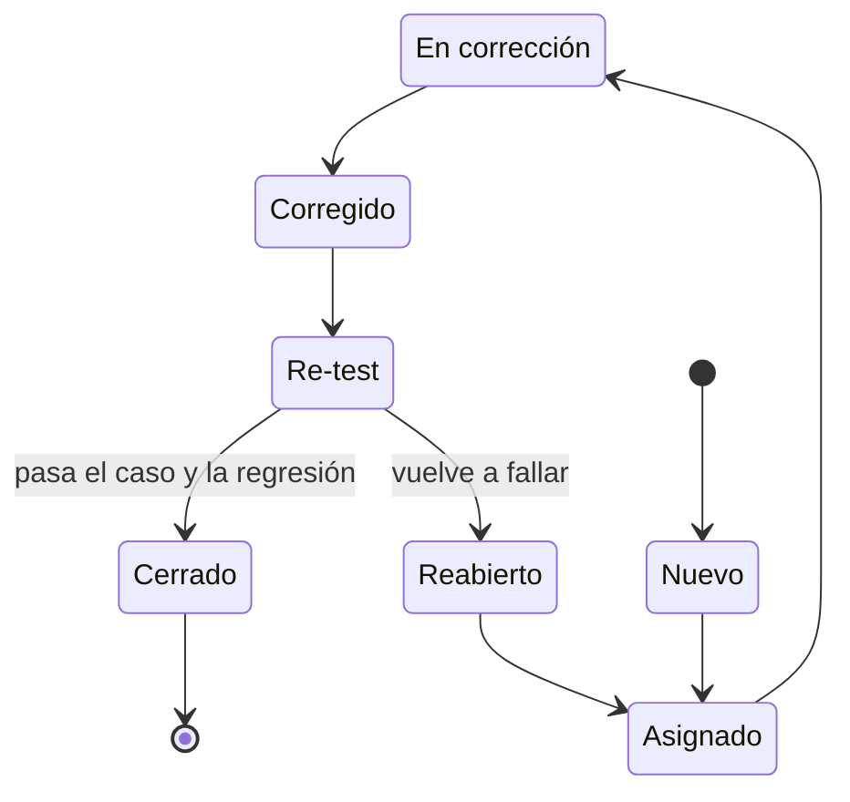

# Testing

Testware del proyecto Mostrador: plan de pruebas, casos de prueba, matriz de trazabilidad, gestión de defectos y checklists. Los identificadores RF-xxx, RNF-xxx y HU-xx coinciden con `docs/requerimientos.xlsx`, `docs/funcional.md` y `docs/no-funcional.md`. Las métricas de calidad están en `docs/indicadores.md` y la planificación en `docs/planificacion.md`.

Flujo del testware: storyboard → historia de usuario → criterios de aceptación en Gherkin (Dado / Cuando / Entonces) → casos de prueba (camino feliz, negativos, de estrés y límites) → ejecución → defectos → trazabilidad.

## Plan de pruebas

### Objetivo y alcance

**Objetivo.** Verificar que cada RF y RNF cumple su criterio de aceptación y su meta medible, y validar con un comercio real que el flujo "pantalla con QR, pedido y WhatsApp" resuelve la necesidad.

**Dentro del alcance:** backend (NestJS), backoffice (Expo, Android y web), reproductor de pantalla, web de autopedido, generación del enlace `wa.me`, aislamiento entre tenants y los RNF de `docs/no-funcional.md`.

**Fuera del alcance:** el comportamiento interno de WhatsApp (que el mensaje llegue o se envíe), pagos (no existen en el MVP) y la calidad de reconocimiento del modelo de visión más allá de una muestra manual; en CI el modelo se reemplaza por un simulado.

### Niveles de prueba

| Nivel | Qué se prueba | Herramienta | Cuándo se ejecuta |
| --- | --- | --- | --- |
| Unitario | Casos de uso, guards, validadores y cálculos del backend | Jest (`backend/test`) | En cada commit y PR |
| Integración / API | Endpoints con base de datos de prueba, contratos de la API | supertest en CI; colecciones de Postman para contrato y pruebas exploratorias | En cada PR |
| E2E web | Autopedido y reproductor de pantalla (incluye modo sin red) | Playwright (Chromium, WebKit, Edge) | En cada PR y antes de cada entrega |
| Móvil | Flujos del backoffice en Android | Maestro sobre emulador Android 10+ | Antes de cada entrega |
| Performance | API bajo carga nominal (50 usuarios); carga del autopedido | k6; Lighthouse | Semanal en staging y antes de cada entrega |
| Estrés | Cada requerimiento bajo concurrencia, volumen, duración o ráfagas (por ejemplo 200 clientes en el catálogo, 100 pantallas consultando cada 30 s, 20 videos de 50 MB seguidos, 10 importaciones en paralelo contra la API de visión) | k6 (JMeter como alternativa); Playwright para ciclos prolongados; scripts de CI | Antes de cada entrega y semanal los de la API; en staging, nunca en producción (en R1, en local a escala reducida; ver "Releases y criterio de salida de R1") |
| Seguridad | Aislamiento entre tenants, autenticación, secretos, HTTPS | Jest e2e (batería de autorización), gitleaks, SSL Labs | En cada PR (autorización y secretos) y antes de la entrega |
| Usabilidad / UAT | Comprensión del flujo y utilidad real | Prueba con un comercio piloto; cuestionario SUS | Una vez, con el MVP completo |
| Regresión | Toda la suite automatizada | Pipeline de CI | En cada PR; completa antes de cada entrega |

Los casos automatizados se escriben cuando se implementa cada RF (no por adelantado), de acuerdo con el avance del cronograma de `docs/planificacion.md`.

**Regla de cobertura mínima.** Cada requerimiento tiene como mínimo 3 casos: feliz, negativo y de estrés. Un requerimiento sin alguno de los tres tipos es un hueco de cobertura y no se da por probado. En los RNF que no son funcionales por naturaleza (por ejemplo, mantenibilidad o cobertura) el caso feliz verifica que la meta se cumple, el negativo verifica que un incumplimiento se detecta y el de estrés ejercita el atributo bajo carga o en un extremo. La RTM lista los casos de cada tipo por requerimiento.

### Entornos y datos de prueba

| Entorno | Uso | Datos |
| --- | --- | --- |
| Local | Desarrollo y pruebas unitarias, de integración y E2E | PostgreSQL local; subdominios `*.localhost` (por ejemplo `local1.localhost`) |
| CI | Suite automatizada en cada PR | Base efímera creada y poblada en cada ejecución; modelo de visión simulado |
| Staging | Performance, estrés, compatibilidad, UAT y ensayo de restauración | Réplica de producción con dominio wildcard (a definir en el paquete Despliegue) |
| Producción | Solo pruebas de humo tras cada despliegue | Sin datos de prueba masivos |

Los datos se cargan con un script SQL idempotente de semilla (sin migraciones), que se puede ejecutar varias veces sin duplicar datos.

| Tenant | Locales | Usuarios de prueba | Catálogo |
| --- | --- | --- | --- |
| `local1` | `palermo` (activo), `belgrano` (activo, sin productos) | `dueno@local1.test` (Dueño), `empleado@local1.test` (Empleado, local palermo) | Bebidas: "Agua 500 ml" 1500,00, "Gaseosa 500 ml" 1800,00; Comidas: "Hamburguesa" 5500,00. Pantalla "Entrada" con 3 contenidos |
| `local2` | `centro` (activo) | `dueno@local2.test` (Dueño) | Un producto propio, para probar el aislamiento |
| Plataforma | | `root@mostrador.test` (Root) | |

Las contraseñas de prueba están definidas solo en el script de semilla y no se repiten en la documentación.

### Releases y criterio de salida de R1

Cada requerimiento lleva su release en `docs/requerimientos.xlsx` y en la columna Release de la RTM: **R1** (38 requerimientos: 30 RF y 8 RNF) se entrega en la demo del **02/11/2026** y **R2** (15 requerimientos) es la hoja de ruta posterior (ver `docs/planificacion.md`).

**Criterio de salida de R1 (demo del 02/11/2026).** Los casos de prueba **feliz, negativa y de estrés** de cada requerimiento R1 son el criterio de salida: todos deben estar ejecutados y aprobados para dar por entregada la demo. Los casos de los requerimientos R2 no bloquean la demo; se ejecutan al terminar cada requerimiento en R2. Si un requerimiento R1 se recorta por capacidad (orden de recorte en `docs/planificacion.md`), pasa a R2 y sus casos salen del criterio de salida en el mismo cambio. RF-012, RNF-001 y RNF-009 están en R1 por decisión del usuario y no figuran en ese orden de recorte.

**Límites de tamaño (RNF-005).** RNF-005 sigue en R2. En R1 los límites (imagen hasta 5 MB, video hasta 50 MB y 60 s) se validan como validación simple del contrato de API dentro de RF-012 y RF-018: los casos TC-033, TC-034, TC-054, TC-055 y TC-056, compartidos con esos RF, se ejecutan en R1. Los casos formales de RNF-005 (TC-114, TC-191 y TC-192, estrés incluido) son R2.

**Estrés de R1 a escala reducida.** En R1 los casos de estrés se corren **en local** (una sola máquina, `local1.localhost`, base de datos de desarrollo con la semilla de la demo), no en staging: no existe un entorno de staging antes del 02/11. Por eso se reducen la concurrencia, la duración y el volumen. Se mantienen sin cambios las condiciones de aprobación (p95 < 500 ms, errores < 1%, 0 fugas entre tenants, sin duplicados ni pérdidas), pero medidas en la máquina local: es una prueba de humo de carga, no una validación de capacidad. **Las metas originales de cada caso (200 VUs, 5 min, 10 000 registros, 24 h, etc.) se conservan en la tabla de casos y son las que se exigen en R2**, en staging.

| Caso | Requerimiento | Escala original (tabla de casos, meta de R2) | Escala reducida de R1 (local) |
| --- | --- | --- | --- |
| TC-129 | RF-001 | k6: 20 VUs, 200 altas en 2 min; 10 altas simultáneas con el slug "carrera1" | 5 VUs, 50 altas en 1 min; 5 altas simultáneas con el slug "carrera1" (un 201 y cuatro 409) |
| TC-130 | RF-002 | k6: 200 VUs durante 5 min, Host rotando entre 50 subdominios | 20 VUs durante 1 min, Host rotando entre 5 subdominios |
| TC-131 | RF-003 | k6: 50 VUs durante 5 min listando y editando locales | Local único (R1): 10 VUs durante 1 min editando el mismo local. La prueba de 500 locales se hace en R2, cuando existan varios locales por tenant |
| TC-132 | RF-004 | 20 POST /stores en paralelo con el slug "carrera"; 200 VUs resolviendo 100 slugs de local durante 5 min | 5 POST /stores en paralelo con el mismo slug; 20 VUs resolviendo 20 slugs durante 1 min |
| TC-133 | RF-005 | k6: 50 VUs con login válido durante 5 min más 1000 intentos con contraseña incorrecta desde una misma IP | 10 VUs con login válido durante 1 min y 100 intentos con contraseña incorrecta |
| TC-135 | RF-006 | k6: 500 VUs durante 2 min con tokens inválidos o ausentes en rutas privadas, más 50 VUs en rutas públicas | 50 VUs durante 1 min con tokens inválidos o ausentes, más 5 VUs en rutas públicas |
| TC-137 | RF-007 | k6: 100 VUs durante 5 min alternando tokens de Dueño y Empleado sobre rutas de edición y de lectura | 20 VUs durante 1 min alternando tokens de Dueño y Empleado |
| TC-139 | RF-009 | k6: 50 VUs con login y lectura de órdenes durante 5 min; Maestro: 30 ciclos seguidos de login y logout | 10 VUs durante 1 min; 10 ciclos seguidos de login y logout |
| TC-140 | RF-010 | k6: 50 VUs listan categorías durante 5 min; 2 usuarios reordenan a la vez 50 veces | 20 categorías; 10 VUs durante 1 min; 2 usuarios reordenan 10 veces |
| TC-141 | RF-011 | k6: 10 VUs crean 1000 productos con nombres únicos en 5 min | 5 VUs crean 100 productos en 1 min |
| TC-142 | RF-012 | k6: 10 VUs suben 100 imágenes JPG de 5 242 880 bytes | 3 VUs suben 20 imágenes JPG de 5 242 880 bytes seguidas, en local (misma condición: 100% aceptadas y ancho menor o igual a 1280 px; p95 < 3 s) |
| TC-143 | RF-013 | k6: 200 VUs leen el catálogo durante 5 min mientras otro proceso alterna la disponibilidad de 100 productos cada 5 s | 20 VUs durante 1 min; 20 productos alternando disponibilidad cada 5 s |
| TC-144 | RF-014 | k6: 200 VUs concurrentes durante 5 min en GET catálogo público | 20 VUs durante 1 min sobre un catálogo de 50 productos |
| TC-148 | RF-018 | 20 videos MP4 de 50 MB y 60 s, subidos uno tras otro; luego 5 en paralelo | 3 videos de 10 MB seguidos y luego 2 en paralelo (los 50 MB quedan como meta de R2) |
| TC-150 | RF-019 | 50 reordenamientos consecutivos y 20 VUs consultando la lista durante 5 min | Lista de 20 contenidos; 10 reordenamientos seguidos y 5 VUs durante 1 min |
| TC-151 | RF-020 | Generar 10 000 tokens; 50 regeneraciones simultáneas de pantallas distintas | 1000 tokens sin colisión (la regeneración del token es R2 y se prueba allí) |
| TC-152 | RF-021 | k6: 100 VUs abren /screen/<token> y descargan el contenido inicial al mismo tiempo (arranque tras un corte de luz) | 10 pantallas abren el reproductor a la vez, 1 min |
| TC-154 | RF-022 | 2 h de bucle con cambios de contenido cada 30 s | 15 min de bucle con cambios de contenido cada 30 s |
| TC-155 | RF-023 | k6: 100 VUs consultando con If-None-Match cada 30 s durante 30 min; un cambio de contenido a los 10 min | 10 VUs consultando cada 30 s durante 5 min; un cambio de contenido en el minuto 2 |
| TC-158 | RF-024 | 50 ciclos de 10 s sin red y 10 s con red durante 20 min | 10 ciclos de 10 s sin red y 10 s con red (3,5 min) |
| TC-159 | RF-025 | k6: 200 VUs abren la URL del QR durante 5 min | 20 VUs durante 1 min |
| TC-161 | RF-026 | k6: 200 VUs navegan categorías durante 5 min | 20 VUs durante 1 min; 5 categorías y 50 productos |
| TC-163 | RF-027 | k6: 200 VUs durante 5 min agregan productos, cambian cantidades (1 a 50) y quitan | 20 VUs durante 1 min (cantidades de 1 a 50) |
| TC-165 | RF-028 | k6: 50 VUs envían 1000 pedidos con notas de 200 caracteres con tildes, emojis y comillas | 5 VUs envían 100 pedidos con notas de 200 caracteres especiales |
| TC-167 | RF-029 | k6: 50 VUs confirman pedidos al mismo tiempo durante 5 min | 10 VUs durante 1 min |
| TC-169 | RF-030 | k6: 100 VUs durante 5 min, con 20% de los pedidos con precios manipulados | 20 VUs durante 1 min, con 20% de pedidos con precios manipulados |
| TC-171 | RF-031 | k6: 30 VUs durante 5 min con filtros por estado y fecha, paginado | 1000 órdenes; 5 VUs durante 1 min con filtros y paginado |
| TC-172 | RF-032 | 10 empleados cambian la misma orden a la vez (en preparación, lista, cancelada); se repite en 100 órdenes | 5 empleados cambian la misma orden a la vez; se repite en 20 órdenes |
| TC-173 | RF-033 | 20 cambios del número del local en 2 min con 50 VUs creando pedidos | 5 cambios del número en 1 min con 10 VUs creando pedidos |
| TC-179 | RF-034 | 10 000 pedidos con 1 a 100 ítems y notas de hasta 200 caracteres | 1000 pedidos aleatorios de 1 a 100 ítems (se mantiene el rango de ítems) |
| TC-182 | RNF-001 | k6: 50 VUs crean 1000 pedidos aleatorios de 1 a 100 ítems | 10 VUs crean 200 pedidos aleatorios de 1 a 100 ítems, en local (mismas condiciones: 100% de coincidencia, 0 diferencias de total, partes de 1500 caracteres o menos) |
| TC-190 | RNF-004 | k6: 100 VUs durante 45 min; un cambio de contenido cada 2 min (20 cambios) | 10 pantallas durante 10 min; un cambio de contenido cada 2 min (5 cambios) |
| TC-198 | RNF-007 | viewport de 360 px; zoom de texto 200% | Catálogo de 50 productos, viewport de 360 px, zoom de texto 200% (el zoom no es de carga, no se reduce) |
| TC-204 | RNF-009 | 3 celulares, 60 intentos a 1,5 m durante la reproducción; ensayo adicional a 3 m | Televisor de la demo (la resolución que haya disponible); 3 celulares, 20 intentos a 1,5 m durante la reproducción, al menos 19 de 20; el ensayo a 3 m se documenta igual |
| TC-206 | RNF-010 | 24 h sin red; 50 cambios de contenido en el servidor durante ese tiempo | 30 min sin red con 5 cambios de contenido en el servidor (las 24 h quedan como meta de R2) |
| TC-211 | RNF-012 | k6: 100 VUs durante 5 min; 50% de las solicitudes con IDs de otro tenant | 20 VUs durante 1 min; 50% de las solicitudes con IDs de otro tenant (misma proporción) |
| TC-216 | RNF-014 | k6: 50 registros y logins por segundo durante 2 min | 10 registros y logins por segundo durante 1 min |
| TC-219 | RNF-015 | 10 tipos de secretos falsos repartidos en 50 commits | 10 secretos falsos en 10 commits (misma detección esperada: 10 de 10) |

Total: 38 casos de estrés de R1 con escala reducida. Los casos de estrés de los requerimientos R2 mantienen su escala original.

### Criterios de entrada y salida

| Criterio | Entrada (empezar a probar un RF) | Salida (cerrar la fase de pruebas) |
| --- | --- | --- |
| Requisito | Tiene historia de usuario y criterios Gherkin aprobados | RTM con el 100% de los RF y RNF vinculados a casos ejecutados, y cada uno con al menos un caso feliz, uno negativo y uno de estrés aprobados. Para R1 (demo del 02/11/2026) basta con los requerimientos R1; los de R2 se cierran al terminar R2 |
| Código | Compila, pasan lint y pruebas unitarias | Cobertura de líneas en casos de uso ≥ 70% (RNF-016) |
| Casos | Revisados con la checklist de revisión por pares | 100% de los casos de prioridad Alta aprobados; al menos 95% del total |
| Defectos | Entorno y semilla disponibles | 0 defectos abiertos de severidad Crítica o Alta; los de severidad Media tienen plan |
| RNF | | Cada RNF alcanza su meta medible (`docs/no-funcional.md`) |
| Validación | | UAT con el comercio piloto realizada y sin observaciones bloqueantes |

### Roles

| Rol | Responsabilidad |
| --- | --- |
| Líder de pruebas | Mantiene este plan y la RTM; reporta métricas (cobertura, DDP, NOEL) |
| Desarrollador | Escribe las pruebas unitarias y de integración de su RF, corrige defectos y completa la causa raíz |
| Analista de pruebas | Diseña y revisa casos, ejecuta pruebas exploratorias y registra defectos |
| Dueño de producto / comercio piloto | Aprueba criterios de aceptación y ejecuta la UAT |

En un equipo chico una persona puede cumplir varios roles, salvo que quien revisa un caso no debería ser quien lo escribió.

### Riesgos de las pruebas

| Riesgo | Probabilidad | Impacto | Mitigación |
| --- | --- | --- | --- |
| El modelo de visión no es determinista | Alta | Medio | Simulado en CI; muestra manual de fotos reales para estimar precisión |
| `wa.me` no confirma el envío del mensaje | Cierta | Medio | Se documenta como limitación; se prueba que la orden queda registrada antes de abrir WhatsApp |
| Fuga de datos entre tenants | Baja | Crítico | Batería de autorización en CI sobre todos los endpoints (RNF-012) |
| QR no legible en televisores reales | Media | Alto | Prueba con televisor y tres celulares (RNF-009) |
| Safari y Android reales no disponibles en CI | Media | Medio | Matriz manual antes de cada entrega (RNF-006) |
| Pruebas E2E inestables (flaky) | Media | Medio | Esperas por condición y no por tiempo; trazas de Playwright; reintento limitado a 1 |
| Retraso en el camino crítico acorta el tiempo de pruebas | Media | Alto | Pruebas automatizadas en paralelo con el desarrollo (ver `docs/planificacion.md`) |
| Las pruebas de estrés consumen cuota o costo del proveedor de visión y saturan staging | Media | Medio | Repeticiones acotadas (10 solicitudes en paralelo, 5 veces), proveedor simulado salvo en la corrida semanal con tope de costo; ventana de ejecución fuera del horario de otras pruebas |
| Las cifras de carga de staging no representan producción | Media | Medio | Los umbrales se toman de los RNF; las cantidades de VUs se recalibran con el uso real del comercio piloto |

### Verificación y validación

- **Verificación** ("¿construimos el producto correctamente?"): los casos de este documento comprueban que el sistema cumple la especificación (RF y RNF).
- **Validación** ("¿construimos el producto correcto?"): la UAT con un comercio piloto comprueba que resuelve la necesidad real. La UAT no reemplaza las mediciones de los RNF.

## Casos de prueba

Se definieron **227 casos**: cada escenario Gherkin de `docs/funcional.md` tiene su caso (en el mismo orden dentro de cada historia), más casos de reglas de negocio, casos para los RNF y, desde la revisión de cobertura, los casos que completan el mínimo de tres por requerimiento (feliz, negativa y estrés). Los casos TC-129 en adelante se agregaron sin renumerar los anteriores.

Convenciones: los pasos se numeran; "Automatizado" indica herramienta; "No (manual)" se usa cuando se necesita hardware real o juicio humano. Los datos de la semilla están en la sección Plan de pruebas. Los casos de tipo Límite prueban el valor exacto y el siguiente fuera del límite.

**Tipos de caso (leyenda de la columna Tipo).**

| Tipo | Qué verifica |
| --- | --- |
| Funcional feliz | El camino principal cumple la regla. En un RNF verifica que la meta medible se cumple |
| Negativa | Un dato, estado o acción inválida se rechaza o se maneja bien. En un RNF verifica que el incumplimiento se detecta (por ejemplo, el pipeline falla con cobertura menor a 70%) |
| Estrés | El requerimiento bajo carga o en un extremo: concurrencia, volumen, duración o ráfagas, con cifras y umbral (k6; JMeter como alternativa). Se ejecuta en staging (en R1, en local a escala reducida; ver "Releases y criterio de salida de R1") |
| Límite | El valor exacto del límite y el siguiente fuera de él |
| Seguridad | Autorización, aislamiento entre tenants, inyección y secretos |
| Performance | Medición de la meta de desempeño en condiciones normales (Lighthouse, k6 con carga nominal) |
| UI | Interfaz, compatibilidad, accesibilidad y legibilidad en dispositivos reales |

Los casos de estrés usan, salvo que se indique "meta propuesta", las metas de `docs/no-funcional.md`: p95 < 500 ms y errores < 1% (RNF-003). Las cantidades de usuarios virtuales (VUs), duraciones y volúmenes de cada caso son el escenario de prueba y se ajustan en la primera corrida en staging.

| ID | HU | RF/RNF | Título | Precondiciones | Datos | Pasos | Resultado esperado | Tipo | Prioridad | Automatizado |
| --- | --- | --- | --- | --- | --- | --- | --- | --- | --- | --- |
| TC-001 | HU-01 | RF-001, RF-035 | Alta de tenant válido | Sesión Root | slug "local3" | 1. POST /tenants con el slug 2. Abrir local3.mostrador.io | 201; tenant activo; el subdominio resuelve el tenant | Funcional feliz | Alta | Sí (supertest) |
| TC-002 | HU-01 | RF-001 | Slug reservado | Sesión Root | slugs "admin", "www", "api", "app" | 1. POST /tenants con cada slug | 400 por cada uno, con mensaje "slug reservado"; no se crea el tenant | Negativa | Alta | Sí (Jest) |
| TC-003 | HU-01 | RF-001 | Slug duplicado | Sesión Root; existe local1 | slug "local1" | 1. POST /tenants con slug existente | 409 con mensaje "el slug ya existe" | Negativa | Alta | Sí (supertest) |
| TC-004 | HU-01 | RF-001 | Formato y longitud del slug | Sesión Root | "ab" (2), "abc" (3), 30 y 31 caracteres, "Local1", "local_1" | 1. Crear un tenant con cada valor | Aceptados: 3 y 30 caracteres en minúsculas; rechazados: 2, 31, mayúsculas y guion bajo | Límite | Media | Sí (Jest) |
| TC-005 | HU-01 | RF-035 | Suspender tenant bloquea login y pedidos | Sesión Root; tenant local2 activo | tenant local2 | 1. Suspender local2 2. Intentar login de dueno@local2.test 3. Abrir autopedido de local2 | Login rechazado; el autopedido muestra mantenimiento y no permite confirmar | Negativa | Alta | Sí (Playwright) |
| TC-006 | HU-01 | RF-035 | Reactivar tenant | Sesión Root; local2 suspendido | tenant local2 | 1. Reactivar local2 2. Login de dueno@local2.test | Login correcto y autopedido operativo | Funcional feliz | Media | Sí (supertest) |
| TC-007 | HU-01 | RF-035, RNF-012 | Solo Root administra tenants | Sesión del dueño de local1 | token de dueno@local1.test | 1. POST /tenants 2. PATCH suspender local2 | 403 en ambos casos | Seguridad | Alta | Sí (supertest) |
| TC-008 | HU-02 | RF-002 | Subdominio existente | Seed cargado | Host local1.mostrador.io | 1. GET /api/stores con ese Host | 200 con los locales de local1 solamente | Funcional feliz | Alta | Sí (supertest) |
| TC-009 | HU-02 | RF-002 | Tenant inexistente | Seed cargado | Host inexistente.mostrador.io | 1. GET /api/stores con ese Host | 404 con mensaje claro; sin datos de otro tenant | Negativa | Alta | Sí (supertest) |
| TC-010 | HU-02 | RF-002 | Subdominio reservado no es tenant | Seed cargado | Host www, api, app, admin | 1. GET con cada Host | 404 en cada caso; no se resuelve como tenant | Negativa | Media | Sí (Jest) |
| TC-011 | HU-03 | RF-003, RF-004 | Crear local con slug | Sesión del dueño de local1 | nombre "Belgrano", slug "belgrano" | 1. POST /stores 2. Abrir local1.mostrador.io/belgrano | 201; el local queda accesible en la URL | Funcional feliz | Alta | Sí (supertest) |
| TC-012 | HU-03 | RF-004 | Slug de local duplicado en el tenant | Existe local palermo en local1 | slug "palermo" | 1. POST /stores con slug repetido | 409; no se crea el local | Negativa | Alta | Sí (supertest) |
| TC-013 | HU-03 | RF-004 | Mismo slug en otro tenant | Existe palermo en local1 | slug "palermo" en local2 | 1. Crear local con ese slug en local2 | Permitido: el slug es único dentro del tenant | Funcional feliz | Media | Sí (supertest) |
| TC-014 | HU-03 | RF-003 | Local desactivado no acepta pedidos | Local palermo desactivado | URL local1.mostrador.io/palermo | 1. Abrir la URL como cliente 2. Intentar confirmar un pedido | Mensaje "local no disponible"; el pedido no se registra | Negativa | Alta | Sí (Playwright) |
| TC-015 | HU-03 | RF-003 | Editar y desactivar local desde el backoffice | Sesión del dueño en Android | local palermo | 1. Abrir Locales 2. Editar el nombre 3. Desactivar el local | Cambios persistidos y visibles; local marcado inactivo | Funcional feliz | Media | Sí (Maestro) |
| TC-016 | HU-04 | RF-005 | Login con credenciales válidas | Usuario dueno@local1.test | correo y contraseña del seed | 1. POST /auth/login | 200 con JWT válido y expiración configurada | Funcional feliz | Alta | Sí (supertest) |
| TC-017 | HU-04 | RF-005, RNF-014 | Credenciales inválidas con error uniforme | Usuario dueno@local1.test | contraseña incorrecta; correo inexistente | 1. POST /auth/login con cada combinación | 401 con el mismo mensaje genérico en ambos casos; sin token | Negativa | Alta | Sí (supertest) |
| TC-018 | HU-04 | RF-005, RF-009 | Token vencido | Token expirado emitido para el seed | JWT con exp en el pasado | 1. Llamar a un endpoint protegido 2. Abrir una pantalla del backoffice | API responde 401 sin detalle interno; el backoffice redirige al login | Negativa | Alta | Sí (Jest, Maestro) |
| TC-019 | HU-04 | RF-006 | Rutas públicas sin sesión | Sin token | rutas autopedido, catálogo público y /screen/:token | 1. GET a cada ruta pública sin Authorization 2. GET a una ruta privada sin Authorization | Públicas responden 200; privadas responden 401 | Funcional feliz | Alta | Sí (supertest) |
| TC-020 | HU-04 | RF-006 | Ruta protegida sin token o con token alterado | Sin token / token modificado | header ausente; esquema no Bearer; firma alterada | 1. GET a un endpoint protegido en cada caso | 401 sin detalle interno en el cuerpo | Seguridad | Alta | Sí (Jest) |
| TC-021 | HU-04 | RF-009 | Login y cierre de sesión en el backoffice | App Android y web | dueno@local1.test | 1. Iniciar sesión 2. Cerrar sesión 3. Reabrir la app | Sesión iniciada; al cerrar se borra el token y se pide login | Funcional feliz | Media | Sí (Maestro) |
| TC-022 | HU-05 | RF-008 | Alta de empleado con local asignado | Sesión del dueño de local1 | empleado, rol Empleado, local palermo | 1. Crear empleado 2. Login como empleado 3. Listar órdenes | El empleado ve las órdenes de palermo | Funcional feliz | Alta | Sí (supertest) |
| TC-023 | HU-05 | RF-007 | Empleado no puede editar el catálogo | Sesión de empleado@local1.test | token de Empleado | 1. POST /categories 2. PATCH /products/:id | 403 en ambos | Negativa | Alta | Sí (supertest) |
| TC-024 | HU-05 | RF-008 | Empleado solo ve órdenes de sus locales | Empleado asignado a palermo; hay órdenes en belgrano | ID de orden de belgrano | 1. GET /orders 2. GET /orders/:id de belgrano | Lista sin órdenes de belgrano; el detalle responde 403 o 404 | Negativa | Alta | Sí (supertest) |
| TC-025 | HU-05 | RF-007 | Permiso revocado rige sin re-login | Empleado con permiso; token vigente | rol con permiso quitado en la base | 1. Quitar el permiso en la base 2. Repetir la llamada con el mismo token | 403 en la siguiente solicitud | Seguridad | Media | Sí (Jest) |
| TC-026 | HU-06 | RF-010 | Crear categoría | Sesión del dueño de local1 | nombre "Bebidas" | 1. POST /categories | 201; aparece en el listado | Funcional feliz | Alta | Sí (supertest) |
| TC-027 | HU-06 | RF-010 | Eliminar categoría con productos | Bebidas con "Agua 500 ml" | categoría Bebidas | 1. DELETE /categories/:id | 409 indicando que tiene productos; la categoría persiste | Negativa | Alta | Sí (supertest) |
| TC-028 | HU-06 | RF-010 | Nombre de categoría repetido | Existe Bebidas en palermo | nombre "Bebidas" | 1. POST /categories con el mismo nombre en el mismo local | 409; no se crea | Negativa | Media | Sí (supertest) |
| TC-029 | HU-06 | RF-010 | Ordenar categorías | Dos categorías creadas | nuevo orden | 1. Cambiar el orden 2. Recargar el listado | El orden persiste | Funcional feliz | Baja | Sí (supertest) |
| TC-030 | HU-07 | RF-011, RF-012 | Producto válido con imagen | Existe Bebidas | "Agua 500 ml", 1500,00, JPG de 1 MB | 1. POST /products con imagen | 201; producto con imagen visible | Funcional feliz | Alta | Sí (supertest) |
| TC-031 | HU-07 | RF-011 | Precio inválido | Existe Bebidas | precio 0, -1, vacío, 10,999 | 1. Crear producto con cada precio | Rechazado: precio mayor que 0 con dos decimales | Negativa | Alta | Sí (Jest) |
| TC-032 | HU-07 | RF-011 | Límites de precio y nombre | Existe Bebidas | precio 0,01; nombre de 80 y 81 caracteres | 1. Crear producto con cada valor | Aceptados: 0,01 y 80 caracteres; rechazado: 81 | Límite | Media | Sí (Jest) |
| TC-033 | HU-07 | RF-012, RNF-005 | Imagen de 6 MB | Formulario de producto | JPG de 6 MB | 1. Subir la imagen | 413 indicando el límite de 5 MB | Negativa | Alta | Sí (supertest) |
| TC-034 | HU-07 | RF-012, RNF-005 | Imagen de exactamente 5 MB | Formulario de producto | JPG de 5 242 880 bytes y de 5 242 881 bytes | 1. Subir cada imagen | 5 242 880 bytes aceptada; 5 242 881 rechazada con 413 | Límite | Alta | Sí (supertest) |
| TC-035 | HU-07 | RF-012 | Formato de imagen no permitido | Formulario de producto | GIF y .exe renombrado a .jpg | 1. Subir cada archivo | Rechazados (solo JPG, PNG y WebP; se valida el contenido real) | Negativa | Media | Sí (supertest) |
| TC-036 | HU-07 | RF-012 | Redimensionado a 1280 px | Formulario de producto | PNG de 4000 px de ancho | 1. Subir la imagen 2. Descargar el archivo guardado | Ancho guardado menor o igual a 1280 px | Funcional feliz | Media | Sí (Jest) |
| TC-037 | HU-07 | RF-012 | Imagen desde la cámara del celular | Backoffice en Android físico | foto tomada en el momento | 1. Editar producto 2. Elegir cámara 3. Guardar | La foto se asocia y se muestra | Funcional feliz | Media | No (manual) |
| TC-038 | HU-08 | RF-013 | Desactivar producto lo oculta | Producto disponible | Agua 500 ml | 1. Marcar no disponible 2. GET catálogo público | El producto no aparece en el catálogo público | Funcional feliz | Alta | Sí (supertest) |
| TC-039 | HU-08 | RF-013, RF-029 | Producto desactivado con carrito abierto | Cliente con Agua en el carrito | carrito con Agua 500 ml | 1. Desactivar el producto 2. El cliente confirma | Se informa que no está disponible; la orden no se guarda | Negativa | Alta | Sí (Playwright) |
| TC-040 | HU-09 | RF-014 | Catálogo con productos | Local con productos disponibles | local palermo | 1. GET catálogo público | Categorías y productos disponibles con precio | Funcional feliz | Alta | Sí (supertest) |
| TC-041 | HU-09 | RF-014 | Catálogo vacío | Local sin productos disponibles | local belgrano | 1. Abrir el catálogo | Mensaje "aún no hay productos" | Negativa | Media | Sí (Playwright) |
| TC-042 | HU-09 | RF-014, RNF-012 | Producto de otro tenant no aparece | Productos en local1 y local2 | ID de producto de local2 | 1. Pedirlo desde Host local1 | 404; no aparece en ningún listado de local1 | Seguridad | Alta | Sí (supertest) |
| TC-043 | HU-10 | RF-015, RF-016 | Foto legible devuelve productos | Dueño con sesión; LLM simulado en CI | foto de menú con 10 productos | 1. Subir la foto 2. Esperar el resultado | Lista con nombre, precio y categoría de los productos detectados | Funcional feliz | Alta | Sí (Jest, LLM simulado); precisión manual |
| TC-044 | HU-10 | RF-016 | Foto sin productos | Dueño con sesión | foto de un paisaje | 1. Enviar la foto | Informa que no detectó productos; no guarda nada | Negativa | Alta | Sí (Jest) |
| TC-045 | HU-10 | RF-016 | Respuesta inválida del modelo | LLM simulado devuelve JSON roto | respuesta no interpretable | 1. Enviar la foto | Error controlado y botón de reintento; sin productos guardados | Negativa | Alta | Sí (Jest) |
| TC-046 | HU-10 | RF-016 | Proveedor del modelo no disponible | LLM simulado con timeout | timeout o error 5xx | 1. Enviar la foto | Error claro, sin quedar colgado; permite reintentar | Negativa | Media | Sí (Jest) |
| TC-047 | HU-10 | RF-015 | Foto de 9 MB | Dueño con sesión | imagen de 9 MB | 1. Enviar la foto | Rechazada indicando el límite de 8 MB | Negativa | Media | Sí (supertest) |
| TC-048 | HU-10 | RF-015 | Foto de exactamente 8 MB | Dueño con sesión | imagen de 8 388 608 bytes | 1. Enviar la foto | Aceptada | Límite | Media | Sí (supertest) |
| TC-049 | HU-11 | RF-017 | Confirmar con precio corregido | Lista de detectados | precio 1200 corregido a 1500,00 | 1. Corregir el precio 2. Confirmar | Se guardan los productos con el precio corregido | Funcional feliz | Alta | Sí (Maestro) |
| TC-050 | HU-11 | RF-017 | Descartar ítems | Lista de detectados | descartar 2 de 10 | 1. Descartar dos ítems 2. Confirmar | Se guardan 8 productos; los descartados no | Funcional feliz | Media | Sí (Maestro) |
| TC-051 | HU-11 | RF-017 | Salir sin confirmar | Lista de detectados | 10 detectados | 1. Salir de la pantalla sin confirmar | No se guarda ningún producto | Negativa | Media | Sí (Maestro) |
| TC-052 | HU-12 | RF-018 | Subir imagen de contenido | Contenido de pantalla abierto | PNG de 1 MB | 1. Subir la imagen | Queda al final de la lista de reproducción | Funcional feliz | Alta | Sí (supertest) |
| TC-053 | HU-12 | RF-018 | Formato no soportado | Contenido de pantalla abierto | archivo .exe | 1. Subir el archivo | Rechazado indicando los formatos permitidos | Negativa | Alta | Sí (supertest) |
| TC-054 | HU-12 | RF-018, RNF-005 | Video de 80 MB | Contenido de pantalla abierto | video de 80 MB | 1. Subir el video | 413 indicando el límite de 50 MB | Negativa | Alta | Sí (supertest) |
| TC-055 | HU-12 | RF-018, RNF-005 | Video en el límite de tamaño y duración | Contenido de pantalla abierto | video de 50 MB y 60 s | 1. Subir el video | Aceptado | Límite | Media | Sí (supertest) |
| TC-056 | HU-12 | RF-018, RNF-005 | Video de 61 segundos | Contenido de pantalla abierto | video de 61 s y menos de 50 MB | 1. Subir el video | Rechazado por duración | Límite | Media | Sí (supertest) |
| TC-057 | HU-12 | RF-019 | Duración mínima de una imagen | Imagen en la lista | duración 2 s y 3 s | 1. Fijar 2 s 2. Fijar 3 s | 2 s rechazado (mínimo 3 s); 3 s aceptado | Límite | Alta | Sí (Jest) |
| TC-058 | HU-12 | RF-019 | Reordenar contenidos | Dos contenidos en la lista | orden A, B a B, A | 1. Cambiar el orden 2. Abrir el reproductor | El reproductor muestra B y luego A | Funcional feliz | Alta | Sí (Playwright) |
| TC-059 | HU-13 | RF-020 | Crear pantalla y obtener URL | Sesión del dueño | pantalla "Entrada" | 1. Registrar la pantalla | URL /screen/<token> única; la URL abre el reproductor | Funcional feliz | Alta | Sí (supertest) |
| TC-060 | HU-13 | RF-020 | Regenerar token | Pantalla Entrada registrada | token anterior | 1. Regenerar el token 2. Abrir la URL anterior | La URL anterior responde 404; la nueva funciona | Negativa | Alta | Sí (supertest) |
| TC-061 | HU-14 | RF-021 | Reproducción en bucle | Pantalla con 3 contenidos | URL /screen/<token> | 1. Abrir la URL en pantalla completa 2. Esperar un ciclo | Se reproducen en orden y vuelve a empezar | Funcional feliz | Alta | Sí (Playwright) |
| TC-062 | HU-14 | RF-022 | QR permanente | Reproductor en ejecución | cambio de contenido | 1. Observar el QR en dos contenidos distintos | El QR no desaparece y su URL abre el autopedido del local | Funcional feliz | Alta | Sí (Playwright) |
| TC-063 | HU-14 | RF-022 | El QR codifica la URL correcta | Pantalla Entrada de palermo | imagen del QR | 1. Decodificar el QR | Contiene local1.mostrador.io/palermo con el origen de la pantalla | Funcional feliz | Alta | Sí (Jest) |
| TC-064 | HU-14 | RF-021 | Token inexistente | Ninguna | token inventado | 1. Abrir /screen/<token> | Mensaje de pantalla no válida | Negativa | Alta | Sí (Playwright) |
| TC-065 | HU-14 | RF-021 | Pantalla sin contenido | Pantalla sin contenidos | URL de la pantalla | 1. Abrir la URL | Imagen por defecto con el QR visible | Límite | Media | Sí (Playwright) |
| TC-066 | HU-14 | RF-021 | Pantalla completa en televisor | Televisor con navegador | URL de la pantalla | 1. Abrir en el televisor | Sin barras ni cursor; el contenido ocupa toda la pantalla | UI | Media | No (manual) |
| TC-067 | HU-15 | RF-023, RNF-004 | Contenido actualizado sin recargar | Reproductor en ejecución | cambio de orden por el dueño | 1. Cambiar el contenido 2. Cronometrar hasta verlo en pantalla | Se aplica en la siguiente consulta (30 s) sin recarga manual | Funcional feliz | Alta | Sí (Playwright) |
| TC-068 | HU-15 | RF-023 | Consulta sin cambios no descarga | Reproductor en ejecución | ETag vigente | 1. Repetir la consulta con If-None-Match | 304 sin cuerpo | Funcional feliz | Media | Sí (supertest) |
| TC-069 | HU-15 | RF-024, RNF-010 | Pérdida de red | Reproductor con contenido descargado | red desactivada | 1. Cortar la red 2. Observar 5 minutos | Sigue reproduciendo sin cortes | Negativa | Alta | Sí (Playwright) |
| TC-070 | HU-15 | RF-024, RNF-010 | Red recuperada | Reproductor sin red; hubo cambios | red reactivada | 1. Reactivar la red 2. Medir el tiempo | Sincroniza en 60 s o menos sin interrumpir la reproducción | Negativa | Alta | Sí (Playwright) |
| TC-071 | HU-15 | RF-024 | Sin red desde el inicio | Sin caché ni red | navegador sin conexión | 1. Abrir la URL | Mensaje de espera y reintentos automáticos | Negativa | Media | Sí (Playwright) |
| TC-072 | HU-16 | RF-025 | QR válido abre el catálogo | Pantalla Entrada de palermo | URL del QR | 1. Abrir la URL del QR en un celular | Se abre el catálogo de palermo; el origen queda asociado a Entrada | Funcional feliz | Alta | Sí (Playwright) |
| TC-073 | HU-16 | RF-025 | Local inexistente o eliminado | QR de un local eliminado | slug inexistente | 1. Abrir la URL | Página de error indicando que el local no existe | Negativa | Alta | Sí (Playwright) |
| TC-074 | HU-16 | RF-025 | Subdominio inexistente | Ninguna | inexistente.mostrador.io | 1. Abrir la URL | Error 404 | Negativa | Alta | Sí (Playwright) |
| TC-075 | HU-16 | RF-025, RF-035 | Tenant suspendido | local2 suspendido | URL de local2 | 1. Abrir el autopedido | Página de mantenimiento | Negativa | Media | Sí (Playwright) |
| TC-076 | HU-17 | RF-026 | Ver productos de una categoría | Catálogo con Bebidas | categoría Bebidas | 1. Elegir Bebidas | Productos con foto y precio | Funcional feliz | Alta | Sí (Playwright) |
| TC-077 | HU-17 | RF-026 | Categoría sin productos disponibles | Todos los productos de una categoría desactivados | categoría Postres | 1. Abrir el catálogo | La categoría no aparece | Límite | Media | Sí (Playwright) |
| TC-078 | HU-17 | RF-026 | Producto sin imagen | Producto sin imagen | producto sin foto | 1. Verlo en el catálogo | Se muestra la imagen por defecto | Límite | Baja | Sí (Playwright) |
| TC-079 | HU-18 | RF-027 | Agregar productos y total | Catálogo abierto | 2 × Agua 500 ml a 1500,00 | 1. Agregar 2 unidades | Carrito con total 3000,00 | Funcional feliz | Alta | Sí (Playwright, Jest) |
| TC-080 | HU-18 | RF-027 | Quitar producto | Carrito con 2 productos | quitar uno | 1. Quitar el producto | Desaparece y el total se recalcula | Funcional feliz | Alta | Sí (Playwright) |
| TC-081 | HU-18 | RF-027 | Cantidades mínima y máxima | Carrito con un producto | cantidades 1, 50 y 51 | 1. Ajustar a 50 y agregar una más 2. Intentar bajar de 1 | No supera 50; el mínimo es 1 (para quitar se usa la acción quitar) | Límite | Alta | Sí (Playwright) |
| TC-082 | HU-18 | RF-027 | Total sin errores de redondeo | Carrito | 3 × 1800,00 + 7 × 1500,00 | 1. Armar el carrito | Total 15900,00 exacto | Límite | Media | Sí (Jest) |
| TC-083 | HU-18 | RF-027 | El carrito sobrevive a la recarga | Carrito con productos | recarga de página | 1. Recargar | El carrito se conserva | Funcional feliz | Media | Sí (Playwright) |
| TC-084 | HU-19 | RF-028, RF-029 | Confirmación exitosa | Carrito con productos; local con WhatsApp | nombre "Ana" | 1. Escribir el nombre 2. Confirmar | Orden "generada" guardada y se abre WhatsApp con el mensaje armado | Funcional feliz | Alta | Sí (Playwright) |
| TC-085 | HU-19 | RF-029 | Carrito vacío | Carrito vacío | ninguno | 1. Intentar confirmar | No se puede; indica que agregue productos | Negativa | Alta | Sí (Playwright) |
| TC-086 | HU-19 | RF-029 | Producto que dejó de estar disponible | Producto desactivado tras agregarse | carrito con producto inactivo | 1. Confirmar | Informa cuál producto no está disponible y pide revisar el carrito | Negativa | Alta | Sí (Playwright) |
| TC-087 | HU-19 | RF-028 | Nota de 200 y 201 caracteres | Carrito con productos | notas de 200 y 201 caracteres | 1. Escribir cada nota | 200 se acepta; 201 indica el máximo | Límite | Alta | Sí (Playwright) |
| TC-088 | HU-19 | RF-028 | Nombre de 50 y 51 caracteres | Carrito con productos | nombres de 50 y 51 caracteres | 1. Escribir cada nombre | 50 se acepta; 51 indica el máximo | Límite | Media | Sí (Playwright) |
| TC-089 | HU-19 | RF-029 | Pedido sin nota ni nombre | Carrito con productos | campos vacíos | 1. Confirmar | El pedido se registra | Funcional feliz | Alta | Sí (Playwright) |
| TC-090 | HU-19 | RF-028 | Caracteres especiales en la nota | Carrito con productos | nota con `<script>`, comillas y emoji | 1. Confirmar 2. Ver la orden en el backoffice | Se guarda como texto; no se ejecuta ningún script | Seguridad | Alta | Sí (Playwright, Jest) |
| TC-091 | HU-19 | RF-029 | Doble clic en confirmar | Carrito con productos | dos clics seguidos | 1. Hacer doble clic en Confirmar | Se registra una sola orden | Negativa | Media | Sí (Playwright) |
| TC-092 | HU-20 | RF-030 | Orden registrada con origen | Pedido desde la pantalla Entrada | 2 ítems | 1. Confirmar el pedido 2. GET /orders/:id | Ítems, total, estado "generada" y origen "Entrada" | Funcional feliz | Alta | Sí (supertest) |
| TC-093 | HU-20 | RF-030 | Precio manipulado | Catálogo vigente | cuerpo con precio 1,00 para un producto de 1500,00 | 1. POST /orders con precios alterados | El total se recalcula con precios vigentes (el descarte de `price`/`total` del body lo hace el ValidationPipe con whitelist). Unit Jest: `create-order.use-case.spec.ts` verifica el recálculo con precios de la base | Seguridad | Alta | Sí (supertest) |
| TC-094 | HU-20 | RF-030, RF-033 | Local sin número de WhatsApp registra la orden | Local sin número | pedido válido | 1. Confirmar el pedido 2. GET /orders/:id | 201; orden "generada" registrada y visible en el backoffice; la respuesta no incluye enlace wa.me (`whatsapp_parts: []`). Unit Jest cubre el registro sin número | Funcional feliz | Alta | Sí (supertest) |
| TC-095 | HU-20 | RF-030, RNF-012 | Producto de otro tenant en el pedido | Productos de local2 | ID de producto de local2 en un pedido de local1 | 1. POST /orders | 409 `PRODUCTS_UNAVAILABLE` con `details` (`reason: not_found`, sin `name`); no se registra. Unit Jest cubre el caso "no existe en el local" (`create-order.use-case.spec.ts`); el aislamiento por tenant en SQL queda para supertest | Seguridad | Alta | Sí (supertest) |
| TC-096 | HU-21 | RF-031 | Listado más reciente primero | Órdenes del local | 3 órdenes con fechas distintas | 1. Abrir el listado | Orden descendente por fecha | Funcional feliz | Alta | Sí (supertest) |
| TC-097 | HU-21 | RF-031 | Filtros por estado y fecha | Órdenes en varios estados | estado "en preparación"; rango de fechas | 1. Aplicar cada filtro | Solo se listan las que cumplen | Funcional feliz | Media | Sí (supertest) |
| TC-098 | HU-21 | RF-031 | Listado vacío | Local sin órdenes | local belgrano | 1. Abrir el listado | Mensaje "aún no hay órdenes" | Límite | Baja | Sí (Maestro) |
| TC-099 | HU-21 | RF-032 | Cambio de estado válido | Orden "generada" | estado "en preparación" | 1. Cambiar el estado | Estado actualizado; se registra quién y cuándo | Funcional feliz | Alta | Sí (supertest) |
| TC-100 | HU-21 | RF-032 | Transición inválida | Orden "entregada" | estado "generada" | 1. Intentar el cambio | Rechazado; el estado no cambia | Negativa | Alta | Sí (Jest) |
| TC-101 | HU-21 | RF-031, RF-032, RF-009 | Flujo del empleado en Android | Empleado con sesión en emulador | una orden generada | 1. Login 2. Abrir la orden 3. Pasarla a lista | Estado actualizado y visible en el listado | Funcional feliz | Media | Sí (Maestro) |
| TC-102 | HU-22 | RF-033 | Número válido | Configuración del local | +5491112345678 | 1. Guardar el número | Queda configurado | Funcional feliz | Alta | Sí (supertest) |
| TC-103 | HU-22 | RF-033 | Número inválido | Configuración del local | "12345", "abc", "5491112345678" sin + | 1. Guardar cada valor | Rechazado indicando el formato internacional | Negativa | Alta | Sí (Jest) |
| TC-104 | HU-22 | RF-033 | Borrar el número | Local con número | campo vacío | 1. Borrar y guardar 2. Confirmar un pedido | El número queda vacío; el local sigue recibiendo pedidos y la web del cliente omite el paso de wa.me | Funcional feliz | Alta | Sí (supertest) |
| TC-105 | HU-22 | RF-033 | Longitud máxima E.164 | Configuración del local | números de 15 y 16 dígitos | 1. Guardar cada valor | 15 dígitos aceptado; 16 rechazado | Límite | Media | Sí (Jest) |
| TC-106 | HU-23 | RF-034 | Mensaje completo | Orden con 2 ítems, nota y nombre | orden de prueba | 1. Generar el enlace wa.me | El texto incluye local, ítems, cantidades, total, nota y nombre, codificado para URL | Funcional feliz | Alta | Sí (Jest) |
| TC-107 | HU-23 | RF-034 | Caracteres especiales | Orden con nota especial | tildes, "&" y saltos de línea | 1. Generar el enlace 2. Decodificar el texto | El texto decodificado es idéntico a la nota original | Límite | Alta | Sí (Jest) |
| TC-108 | HU-23 | RF-034, RNF-001 | Mensaje de más de 1500 caracteres se divide en partes | Orden con muchos ítems | pedido que genera 2300 caracteres | 1. Generar los enlaces | Se generan 2 partes de hasta 1500 caracteres, numeradas "Pedido #N — parte 1/2" y "parte 2/2"; el total está en la última parte. Unit Jest: `whatsapp-message.spec.ts` | Límite | Media | Sí (Jest) |
| TC-109 | HU-23 | RF-034 | El cliente cierra WhatsApp sin enviar | Orden recién confirmada | cierre sin enviar | 1. Cerrar WhatsApp sin enviar 2. Ver el listado de órdenes | La orden sigue "generada" (limitación documentada: no se sabe si se envió) | Negativa | Media | No (manual) |
| TC-110 | — | RNF-001 | Integridad del pedido y del mensaje en 50 pedidos | Generador de pedidos aleatorios | 50 pedidos | 1. Crear cada pedido 2. Comparar carrito, orden guardada y mensaje | 100% de coincidencia en ítems, cantidades y total; 0 diferencias de total | Funcional feliz | Alta | Sí (Jest) |
| TC-111 | — | RNF-002 | Tiempo de carga del autopedido | Staging con catálogo de 50 productos | Lighthouse móvil, 4G simulada | 1. Medir 5 corridas | Carga < 3 s; LCP ≤ 2,5 s; performance ≥ 80 | Performance | Alta | Sí (Lighthouse CI) |
| TC-112 | — | RNF-003 | Carga sobre catálogo y órdenes | Staging con seed | 50 usuarios virtuales, 5 minutos | 1. Ejecutar el script k6 de catálogo y creación de órdenes | p95 < 500 ms; errores < 1% | Performance | Alta | Sí (k6) |
| TC-113 | — | RNF-004 | Latencia de actualización de la pantalla | Reproductor en ejecución | 20 cambios de contenido | 1. Cambiar contenido 2. Cronometrar hasta verlo | Visible en 60 s o menos en al menos 19 de 20 (95%) | Performance | Media | Sí (Playwright) |
| TC-114 | — | RNF-005 | Batería de límites de contenido | Contenido de pantalla abierto | imagen 5 MB y 5 MB + 1 byte; video 50 MB y 50 MB + 1 byte | 1. Subir cada archivo | Los que exceden responden 413 en el 100% de los casos | Límite | Alta | Sí (supertest) |
| TC-115 | — | RNF-006 | Matriz de navegadores y sistemas | Build en staging | Chrome, Edge y Safari (últimas 2 versiones); Android 10+ | 1. Ejecutar el flujo QR a confirmación en cada combinación | 0 defectos bloqueantes en la matriz | UI | Alta | Sí (Playwright); Android 10 y Safari reales manual |
| TC-116 | — | RNF-007 | Responsive sin scroll horizontal | Autopedido cargado | viewports 360, 768 y 1280 px | 1. Abrir cada pantalla del autopedido en cada viewport | Sin scroll horizontal en ninguna | UI | Alta | Sí (Playwright) |
| TC-117 | — | RNF-008 | Accesibilidad básica del autopedido | Autopedido cargado | axe, contraste, teclado | 1. Ejecutar axe en cada pantalla 2. Recorrer con Tab | 0 violaciones críticas; contraste ≥ 4,5:1; flujo completo por teclado | UI | Media | Sí (Playwright con axe); teclado manual |
| TC-118 | — | RNF-009 | QR legible a 1,5 m | Televisor real con el reproductor | 3 celulares, 20 intentos | 1. Escanear desde 1,5 m con cada celular | Lectura exitosa en al menos 19 de 20 intentos (95%); lado del QR ≥ 8% del alto | UI | Alta | No (manual) |
| TC-119 | — | RNF-010 | Reproducción 24 h sin red | Reproductor con contenido descargado | red cortada 24 h | 1. Cortar la red 2. Dejar reproduciendo 24 h 3. Reactivar la red | Sin interrupciones; resincroniza en 60 s o menos | Negativa | Alta | Sí (Playwright, 10 min); 24 h manual |
| TC-120 | — | RNF-011 | Backup diario y restauración | Base de staging con datos | respaldo del día anterior | 1. Verificar la tarea programada 2. Restaurar en un entorno limpio y cronometrar | Backup diario con retención de 7 días; restauración en 1 h o menos | Funcional feliz | Media | No (manual) |
| TC-121 | — | RNF-012 | Batería de autorización entre tenants | Tokens de local1 y local2; datos en ambos | IDs de recursos de local2 con token de local1 | 1. Llamar a cada endpoint con el ID ajeno | 0 accesos: todo responde 403 o 404 | Seguridad | Alta | Sí (Jest e2e) |
| TC-122 | — | RNF-012 | Host de un tenant con token de otro | Token de local1 | Host local2.mostrador.io con token de local1 | 1. GET /orders con ese Host y token | Rechazado (403/404); no hay datos de local2 | Seguridad | Alta | Sí (supertest) |
| TC-123 | — | RNF-013 | HTTPS y certificado wildcard | Staging con dominio | *.mostrador.io | 1. Escanear con SSL Labs 2. Pedir http:// en 5 subdominios | Calificación ≥ A; TLS 1.2+; 100% de HTTP redirigido a HTTPS | Seguridad | Alta | Sí (script curl); SSL Labs manual |
| TC-124 | — | RNF-014 | Contraseñas con bcrypt | Base con usuarios del seed | tabla users y logs | 1. Inspeccionar el hash guardado 2. Buscar contraseñas en logs | 100% con bcrypt de costo ≥ 10; 0 contraseñas en logs | Seguridad | Alta | Sí (Jest) |
| TC-125 | — | RNF-015 | Secretos fuera del repositorio | Repositorio y su historial | gitleaks | 1. Ejecutar gitleaks sobre el historial completo | 0 secretos detectados | Seguridad | Alta | Sí (gitleaks en CI) |
| TC-126 | — | RNF-016 | Cobertura del backend | Suite Jest completa | umbral 70% | 1. Ejecutar jest --coverage 2. Bajar artificialmente la cobertura | Cobertura de líneas en casos de uso ≥ 70%; el pipeline falla por debajo | Límite | Media | Sí (Jest) |
| TC-127 | — | RNF-017 | Logs estructurados | Backend en ejecución | 10 solicitudes variadas | 1. Ejecutar solicitudes 2. Revisar los logs | 100% en JSON con requestId y tenantId; sin contraseñas ni tokens | Funcional feliz | Media | Sí (Jest) |
| TC-128 | — | RNF-018 | Backoffice multiplataforma | Repositorio y CI | builds APK y web | 1. Medir código compartido 2. Ejecutar ambos builds en CI | ≥ 90% de código compartido; ambos builds en 30 min o menos | Performance | Media | Sí (script CI) |
| TC-129 | HU-01 | RF-001 | Altas concurrentes con slugs repetidos | Staging; sesión Root | k6: 20 VUs, 200 altas en 2 min; 10 altas simultáneas con el slug "carrera1" | 1. Ejecutar el script k6 2. Contar los tenants con slug "carrera1" en la base | Un solo 201 y nueve 409 para "carrera1"; 0 slugs duplicados en la base; p95 < 500 ms; 0 errores 5xx | Estrés | Media | Sí (k6) |
| TC-130 | HU-02 | RF-002 | Resolución de tenant bajo carga | Staging con 50 tenants de prueba | k6: 200 VUs durante 5 min, Host rotando entre 50 subdominios | 1. Pedir GET /api/stores con cada Host 2. Verificar que cada respuesta contiene solo datos del tenant del Host | p95 < 500 ms; errores < 1%; 0 respuestas con datos de otro tenant | Estrés | Alta | Sí (k6) |
| TC-131 | HU-03 | RF-003 | Tenant con 500 locales | Staging; tenant local1 con 500 locales | k6: 50 VUs durante 5 min listando y editando locales | 1. Listar locales 2. Editar el nombre de un local al azar | p95 < 500 ms; errores < 1%; cada edición queda persistida | Estrés | Baja | Sí (k6) |
| TC-132 | HU-03 | RF-004 | Altas simultáneas con el mismo slug de local | Staging; tenant local1 | 20 POST /stores en paralelo con el slug "carrera"; 200 VUs resolviendo 100 slugs de local durante 5 min | 1. Disparar las 20 altas a la vez 2. Resolver las URL local1.mostrador.io/<slug> bajo carga | Un 201 y diecinueve 409 (el slug es único dentro del tenant); resolución con p95 < 500 ms y errores < 1% | Estrés | Media | Sí (k6) |
| TC-133 | HU-04 | RF-005 | Login concurrente y ráfaga de intentos fallidos | Staging con 50 usuarios del seed | k6: 50 VUs con login válido durante 5 min más 1000 intentos con contraseña incorrecta desde una misma IP | 1. Ejecutar ambos escenarios a la vez 2. Medir /auth/login y un endpoint de catálogo | Login válido con p95 < 500 ms; los fallidos devuelven 401 uniforme; el catálogo mantiene p95 < 500 ms; 0 errores 5xx | Estrés | Alta | Sí (k6) |
| TC-134 | HU-04 | RF-006 | Token firmado con otra clave o con algoritmo none | Sin sesión | JWT firmado con una clave distinta; JWT con alg "none" | 1. Llamar a un endpoint protegido con cada token | 401 en ambos casos, sin detalle interno; no se ejecuta el handler | Negativa | Alta | Sí (Jest) |
| TC-135 | HU-04 | RF-006 | Ráfaga de solicitudes rechazadas por el guard | Staging | k6: 500 VUs durante 2 min con tokens inválidos o ausentes en rutas privadas, más 50 VUs en rutas públicas | 1. Ejecutar el script 2. Medir las rutas públicas durante la ráfaga | Todas las privadas responden 401; las rutas públicas mantienen p95 < 500 ms y errores < 1% | Estrés | Media | Sí (k6) |
| TC-136 | HU-05 | RF-007 | Cada rol ejecuta lo que su permiso habilita | Seed con Dueño y Empleado | dueno@local1.test y empleado@local1.test | 1. Dueño: POST /categories 2. Empleado: GET /orders de su local | El Dueño recibe 201; el Empleado recibe 200 con las órdenes de su local | Funcional feliz | Alta | Sí (supertest) |
| TC-137 | HU-05 | RF-007 | Permisos desde la base con alternancia de roles | Staging; Dueño y Empleado | k6: 100 VUs durante 5 min alternando tokens de Dueño y Empleado sobre rutas de edición y de lectura | 1. Ejecutar el script 2. Contar las respuestas con permiso erróneo | 0 respuestas 2xx del Empleado en rutas de edición; 0 respuestas 403 del Dueño en rutas permitidas; p95 < 500 ms | Estrés | Alta | Sí (k6) |
| TC-138 | HU-05 | RF-008 | Altas de empleados con correos repetidos en paralelo | Staging; sesión del dueño de local1 | k6: 10 VUs crean 200 empleados en 2 min; 20 solicitudes simultáneas con el mismo correo | 1. Ejecutar el script k6 2. Contar los empleados con el correo repetido | Un solo empleado por correo (el resto 409); p95 < 500 ms; 0 errores 5xx | Estrés | Media | Sí (k6) |
| TC-139 | HU-04 | RF-009 | Sesiones simultáneas y ciclos de login y logout | Staging; backoffice web y emulador Android | k6: 50 VUs con login y lectura de órdenes durante 5 min; Maestro: 30 ciclos seguidos de login y logout | 1. Ejecutar el escenario k6 2. Ejecutar los 30 ciclos en Android | p95 < 500 ms; errores < 1%; en los 30 ciclos el tiempo de login no crece más de 20% y no queda token tras cada logout | Estrés | Media | Sí (k6, Maestro) |
| TC-140 | HU-06 | RF-010 | Local con 200 categorías y reordenamiento simultáneo | Staging; local con 200 categorías | k6: 50 VUs listan categorías durante 5 min; 2 usuarios reordenan a la vez 50 veces | 1. Ejecutar el script k6 2. Revisar las posiciones al final | p95 < 500 ms; errores < 1%; posiciones sin duplicados ni huecos | Estrés | Baja | Sí (k6) |
| TC-141 | HU-07 | RF-011 | Alta de 1000 productos | Staging; categoría Bebidas | k6: 10 VUs crean 1000 productos con nombres únicos en 5 min | 1. Ejecutar el script 2. Listar los productos | Se crean 1000 productos válidos y ninguno se duplica; p95 < 500 ms; errores < 1% | Estrés | Media | Sí (k6) |
| TC-142 | HU-07 | RF-012 | Subida de 100 imágenes de 5 MB con concurrencia | Staging; producto existente | k6: 10 VUs suben 100 imágenes JPG de 5 242 880 bytes | 1. Ejecutar el script 2. Descargar las imágenes guardadas | 100% aceptadas; todas con ancho menor o igual a 1280 px; p95 < 3 s por subida (meta propuesta); memoria del backend sin crecimiento sostenido | Estrés | Media | Sí (k6) |
| TC-143 | HU-08 | RF-013 | Cambios de disponibilidad mientras se consulta el catálogo | Staging; 100 productos | k6: 200 VUs leen el catálogo durante 5 min mientras otro proceso alterna la disponibilidad de 100 productos cada 5 s | 1. Ejecutar ambos procesos 2. Comparar cada respuesta con el último estado guardado | Un producto desactivado no aparece en la consulta siguiente; p95 < 500 ms; errores < 1% | Estrés | Media | Sí (k6) |
| TC-144 | HU-09 | RF-014 | 200 clientes consultando un catálogo de 200 productos | Staging; local con 200 productos disponibles | k6: 200 VUs concurrentes durante 5 min en GET catálogo público | 1. Ejecutar el script | p95 < 500 ms; errores < 1%; todas las respuestas con los 200 productos del local | Estrés | Alta | Sí (k6) |
| TC-145 | HU-10 | RF-015 | 20 fotos de 8 MB seguidas | Dueño con sesión; LLM simulado | 20 fotos de 8 388 608 bytes, una tras otra | 1. Subir las 20 fotos en serie 2. Revisar el almacenamiento temporal y la memoria | Las 20 se aceptan; 0 archivos residuales tras el procesamiento; memoria sin crecimiento sostenido | Estrés | Media | Sí (k6, Jest) |
| TC-146 | HU-10 | RF-016 | 10 importaciones simultáneas contra la API de visión | Staging con el proveedor real; timeout de 30 s | k6: 10 solicitudes en paralelo con fotos de menú, repetidas 5 veces; respuestas 429 y timeouts forzados con un proxy | 1. Enviar las 10 solicitudes a la vez 2. Forzar 429 y timeouts del proveedor | Ninguna queda colgada: cada una responde en 60 s o menos; ante 429 se reintenta con espera creciente o se informa el error; 0 productos guardados por solicitudes fallidas; costo por llamada dentro del límite | Estrés | Alta | Sí (k6) |
| TC-147 | HU-11 | RF-017 | Confirmar 300 ítems detectados y doble confirmación | Lista de 300 detectados | 300 ítems; doble clic en Confirmar | 1. Confirmar los 300 con doble clic | Se guardan 300 productos (no 600) en menos de 5 s | Estrés | Media | Sí (Jest, k6) |
| TC-148 | HU-12 | RF-018 | 20 videos de 50 MB seguidos | Contenido de pantalla abierto; staging | 20 videos MP4 de 50 MB y 60 s, subidos uno tras otro; luego 5 en paralelo | 1. Subir los 20 en serie 2. Subir 5 en paralelo 3. Medir memoria y disco | 100% aceptados y reproducibles; p95 < 30 s por video (meta propuesta); memoria del backend sin crecimiento sostenido; sin archivos parciales | Estrés | Media | Sí (k6) |
| TC-149 | HU-12 | RF-019 | Duración inválida | Imagen en la lista | vacío, "abc", 0, -5 y 61 s | 1. Fijar cada duración | Todas se rechazan con mensaje (rango válido de 3 a 60 s) | Negativa | Alta | Sí (Jest) |
| TC-150 | HU-12 | RF-019 | Lista de 100 contenidos y reordenamientos seguidos | Staging; pantalla con 100 contenidos | 50 reordenamientos consecutivos y 20 VUs consultando la lista durante 5 min | 1. Reordenar 50 veces 2. Abrir el reproductor | El orden final persiste; p95 < 500 ms; errores < 1% | Estrés | Baja | Sí (k6) |
| TC-151 | HU-13 | RF-020 | 10 000 tokens de pantalla sin colisión | Staging | Generar 10 000 tokens; 50 regeneraciones simultáneas de pantallas distintas | 1. Generar los tokens 2. Regenerar 50 a la vez | 0 colisiones; cada token anterior responde 404 tras regenerarse; p95 < 500 ms | Estrés | Media | Sí (Jest, k6) |
| TC-152 | HU-14 | RF-021 | 100 pantallas arrancan el reproductor a la vez | Staging; 100 pantallas con token; 3 contenidos (2 imágenes de 5 MB y 1 video de 50 MB) | k6: 100 VUs abren /screen/<token> y descargan el contenido inicial al mismo tiempo (arranque tras un corte de luz) | 1. Ejecutar el script 2. Medir el tiempo hasta tener el contenido | 100% cargan en 60 s o menos; errores < 1%; sin saturación de CPU del backend | Estrés | Alta | Sí (k6) |
| TC-153 | HU-14 | RF-022 | El QR deja de ser válido con un token revocado | Pantalla con token activo | token anterior a la regeneración | 1. Regenerar el token 2. Abrir la URL anterior | La URL anterior responde pantalla no válida y no muestra ningún QR hacia el local | Negativa | Media | Sí (Playwright) |
| TC-154 | HU-14 | RF-022 | QR estable durante 2 h de reproducción continua | Navegador en pantalla completa; 3 contenidos | 2 h de bucle con cambios de contenido cada 30 s | 1. Reproducir 2 h 2. Muestrear y decodificar el QR cada minuto | El QR está presente en 100% de las muestras y decodifica siempre la misma URL; sin bloqueos del navegador | Estrés | Media | Sí (Playwright, 2 h) |
| TC-155 | HU-15 | RF-023 | 100 pantallas consultando cada 30 s | Staging; 100 pantallas con token | k6: 100 VUs consultando con If-None-Match cada 30 s durante 30 min; un cambio de contenido a los 10 min | 1. Ejecutar el script 2. Medir los 304 y la llegada del cambio | p95 < 500 ms; errores < 1%; la gran mayoría de respuestas son 304 sin cuerpo; el cambio llega a las 100 pantallas en 60 s o menos | Estrés | Alta | Sí (k6) |
| TC-156 | HU-15 | RF-023 | Consulta con ETag desconocido o token inexistente | Reproductor en ejecución | If-None-Match con valor inventado; token inexistente | 1. Consultar con el ETag inventado 2. Consultar con el token inexistente | ETag desconocido: 200 con el contenido completo (no 304); token inexistente: 404 | Negativa | Media | Sí (supertest) |
| TC-157 | HU-15 | RF-024 | Reproducción sin red y resincronización al volver | Reproductor con contenido descargado | corte de red de 2 min y cambio de contenido durante el corte | 1. Cortar la red 2. Cambiar el contenido en el backoffice 3. Reactivar la red | Reproduce sin cortes con la red caída; al volver, aplica el cambio sin reiniciar la reproducción | Funcional feliz | Alta | Sí (Playwright) |
| TC-158 | HU-15 | RF-024 | 50 cortes de red consecutivos | Reproductor con contenido descargado | 50 ciclos de 10 s sin red y 10 s con red durante 20 min | 1. Alternar la red 50 veces | Sin interrupciones de reproducción; caché sin corrupción; tras la última reconexión sincroniza en 60 s o menos | Estrés | Alta | Sí (Playwright) |
| TC-159 | HU-16 | RF-025 | 200 escaneos simultáneos del QR | Staging; pantalla Entrada | k6: 200 VUs abren la URL del QR durante 5 min | 1. Ejecutar el script | p95 < 500 ms; errores < 1%; 100% con el origen "Entrada" asociado | Estrés | Alta | Sí (k6) |
| TC-160 | HU-17 | RF-026 | Categoría inexistente o de otro local | Catálogo abierto | categoría inexistente; categoría de otro local | 1. Abrir la URL de cada categoría | Mensaje de categoría no encontrada; no se muestran productos de otro local | Negativa | Media | Sí (Playwright) |
| TC-161 | HU-17 | RF-026 | Navegar 20 categorías con 200 productos | Staging; catálogo de 200 productos en 20 categorías | k6: 200 VUs navegan categorías durante 5 min | 1. Recorrer las categorías 2. Medir cada consulta | p95 < 500 ms por consulta; errores < 1% | Estrés | Media | Sí (k6) |
| TC-162 | HU-18 | RF-027 | Cantidades inválidas | Carrito con un producto | 0, -1, 51, 2,5 y "abc" | 1. Escribir cada cantidad | Todas se rechazan; el carrito conserva la cantidad anterior | Negativa | Alta | Sí (Playwright) |
| TC-163 | HU-18 | RF-027 | 200 clientes armando carritos | Staging | k6: 200 VUs durante 5 min agregan productos, cambian cantidades (1 a 50) y quitan | 1. Ejecutar el script | p95 < 500 ms; errores < 1%; el total se recalcula exacto en el 100% de los casos | Estrés | Alta | Sí (k6) |
| TC-164 | HU-19 | RF-028 | Nota de 5000 caracteres enviada directo a la API | Sin pasar por la web | POST /orders con nota de 5000 caracteres | 1. Enviar la solicitud | 400 indicando el máximo de 200 caracteres; no se registra la orden | Negativa | Alta | Sí (supertest) |
| TC-165 | HU-19 | RF-028 | 1000 pedidos con notas de 200 caracteres especiales | Staging | k6: 50 VUs envían 1000 pedidos con notas de 200 caracteres con tildes, emojis y comillas | 1. Ejecutar el script 2. Comparar la nota guardada con la enviada | 1000 notas guardadas idénticas al texto enviado, sin script ejecutable; p95 < 500 ms | Estrés | Media | Sí (k6) |
| TC-166 | HU-19 | RF-029, RF-030 | Confirmación en un local sin número de WhatsApp | Carrito con productos; local sin número | nombre "Ana" | 1. Confirmar el pedido 2. Ver la pantalla de resultado 3. Abrir el listado de órdenes en el backoffice | Se registra la orden "generada"; la web muestra "Tu pedido fue registrado, el comercio lo verá en su panel" y no abre wa.me; la orden aparece en el backoffice | Funcional feliz | Alta | Sí (Playwright) |
| TC-167 | HU-19 | RF-029 | 50 pedidos simultáneos en un mismo tenant | Staging; tenant local1 | k6: 50 VUs confirman pedidos al mismo tiempo durante 5 min | 1. Ejecutar el script 2. Contar las órdenes en la base | Una orden por confirmación (sin duplicados ni pérdidas); p95 < 500 ms; errores < 1% | Estrés | Alta | Sí (k6) |
| TC-168 | HU-20 | RF-030 | Pedido con ítems inválidos | Catálogo vigente | producto inexistente; cantidad 51; lista de ítems vacía | 1. POST /orders con cada cuerpo | Producto inexistente: 409 `PRODUCTS_UNAVAILABLE` (`not_found`); cantidad 51 y lista vacía: 400; no se registra ninguna orden. Unit Jest cubre el 409 sin inserts; los 400 dependen del DTO y quedan para supertest | Negativa | Alta | Sí (supertest) |
| TC-169 | HU-20 | RF-030 | Registro concurrente con precios alterados | Staging | k6: 100 VUs durante 5 min, con 20% de los pedidos con precios manipulados | 1. Ejecutar el script 2. Comparar los totales guardados con el catálogo vigente | 100% de los totales recalculados con precios vigentes; sin órdenes duplicadas; p95 < 500 ms; errores < 1% | Estrés | Alta | Sí (k6) |
| TC-170 | HU-21 | RF-031 | Filtros inválidos y órdenes de otro local | Empleado de palermo | fecha 31/02/2027; rango con fin anterior al inicio; estado inexistente; órdenes de belgrano | 1. Aplicar cada filtro 2. Pedir las órdenes de belgrano | Los filtros inválidos responden 400; belgrano responde 403 o 404 | Negativa | Media | Sí (supertest) |
| TC-171 | HU-21 | RF-031 | Listado con 10 000 órdenes | Staging; local con 10 000 órdenes | k6: 30 VUs durante 5 min con filtros por estado y fecha, paginado | 1. Ejecutar el script | p95 < 500 ms; errores < 1%; orden descendente por fecha en todas las páginas | Estrés | Media | Sí (k6) |
| TC-172 | HU-21 | RF-032 | Cambios de estado simultáneos sobre una misma orden | Staging; 100 órdenes generadas | 10 empleados cambian la misma orden a la vez (en preparación, lista, cancelada); se repite en 100 órdenes | 1. Disparar los cambios en paralelo 2. Revisar el historial | Siempre queda un estado válido; solo se aplican transiciones permitidas; cada cambio registra quién y cuándo; p95 < 500 ms | Estrés | Media | Sí (k6) |
| TC-173 | HU-22 | RF-033 | Cambios de número de WhatsApp mientras se reciben pedidos | Staging | 20 cambios del número del local en 2 min con 50 VUs creando pedidos | 1. Ejecutar ambos procesos | No se pierde ningún pedido (con o sin número); cada mensaje usa el número vigente al confirmar; 0 errores 5xx | Estrés | Media | Sí (k6) |
| TC-174 | HU-23 | RF-034 | Mensaje que cabe en una sola parte | Orden con 3 ítems (menos de 500 caracteres) | orden de prueba | 1. Generar el mensaje y el enlace | Una sola parte con el encabezado "Pedido #N", sin "parte N/M"; un solo botón de envío; incluye el total | Funcional feliz | Alta | Sí (Jest) |
| TC-175 | HU-23 | RF-034 | Mensaje dividido en dos partes | Orden de unos 2300 caracteres | orden con 60 ítems | 1. Generar las partes 2. Abrir la web de confirmación | 2 partes numeradas "Pedido #N — parte 1/2" y "parte 2/2", cada una de hasta 1500 caracteres y con su propio enlace wa.me; botones "Enviar parte 1/2" y "Enviar parte 2/2"; datos del cliente y nota en la parte 1 y total en la parte 2 | Funcional feliz | Alta | Sí (Jest, Playwright) |
| TC-176 | HU-23 | RF-034 | Frontera de 1500 y 1501 caracteres | Orden armada a medida | texto formateado de exactamente 1500 caracteres y de 1501 | 1. Generar el mensaje de cada orden | 1500 caracteres: una sola parte; 1501: dos partes, ambas de 1500 caracteres o menos | Límite | Alta | Sí (Jest) |
| TC-177 | HU-23 | RF-034 | Un ítem nunca se divide entre partes | Orden donde el corte de 1500 cae dentro de la línea de un ítem | orden con 40 ítems de nombre largo | 1. Generar las partes 2. Verificar cada línea de ítem | La línea completa pasa a la parte siguiente; cada ítem aparece completo en una sola parte; la suma de ítems de todas las partes es igual a la del pedido | Límite | Alta | Sí (Jest) |
| TC-178 | HU-23 | RF-034 | Partes enviadas fuera de orden o incompletas | Orden de 3 partes; WhatsApp del local | el cliente envía primero la parte 2/3 y nunca envía la 3/3 | 1. Enviar la parte 2/3 2. Enviar la parte 1/3 3. Revisar el chat del local | Cada mensaje muestra el número de pedido y "parte N/M", por lo que el local detecta que falta la parte 3/3; la orden completa está en el backoffice | Negativa | Media | No (manual) |
| TC-179 | HU-23 | RF-034 | 10 000 pedidos aleatorios de hasta 100 ítems | Generador de pedidos aleatorios | 10 000 pedidos con 1 a 100 ítems y notas de hasta 200 caracteres | 1. Generar el mensaje de cada pedido 2. Verificar partes, ítems y tiempo | Cada parte tiene 1500 caracteres o menos; ningún ítem queda partido; la suma de ítems de las partes iguala al pedido; la generación toma menos de 10 ms por pedido (meta propuesta) | Estrés | Media | Sí (Jest) |
| TC-180 | HU-01 | RF-035 | Suspensión de un tenant bajo carga | Staging; local2 con 100 VUs activos | 100 VUs hacen pedidos en local2 durante 5 min; a los 2 min Root suspende local2 | 1. Ejecutar la carga 2. Suspender local2 a los 2 min | Desde la solicitud siguiente a la suspensión no se acepta ningún pedido ni login nuevo de local2; local1 mantiene p95 < 500 ms | Estrés | Media | Sí (k6) |
| TC-181 | — | RNF-001 | Una diferencia de un centavo se detecta | Verificador de integridad de la suite | pedido de prueba con el total del mensaje alterado en 0,01 | 1. Alterar el total del mensaje 2. Ejecutar la comparación carrito, orden y mensaje | La comparación informa la diferencia y la prueba falla (el verificador no deja pasar un total alterado) | Negativa | Alta | Sí (Jest) |
| TC-182 | — | RNF-001 | 1000 pedidos concurrentes con comparación completa | Staging | k6: 50 VUs crean 1000 pedidos aleatorios de 1 a 100 ítems | 1. Ejecutar el script 2. Comparar carrito, orden guardada y partes del mensaje | 100% de coincidencia en ítems, cantidades y total; 0 diferencias de total; cada parte con 1500 caracteres o menos | Estrés | Alta | Sí (k6, Jest) |
| TC-183 | — | RNF-002 | Carga en un celular real de gama media | Celular Android 10 de gama media; 4G; catálogo de 200 productos | QR escaneado desde la pantalla de prueba | 1. Escanear el QR 2. Cronometrar hasta ver el catálogo utilizable (5 repeticiones) | Carga en menos de 3 s en las 5 repeticiones | Funcional feliz | Media | No (manual) |
| TC-184 | — | RNF-002 | Una imagen sin optimizar rompe el presupuesto | Lighthouse CI con presupuesto (performance ≥ 80, LCP ≤ 2,5 s) | imagen de 3 MB sin redimensionar en el catálogo | 1. Agregar la imagen en una rama de prueba 2. Ejecutar Lighthouse CI | El pipeline falla indicando performance < 80 o LCP > 2,5 s | Negativa | Media | Sí (Lighthouse CI) |
| TC-185 | — | RNF-002 | Autopedido bajo carga simultánea | Staging; catálogo de 200 productos | k6: 200 VUs cargan el autopedido durante 5 min mientras corre Lighthouse en paralelo | 1. Ejecutar k6 2. Ejecutar 5 corridas de Lighthouse durante la carga | Carga menor a 3 s y LCP de 2,5 s o menos en las 5 corridas; errores < 1% | Estrés | Alta | Sí (k6, Lighthouse CI) |
| TC-186 | — | RNF-003 | Latencia de referencia con un solo usuario | Staging con seed | k6: 1 VU, 100 iteraciones sobre 6 endpoints críticos (catálogo, crear orden, listado de órdenes, login, contenido de pantalla, estado de orden) | 1. Ejecutar el script | p95 < 500 ms en cada uno de los 6 endpoints | Funcional feliz | Alta | Sí (k6) |
| TC-187 | — | RNF-003 | Un umbral incumplido hace fallar el pipeline | Script k6 con umbrales p95 < 500 ms y errores < 1% | latencia inyectada de 700 ms en un endpoint de prueba | 1. Ejecutar el script contra el endpoint lento | k6 termina con código distinto de cero y el pipeline falla indicando el umbral violado | Negativa | Alta | Sí (k6) |
| TC-188 | — | RNF-003 | Escalada de 50 a 400 usuarios y recuperación | Staging con seed | k6: etapas de 3 min con 50, 100, 200 y 400 VUs; luego baja a 50 | 1. Ejecutar el script 2. Observar CPU, memoria y errores 3. Medir la recuperación | Hasta 200 VUs: p95 < 500 ms y errores < 1%; a 400 VUs la degradación es gradual (429 o 503 controlados, sin caída del proceso); al bajar a 50 VUs vuelve a p95 < 500 ms en menos de 2 min | Estrés | Alta | Sí (k6) |
| TC-189 | — | RNF-004 | Intervalo de consulta mal configurado | Reproductor con intervalo forzado a 90 s | 20 cambios de contenido | 1. Cambiar el contenido 20 veces 2. Cronometrar hasta verlo en pantalla | Menos de 19 de 20 cambios dentro de 60 s: la prueba informa el incumplimiento | Negativa | Media | Sí (Playwright) |
| TC-190 | — | RNF-004 | 100 pantallas y 20 cambios de contenido | Staging; 100 pantallas consultando cada 30 s | k6: 100 VUs durante 45 min; un cambio de contenido cada 2 min (20 cambios) | 1. Ejecutar el script 2. Medir cuándo cada pantalla recibe cada cambio | Al menos 95% de los pares (pantalla, cambio) visibles en 60 s o menos; errores < 1% | Estrés | Alta | Sí (k6) |
| TC-191 | — | RNF-005 | Archivos dentro de los límites se aceptan | Contenido de pantalla abierto | 10 imágenes de 1 a 5 MB y 5 videos de hasta 50 MB y 60 s | 1. Subir cada archivo | 100% aceptados | Funcional feliz | Alta | Sí (supertest) |
| TC-192 | — | RNF-005 | 20 cargas simultáneas de 200 MB | Staging | k6: 20 solicitudes en paralelo con archivos de 200 MB | 1. Enviar las 20 cargas a la vez 2. Medir memoria y disco del backend | Las 20 responden 413 sin almacenar el archivo completo; memoria y disco sin crecimiento sostenido; el resto de la API mantiene p95 < 500 ms | Estrés | Media | Sí (k6) |
| TC-193 | — | RNF-006 | Flujo completo en Chrome sobre Android 10 | Celular Android 10 real; Chrome última versión | pedido de 2 productos | 1. Escanear el QR 2. Armar el carrito 3. Confirmar | Pedido registrado sin errores visuales ni de consola | Funcional feliz | Alta | No (manual) |
| TC-194 | — | RNF-006 | Navegador fuera de la matriz soportada | Navegador con más de 2 versiones de antigüedad o sin soporte | Internet Explorer 11; Chrome de 3 versiones atrás | 1. Abrir el autopedido | Mensaje de navegador no soportado (comportamiento propuesto); nunca una pantalla en blanco | Negativa | Media | Sí (Playwright) |
| TC-195 | — | RNF-006 | 100 ejecuciones del flujo en cada navegador en paralelo | CI con Playwright (Chromium, WebKit, Edge) | 10 workers; 100 ejecuciones del flujo QR a confirmación por navegador | 1. Ejecutar la suite en paralelo | Tasa de fallo menor a 1%; sin diferencias de resultado entre navegadores | Estrés | Media | Sí (Playwright) |
| TC-196 | — | RNF-007 | Pedido completo en 360 px | Autopedido cargado | viewport de 360 px | 1. Recorrer catálogo, carrito, nota y confirmación | Sin scroll horizontal en ninguna pantalla del flujo | Funcional feliz | Alta | Sí (Playwright) |
| TC-197 | — | RNF-007 | Nombre largo sin espacios en 360 px | Producto de prueba | nombre de 80 caracteres sin espacios | 1. Abrir el catálogo y el carrito en 360 px | El texto se ajusta o se corta; el ancho del documento no supera el del viewport | Negativa | Media | Sí (Playwright) |
| TC-198 | — | RNF-007 | Catálogo de 200 productos con zoom de texto al 200% | Staging; nombres de 80 caracteres | viewport de 360 px; zoom de texto 200% | 1. Abrir el catálogo 2. Recorrerlo completo | Sin scroll horizontal; ningún texto se superpone | Estrés | Baja | Sí (Playwright) |
| TC-199 | — | RNF-008 | Pedido completo solo con teclado | Autopedido cargado | Tab, Enter y Espacio | 1. Armar el carrito y confirmar sin mouse | El flujo completo se logra; el foco es visible en todo momento | Funcional feliz | Media | Sí (Playwright); lector de pantalla manual |
| TC-200 | — | RNF-008 | Contraste insuficiente detectado | Rama de prueba | botón con contraste 2,3:1 (#AAAAAA sobre blanco) | 1. Ejecutar axe sobre la pantalla | axe informa la violación y el pipeline falla | Negativa | Media | Sí (Playwright con axe) |
| TC-201 | — | RNF-008 | Catálogo de 200 productos sin trampas de foco | Staging; catálogo de 200 productos | recorrido con Tab de punta a punta | 1. Recorrer el catálogo con Tab 2. Ejecutar axe | El foco recorre todos los elementos sin trampas; 0 violaciones críticas | Estrés | Baja | Sí (Playwright con axe) |
| TC-202 | — | RNF-009 | Tamaño del QR en tres resoluciones | Reproductor en pantallas de 720p, 1080p y 4K | captura de cada resolución | 1. Medir el lado del QR respecto del alto | Lado del QR de al menos 8% del alto en las tres resoluciones | Funcional feliz | Alta | Sí (Playwright) |
| TC-203 | — | RNF-009 | QR demasiado pequeño no cumple | Reproductor con QR configurado al 5% del alto | 20 intentos a 1,5 m | 1. Medir el tamaño 2. Escanear desde 1,5 m | La medición automatizada falla y la lectura queda por debajo del 95%; el defecto se detecta | Negativa | Media | Sí (Playwright); lectura manual |
| TC-204 | — | RNF-009 | Escaneo mientras cambia un video 4K | Televisor 4K real; video de 60 s | 3 celulares, 60 intentos a 1,5 m durante la reproducción; ensayo adicional a 3 m | 1. Escanear durante el video y en transiciones 2. Repetir a 3 m y registrar el resultado | Al menos 95% de lectura a 1,5 m; a 3 m se documenta el resultado como límite conocido | Estrés | Media | No (manual) |
| TC-205 | — | RNF-010 | Resincronización tras 1 hora sin red | Reproductor con contenido descargado | 1 h sin red y un cambio de contenido | 1. Cortar la red 1 h 2. Cambiar el contenido 3. Reactivar la red | Reproduce sin interrupciones; resincroniza en 60 s o menos | Funcional feliz | Alta | Sí (Playwright) |
| TC-206 | — | RNF-010 | 24 h sin red con 50 cambios acumulados | Reproductor con 3 videos de 50 MB en bucle | 24 h sin red; 50 cambios de contenido en el servidor durante ese tiempo | 1. Cortar la red 24 h 2. Reactivarla | Sin reinicios del navegador ni cortes; resincroniza en 60 s o menos y muestra la última versión | Estrés | Alta | No (manual); Playwright en versión acelerada |
| TC-207 | — | RNF-011 | Backup faltante o corrupto | Staging con la tarea de backup | backup del día eliminado; backup truncado | 1. Eliminar el backup 2. Esperar la verificación diaria 3. Intentar restaurar el backup truncado | La verificación alerta que falta el backup; la restauración del truncado falla con error claro sin modificar la base | Negativa | Media | No (manual) |
| TC-208 | — | RNF-011 | Backup y restauración con 1 000 000 de órdenes | Staging con 1 000 000 de órdenes; 50 VUs activos | k6: 50 VUs durante el backup | 1. Ejecutar el backup con carga 2. Restaurar en un entorno limpio y cronometrar | Restauración en 1 h o menos; p95 < 500 ms durante el backup; RPO de 24 h o menos | Estrés | Media | No (manual); k6 para la carga |
| TC-209 | — | RNF-012 | Cada tenant solo ve sus propios datos | Datos en local1 y local2 | tokens de cada tenant | 1. Listar recursos con cada token | Cada token recibe 200 solo con datos de su tenant | Funcional feliz | Alta | Sí (supertest) |
| TC-210 | — | RNF-012 | Modificar o eliminar recursos de otro tenant | Token de local1; recursos de local2 | PUT y DELETE sobre IDs de local2 | 1. Enviar PUT y DELETE con el token de local1 | 403 o 404 en todos; los datos de local2 no cambian | Negativa | Alta | Sí (supertest) |
| TC-211 | — | RNF-012 | Batería de autorización bajo carga | Staging con local1 y local2 | k6: 100 VUs durante 5 min; 50% de las solicitudes con IDs de otro tenant | 1. Ejecutar el script 2. Contar respuestas 2xx con datos ajenos | 0 respuestas con datos de otro tenant; p95 < 500 ms | Estrés | Alta | Sí (k6) |
| TC-212 | — | RNF-013 | Subdominio nuevo cubierto por el certificado | Staging; tenant local3 recién creado | https://local3.mostrador.io | 1. Abrir el subdominio nuevo 2. Revisar el certificado | Certificado *.mostrador.io válido sin advertencias | Funcional feliz | Alta | Sí (script curl) |
| TC-213 | — | RNF-013 | TLS antiguo rechazado y certificado por vencer | Staging | conexiones con TLS 1.0 y 1.1; certificado de prueba con 10 días de vigencia | 1. Conectar con TLS 1.0 y 1.1 2. Ejecutar el chequeo de vencimiento | TLS 1.0 y 1.1 rechazados; el chequeo alerta con menos de 14 días de vigencia (umbral propuesto) | Negativa | Media | Sí (script) |
| TC-214 | — | RNF-013 | Conexiones nuevas en 20 subdominios | Staging con 20 subdominios | k6: 200 VUs con conexión nueva en cada solicitud durante 5 min, HTTPS y HTTP mezclados | 1. Ejecutar el script | p95 < 500 ms; 0 errores de certificado; 100% de HTTP redirigido a HTTPS | Estrés | Media | Sí (k6) |
| TC-215 | — | RNF-014 | Registro y login verifican la contraseña con bcrypt | Entorno local | usuario nuevo con contraseña válida | 1. Registrar el usuario 2. Revisar el hash en la base 3. Iniciar sesión | Hash bcrypt con costo 10 o mayor; el login con la contraseña correcta funciona | Funcional feliz | Alta | Sí (Jest) |
| TC-216 | — | RNF-014 | El costo del hash se mantiene bajo carga | Staging | k6: 50 registros y logins por segundo durante 2 min | 1. Ejecutar el script 2. Revisar el costo de todos los hashes creados | 100% con costo 10 o mayor (no se baja el costo por rendimiento); login con p95 < 500 ms | Estrés | Media | Sí (k6) |
| TC-217 | — | RNF-015 | Repositorio sin secretos en el último commit | Repositorio actual | gitleaks sobre el último commit | 1. Ejecutar gitleaks 2. Verificar que .env está ignorado | 0 hallazgos; archivos .env fuera del control de versiones | Funcional feliz | Alta | Sí (gitleaks en CI) |
| TC-218 | — | RNF-015 | Secreto plantado en una rama de prueba | Rama de prueba | clave falsa con formato de clave de API | 1. Commitear la clave 2. Abrir un PR | gitleaks falla en CI y bloquea el PR | Negativa | Alta | Sí (gitleaks en CI) |
| TC-219 | — | RNF-015 | 50 secretos falsos en 50 commits | Rama de prueba | 10 tipos de secretos falsos repartidos en 50 commits | 1. Ejecutar gitleaks sobre el historial completo 2. Cronometrar | Detecta 50 de 50; el historial se escanea en 5 min o menos (meta propuesta) | Estrés | Media | Sí (gitleaks) |
| TC-220 | — | RNF-016 | Pipeline en verde con cobertura de 70% o más | Suite Jest completa | umbral de cobertura en 70% | 1. Ejecutar jest --coverage en CI | Cobertura de líneas en casos de uso de 70% o más y pipeline en verde | Funcional feliz | Media | Sí (Jest) |
| TC-221 | — | RNF-016 | Un caso de uso sin pruebas hace fallar el pipeline | Rama de prueba | caso de uso nuevo sin ninguna prueba | 1. Agregar el caso de uso 2. Ejecutar el pipeline | La cobertura baja de 70%, el pipeline falla y el reporte señala el archivo | Negativa | Media | Sí (Jest) |
| TC-222 | — | RNF-016 | 20 ejecuciones seguidas de la suite | CI | 20 ejecuciones completas de la suite | 1. Ejecutar la suite 20 veces seguidas | 20 de 20 en verde (0 pruebas inestables); cobertura estable con variación de 0,5 puntos o menos; cada ejecución en menos de 10 minutos (meta propuesta) | Estrés | Media | Sí (CI) |
| TC-223 | — | RNF-017 | Log sin formato o con dato sensible | Backend de prueba | línea console.log con "password=1234" | 1. Emitir la línea 2. Ejecutar la verificación de logs | La verificación falla por log no JSON o por dato sensible | Negativa | Media | Sí (Jest) |
| TC-224 | — | RNF-017 | 10 000 solicitudes con errores forzados | Staging | k6: 100 VUs, 10 000 solicitudes en 2 min, 5% con errores 500 forzados | 1. Ejecutar el script 2. Contar las líneas de log | 100% de las líneas son JSON con requestId y tenantId; el conteo de logs es igual al de solicitudes; 0 contraseñas o tokens | Estrés | Media | Sí (k6, Jest) |
| TC-225 | — | RNF-018 | Misma pantalla de órdenes en Android y web | Builds de APK y web | flujo de listar órdenes | 1. Ejecutar el flujo con Maestro en Android 2. Ejecutar el mismo flujo en web con Playwright | Mismo comportamiento y mismos textos en ambas plataformas | Funcional feliz | Media | Sí (Maestro, Playwright) |
| TC-226 | — | RNF-018 | Código compartido bajo 90% hace fallar el chequeo | Rama de prueba | módulos duplicados por plataforma hasta quedar en 85% compartido | 1. Ejecutar el script de medición en CI | El job falla informando 85% < 90% | Negativa | Media | Sí (script CI) |
| TC-227 | — | RNF-018 | 10 builds consecutivos con caché limpia | CI | 10 builds de APK y 10 de web, con caché limpia | 1. Ejecutar los 20 builds seguidos 2. Medir cada tiempo | Todos terminan en 30 min o menos; 0 builds fallidos | Estrés | Media | Sí (CI) |

### Resumen

| Tipo | Casos |
| --- | --- |
| Funcional feliz | 66 |
| Negativa | 65 |
| Estrés | 53 |
| Límite | 22 |
| Seguridad | 12 |
| Performance | 4 |
| UI | 5 |
| **Total** | **227** |

Casos por release (según el requerimiento al que pertenece cada caso; un caso que cubre requerimientos de ambos releases cuenta como R1):

| Release | Casos | Funcional feliz | Negativa | Estrés | Límite | Seguridad | Performance | UI |
| --- | --- | --- | --- | --- | --- | --- | --- | --- |
| R1 | 172 | 51 | 49 | 38 | 19 | 11 | 1 | 3 |
| R2 | 55 | 15 | 16 | 15 | 3 | 1 | 3 | 2 |
| **Total** | **227** | **66** | **65** | **53** | **22** | **12** | **4** | **5** |

- Prioridad: Alta 128, Media 91, Baja 8.
- Automatizados (total o parcialmente): 215 de 227; manuales: 12.
- Casos por historia: hasta 12 (ver la RTM para el detalle).
- Cada uno de los 35 RF y los 18 RNF tiene al menos un caso Funcional feliz, uno Negativa y uno Estrés (53 requerimientos, 159 combinaciones mínimas). Ver "Cobertura mínima de tres casos por requerimiento" en la RTM.

## Matriz de trazabilidad de requisitos (RTM)

La matriz es bidireccional:

- **Hacia adelante** (historia o requisito → caso de prueba): mide cobertura. Un requisito sin caso es un hueco de cobertura.
- **Hacia atrás** (defecto → caso → requisito): sirve para el análisis de causa raíz. Dado un defecto se sabe qué caso lo encontró y qué requisito incumple.

La columna Release (R1 o R2) coincide con la del xlsx de requerimientos. Nota: RNF-005 sigue en R2, pero los límites de tamaño se validan en R1 como parte de RF-012 y RF-018 (casos compartidos TC-033, TC-034, TC-054, TC-055 y TC-056); sus casos formales propios, estrés incluido, son R2. Las columnas Feliz, Negativa y Estrés listan los casos de cada tipo; cada requerimiento debe tener al menos uno en las tres. Estado de ejecución inicial: "Pendiente" (todavía no se ejecutó ningún caso nuevo). El ID de defecto se completa al registrar un defecto (ver Gestión de defectos y depuración).

| ID historia/requisito | Descripción | Release | Criterio de aceptación | ID caso de prueba | Tipo de prueba | Feliz | Negativa | Estrés | Estado de ejecución | ID defecto | Estado defecto |
| --- | --- | --- | --- | --- | --- | --- | --- | --- | --- | --- | --- |
| HU-01 / RF-001 | Tenant con slug único | R1 | Alta exitosa; slug reservado; slug duplicado (HU-01) | TC-001, TC-002, TC-003, TC-004, TC-129 | Funcional feliz, Negativa, Estrés, Límite | TC-001 | TC-002, TC-003 | TC-129 | Pendiente | — | — |
| HU-02 / RF-002 | Resolución de tenant por subdominio | R1 | Subdominio existente; tenant no encontrado (HU-02) | TC-008, TC-009, TC-010, TC-130 | Funcional feliz, Negativa, Estrés | TC-008 | TC-009, TC-010 | TC-130 | Pendiente | — | — |
| HU-03 / RF-003 | Gestión de locales | R1 | Crear local; local desactivado (HU-03) | TC-011, TC-014, TC-015, TC-131 | Funcional feliz, Negativa, Estrés | TC-011, TC-015 | TC-014 | TC-131 | Pendiente | — | — |
| HU-03 / RF-004 | Slug de local y URL de self-order | R1 | Local accesible por slug; slug de local duplicado (HU-03) | TC-011, TC-012, TC-013, TC-132 | Funcional feliz, Negativa, Estrés | TC-011, TC-013 | TC-012 | TC-132 | Pendiente | — | — |
| HU-04 / RF-005 | Autenticación con JWT | R1 | Credenciales válidas; credenciales inválidas; token vencido (HU-04) | TC-016, TC-017, TC-018, TC-133 | Funcional feliz, Negativa, Estrés | TC-016 | TC-017, TC-018 | TC-133 | Pendiente | — | — |
| HU-04 / RF-006 | Guard global y rutas públicas | R1 | Ruta pública sin sesión (HU-04) | TC-019, TC-020, TC-134, TC-135 | Funcional feliz, Negativa, Estrés, Seguridad | TC-019 | TC-134 | TC-135 | Pendiente | — | — |
| HU-05 / RF-007 | Roles y permisos desde la base | R1 | Acción sin permiso (HU-05) | TC-023, TC-025, TC-136, TC-137 | Funcional feliz, Negativa, Estrés, Seguridad | TC-136 | TC-023 | TC-137 | Pendiente | — | — |
| HU-05 / RF-008 | Gestión de empleados | R2 | Alta de empleado; local no asignado (HU-05) | TC-022, TC-024, TC-138 | Funcional feliz, Negativa, Estrés | TC-022 | TC-024 | TC-138 | Pendiente | — | — |
| HU-04 / RF-009 | Login del backoffice | R1 | Credenciales válidas; token vencido redirige al login (HU-04) | TC-018, TC-021, TC-101, TC-139 | Funcional feliz, Negativa, Estrés | TC-021, TC-101 | TC-018 | TC-139 | Pendiente | — | — |
| HU-06 / RF-010 | Categorías del catálogo | R1 | Crear categoría; eliminar con productos; nombre repetido (HU-06) | TC-026, TC-027, TC-028, TC-029, TC-140 | Funcional feliz, Negativa, Estrés | TC-026, TC-029 | TC-027, TC-028 | TC-140 | Parcial: lógica de casos de uso cubierta con Jest (mocks); supertest pendiente | — | — |
| HU-07 / RF-011 | Alta y edición de productos | R1 | Producto válido; precio inválido (HU-07) | TC-030, TC-031, TC-032, TC-141 | Funcional feliz, Negativa, Estrés, Límite | TC-030 | TC-031 | TC-141 | Parcial: TC-031 y TC-032 (precio) cubiertos con Jest en casos de uso (mocks); supertest pendiente | — | — |
| HU-07 / RF-012 | Imagen de producto | R1 | Imagen demasiado grande; imagen en el límite (HU-07) | TC-030, TC-033, TC-034, TC-035, TC-036, TC-037, TC-142 | Funcional feliz, Negativa, Estrés, Límite | TC-030, TC-036, TC-037 | TC-033, TC-035 | TC-142 | Parcial: TC-033, TC-034 (límite exacto de 5 MB con supertest sobre un controlador de prueba), TC-035 (magic bytes) y TC-036 (sharp real) cubiertos con Jest; el endpoint completo con base y supertest sigue pendiente; TC-037 (cámara) manual; TC-142 (k6) pendiente | — | — |
| HU-08 / RF-013 | Disponibilidad de producto | R1 | Desactivar producto; producto inactivo en carrito abierto (HU-08) | TC-038, TC-039, TC-143 | Funcional feliz, Negativa, Estrés | TC-038 | TC-039 | TC-143 | Parcial: PATCH de disponibilidad y filtro is_available cubiertos con Jest (mocks); catálogo público cubierto con Jest en caso de uso (mocks, TC-038 parcial); supertest pendiente | — | — |
| HU-09 / RF-014 | Catálogo público por local | R1 | Catálogo disponible; catálogo vacío; otro tenant (HU-09) | TC-040, TC-041, TC-042, TC-144 | Funcional feliz, Negativa, Estrés, Seguridad | TC-040 | TC-041 | TC-144 | Pendiente | — | — |
| HU-10 / RF-015 | Subida de foto del menú | R2 | Foto legible; foto demasiado grande (HU-10) | TC-043, TC-047, TC-048, TC-145 | Funcional feliz, Negativa, Estrés, Límite | TC-043 | TC-047 | TC-145 | Pendiente | — | — |
| HU-10 / RF-016 | Extracción de productos con LLM | R2 | Foto sin productos; respuesta inválida del modelo (HU-10) | TC-043, TC-044, TC-045, TC-046, TC-146 | Funcional feliz, Negativa, Estrés | TC-043 | TC-044, TC-045, TC-046 | TC-146 | Pendiente | — | — |
| HU-11 / RF-017 | Revisión y confirmación de lo detectado | R2 | Confirmar con correcciones; descartar ítems; salir sin confirmar (HU-11) | TC-049, TC-050, TC-051, TC-147 | Funcional feliz, Negativa, Estrés | TC-049, TC-050 | TC-051 | TC-147 | Pendiente | — | — |
| HU-12 / RF-018 | Carga de imágenes y videos | R1 | Subir imagen; formato no soportado; video excede el límite (HU-12) | TC-052, TC-053, TC-054, TC-055, TC-056, TC-148 | Funcional feliz, Negativa, Estrés, Límite | TC-052 | TC-053, TC-054 | TC-148 | Pendiente | — | — |
| HU-12 / RF-019 | Orden y duración del contenido | R1 | Duración fuera de rango; reordenar (HU-12) | TC-057, TC-058, TC-149, TC-150 | Funcional feliz, Negativa, Estrés, Límite | TC-058 | TC-149 | TC-150 | Pendiente | — | — |
| HU-13 / RF-020 | Alta de pantalla con token | R1 | Crear pantalla; regenerar token (HU-13) | TC-059, TC-060, TC-151 | Funcional feliz, Negativa, Estrés | TC-059 | TC-060 | TC-151 | Pendiente | — | — |
| HU-14 / RF-021 | Reproductor web en pantalla completa | R1 | Reproducción en bucle; token inválido; pantalla sin contenido (HU-14) | TC-061, TC-064, TC-065, TC-066, TC-152 | Funcional feliz, Negativa, Estrés, Límite, UI | TC-061 | TC-064 | TC-152 | Pendiente | — | — |
| HU-14 / RF-022 | QR permanente en pantalla | R1 | QR permanente (HU-14) | TC-062, TC-063, TC-153, TC-154 | Funcional feliz, Negativa, Estrés | TC-062, TC-063 | TC-153 | TC-154 | Pendiente | — | — |
| HU-15 / RF-023 | Actualización de contenido por consulta periódica | R1 | Contenido actualizado (HU-15) | TC-067, TC-068, TC-155, TC-156 | Funcional feliz, Negativa, Estrés | TC-067, TC-068 | TC-156 | TC-155 | Pendiente | — | — |
| HU-15 / RF-024 | Reproducción sin red | R1 | Pérdida de red; red recuperada; sin red desde el inicio (HU-15) | TC-069, TC-070, TC-071, TC-157, TC-158 | Funcional feliz, Negativa, Estrés | TC-157 | TC-069, TC-070, TC-071 | TC-158 | Pendiente | — | — |
| HU-16 / RF-025 | Apertura del self-order desde el QR | R1 | QR válido; local inexistente; tenant no encontrado (HU-16) | TC-072, TC-073, TC-074, TC-075, TC-159 | Funcional feliz, Negativa, Estrés | TC-072 | TC-073, TC-074, TC-075 | TC-159 | Pendiente | — | — |
| HU-17 / RF-026 | Navegación del catálogo por categoría | R1 | Ver categoría; categoría sin productos; producto sin imagen (HU-17) | TC-076, TC-077, TC-078, TC-160, TC-161 | Funcional feliz, Negativa, Estrés, Límite | TC-076 | TC-160 | TC-161 | Pendiente | — | — |
| HU-18 / RF-027 | Carrito de compras | R1 | Agregar productos; quitar; cantidad máxima; recarga de página (HU-18) | TC-079, TC-080, TC-081, TC-082, TC-083, TC-162, TC-163 | Funcional feliz, Negativa, Estrés, Límite | TC-079, TC-080, TC-083 | TC-162 | TC-163 | Pendiente | — | — |
| HU-19 / RF-028 | Nota y nombre del cliente | R1 | Nota en el límite; sin nota ni nombre (HU-19) | TC-084, TC-087, TC-088, TC-090, TC-164, TC-165 | Funcional feliz, Negativa, Estrés, Límite, Seguridad | TC-084 | TC-164 | TC-165 | Pendiente | — | — |
| HU-19 / RF-029 | Confirmación del pedido | R1 | Confirmación exitosa; carrito vacío; producto no disponible (HU-19) | TC-039, TC-084, TC-085, TC-086, TC-089, TC-091, TC-166, TC-167 | Funcional feliz, Negativa, Estrés | TC-084, TC-089, TC-166 | TC-039, TC-085, TC-086, TC-091 | TC-167 | Pendiente | — | — |
| HU-20 / RF-030 | Registro de la orden con origen | R1 | Orden registrada; precio manipulado; local sin WhatsApp (HU-20) | TC-092, TC-093, TC-094, TC-095, TC-166, TC-168, TC-169 | Funcional feliz, Negativa, Estrés, Seguridad | TC-092, TC-094, TC-166 | TC-168 | TC-169 | Pendiente | — | — |
| HU-21 / RF-031 | Listado de órdenes en el backoffice | R1 | Listado; sin órdenes (HU-21) | TC-096, TC-097, TC-098, TC-101, TC-170, TC-171 | Funcional feliz, Negativa, Estrés, Límite | TC-096, TC-097, TC-101 | TC-170 | TC-171 | Pendiente | — | — |
| HU-21 / RF-032 | Cambio de estado de una orden | R1 | Cambio de estado válido; transición inválida (HU-21) | TC-099, TC-100, TC-101, TC-172 | Funcional feliz, Negativa, Estrés | TC-099, TC-101 | TC-100 | TC-172 | Pendiente | — | — |
| HU-22 / RF-033 | Configuración del número de WhatsApp del local | R1 | Número válido; número inválido; número vacío (HU-22) | TC-094, TC-102, TC-103, TC-104, TC-105, TC-173 | Funcional feliz, Negativa, Estrés, Límite | TC-094, TC-102, TC-104 | TC-103 | TC-173 | Pendiente | — | — |
| HU-23 / RF-034 | Mensaje del pedido y enlace wa.me | R1 | Mensaje completo; caracteres especiales; cliente no envía (HU-23) | TC-106, TC-107, TC-108, TC-109, TC-174, TC-175, TC-176, TC-177, TC-178, TC-179 | Funcional feliz, Negativa, Estrés, Límite | TC-106, TC-174, TC-175 | TC-109, TC-178 | TC-179 | Pendiente | — | — |
| HU-01 / RF-035 | Administración de tenants por el Root | R2 | Alta exitosa; tenant suspendido (HU-01) | TC-001, TC-005, TC-006, TC-007, TC-075, TC-180 | Funcional feliz, Negativa, Estrés, Seguridad | TC-001, TC-006 | TC-005, TC-075 | TC-180 | Pendiente | — | — |
| RNF-001 | Integridad del pedido y del mensaje | R1 | 100% de coincidencia en ítems, cantidades y total en 50 pedidos de prueba automatizados; 0 diferencias de total. Cada parte del mensaje de hasta 1500 caracteres; los pedidos más largos se dividen en partes numeradas sin cortar ítems. | TC-108, TC-110, TC-181, TC-182 | Funcional feliz, Negativa, Estrés, Límite | TC-110 | TC-181 | TC-182 | Pendiente | — | — |
| RNF-002 | Tiempo de carga del self-order | R2 | carga < 3 s en 4G simulada (Lighthouse); LCP ≤ 2,5 s; puntaje Lighthouse de performance ≥ 80. | TC-111, TC-183, TC-184, TC-185 | Funcional feliz, Negativa, Estrés, Performance | TC-183 | TC-184 | TC-185 | Pendiente | — | — |
| RNF-003 | Tiempo de respuesta de la API | R2 | p95 < 500 ms con 50 usuarios concurrentes en catálogo y creación de órdenes (k6); tasa de error < 1%. | TC-112, TC-186, TC-187, TC-188 | Funcional feliz, Negativa, Estrés, Performance | TC-186 | TC-187 | TC-188 | Pendiente | — | — |
| RNF-004 | Latencia de actualización de la pantalla | R1 | consulta cada 30 s; un cambio se refleja en ≤ 60 s en el 95% de las pruebas. | TC-067, TC-113, TC-189, TC-190 | Funcional feliz, Negativa, Estrés, Performance | TC-067 | TC-189 | TC-190 | Pendiente | — | — |
| RNF-005 | Límites de tamaño del contenido | R2 | imagen ≤ 5 MB, video ≤ 50 MB y ≤ 60 s; archivos mayores se rechazan con error 413 en el 100% de los casos probados. | TC-033, TC-034, TC-054, TC-055, TC-056, TC-114, TC-191, TC-192 | Funcional feliz, Negativa, Estrés, Límite | TC-191 | TC-033, TC-054 | TC-192 | Pendiente | — | — |
| RNF-006 | Navegadores y sistemas operativos soportados | R2 | Android 10+ y las últimas 2 versiones de Chrome, Edge y Safari; 0 defectos bloqueantes en la matriz de pruebas. | TC-115, TC-193, TC-194, TC-195 | Funcional feliz, Negativa, Estrés, UI | TC-193 | TC-194 | TC-195 | Pendiente | — | — |
| RNF-007 | Diseño responsive desde 360 px | R1 | sin scroll horizontal desde 360 px de ancho; verificado en 360, 768 y 1280 px. | TC-116, TC-196, TC-197, TC-198 | Funcional feliz, Negativa, Estrés, UI | TC-196 | TC-197 | TC-198 | Pendiente | — | — |
| RNF-008 | Accesibilidad WCAG 2.1 AA básica | R2 | contraste ≥ 4,5:1; 0 violaciones críticas en axe en las pantallas del self-order; navegación por teclado completa. | TC-117, TC-199, TC-200, TC-201 | Funcional feliz, Negativa, Estrés, UI | TC-199 | TC-200 | TC-201 | Pendiente | — | — |
| RNF-009 | QR legible a distancia | R1 | lectura a 1,5 m con ≥ 95% de éxito en 20 intentos con 3 celulares distintos; lado del QR ≥ 8% del alto de la pantalla. | TC-118, TC-202, TC-203, TC-204 | Funcional feliz, Negativa, Estrés, UI | TC-202 | TC-203 | TC-204 | Pendiente | — | — |
| RNF-010 | Reproducción sin conexión | R1 | reproduce el último contenido sin interrupciones durante 24 h sin red; recupera la sincronización en ≤ 60 s al volver la red. | TC-069, TC-070, TC-119, TC-205, TC-206 | Funcional feliz, Negativa, Estrés | TC-205 | TC-069, TC-070, TC-119 | TC-206 | Pendiente | — | — |
| RNF-011 | Copias de seguridad diarias | R2 | backup diario automático, retención de 7 días; RPO ≤ 24 h; restauración probada en ≤ 1 h. | TC-120, TC-207, TC-208 | Funcional feliz, Negativa, Estrés | TC-120 | TC-207 | TC-208 | Pendiente | — | — |
| RNF-012 | Aislamiento entre tenants | R1 | 0 accesos entre tenants en la batería de pruebas de autorización (todos los endpoints con datos de otro tenant devuelven 403/404). | TC-007, TC-042, TC-095, TC-121, TC-122, TC-209, TC-210, TC-211 | Funcional feliz, Negativa, Estrés, Seguridad | TC-209 | TC-210 | TC-211 | Pendiente | — | — |
| RNF-013 | HTTPS con certificado wildcard | R2 | certificado *.mostrador.io vigente, TLS 1.2 o superior; 100% de las solicitudes HTTP redirigidas a HTTPS (SSL Labs ≥ A). | TC-123, TC-212, TC-213, TC-214 | Funcional feliz, Negativa, Estrés, Seguridad | TC-212 | TC-213 | TC-214 | Pendiente | — | — |
| RNF-014 | Contraseñas con hash bcrypt | R1 | 100% de las contraseñas con hash bcrypt de costo ≥ 10; 0 contraseñas en logs. Ya implementado en autenticación (BU-021). | TC-017, TC-124, TC-215, TC-216 | Funcional feliz, Negativa, Estrés, Seguridad | TC-215 | TC-017 | TC-216 | Pendiente | — | — |
| RNF-015 | Secretos fuera del repositorio | R1 | 0 secretos detectados por gitleaks en el repositorio y su historial; configuración por variables de entorno. | TC-125, TC-217, TC-218, TC-219 | Funcional feliz, Negativa, Estrés, Seguridad | TC-217 | TC-218 | TC-219 | Pendiente | — | — |
| RNF-016 | Cobertura de pruebas del backend | R2 | cobertura de líneas ≥ 70% en casos de uso (Jest); el pipeline falla por debajo de ese valor. | TC-126, TC-220, TC-221, TC-222 | Funcional feliz, Negativa, Estrés, Límite | TC-220 | TC-221 | TC-222 | Pendiente | — | — |
| RNF-017 | Logging estructurado | R2 | 100% de los logs en JSON con requestId y tenantId; 0 datos sensibles (contraseñas, tokens) en logs. | TC-127, TC-223, TC-224 | Funcional feliz, Negativa, Estrés | TC-127 | TC-223 | TC-224 | Pendiente | — | — |
| RNF-018 | Backoffice multiplataforma | R2 | ≥ 90% del código compartido entre Android y web; build de APK y de web generados en ≤ 30 min en CI. | TC-128, TC-225, TC-226, TC-227 | Funcional feliz, Negativa, Estrés, Performance | TC-225 | TC-226 | TC-227 | Pendiente | — | — |

### Ejemplo ilustrativo de trazabilidad hacia atrás

Fila de **ejemplo** (no es un resultado real): muestra cómo queda la RTM cuando un caso falla y se registra un defecto.

| ID historia/requisito | Descripción | Criterio de aceptación | ID caso de prueba | Tipo de prueba | Estado de ejecución | ID defecto | Estado defecto |
| --- | --- | --- | --- | --- | --- | --- | --- |
| HU-07 / RF-012 (EJEMPLO) | Imagen de producto | Imagen en el límite: exactamente 5 MB se acepta | TC-034 | Límite | FALLÓ | BUG-001 | En corrección |

Lectura hacia atrás: BUG-001 → TC-034 → RF-012 → HU-07. Con eso se identifica que el defecto afecta al requisito de imagen de producto y a su escenario "Imagen en el límite". Supuesta causa raíz de ejemplo: comparación `>=` en lugar de `>` en el validador de tamaño; se corrige el validador y se agrega una prueba de regresión.

### Cobertura por historia

| Historia | Título | Release | Requerimientos | Casos |
| --- | --- | --- | --- | --- |
| HU-01 | Alta y administración de tenants | R1 y R2 | RF-001, RF-035 | TC-001, TC-002, TC-003, TC-004, TC-005, TC-006, TC-007, TC-129, TC-180 |
| HU-02 | Resolución de tenant por subdominio | R1 | RF-002 | TC-008, TC-009, TC-010, TC-130 |
| HU-03 | Gestión de locales | R1 | RF-003, RF-004 | TC-011, TC-012, TC-013, TC-014, TC-015, TC-131, TC-132 |
| HU-04 | Inicio de sesión | R1 | RF-005, RF-006, RF-009 | TC-016, TC-017, TC-018, TC-019, TC-020, TC-021, TC-133, TC-134, TC-135, TC-139 |
| HU-05 | Roles y empleados | R1 y R2 | RF-007, RF-008 | TC-022, TC-023, TC-024, TC-025, TC-136, TC-137, TC-138 |
| HU-06 | Categorías | R1 | RF-010 | TC-026, TC-027, TC-028, TC-029, TC-140 |
| HU-07 | Productos e imágenes | R1 | RF-011, RF-012 | TC-030, TC-031, TC-032, TC-033, TC-034, TC-035, TC-036, TC-037, TC-141, TC-142 |
| HU-08 | Disponibilidad de productos | R1 | RF-013 | TC-038, TC-039, TC-143 |
| HU-09 | Catálogo público | R1 | RF-014 | TC-040, TC-041, TC-042, TC-144 |
| HU-10 | Catálogo desde foto: subida y extracción | R2 | RF-015, RF-016 | TC-043, TC-044, TC-045, TC-046, TC-047, TC-048, TC-145, TC-146 |
| HU-11 | Catálogo desde foto: revisión y confirmación | R2 | RF-017 | TC-049, TC-050, TC-051, TC-147 |
| HU-12 | Contenido de pantalla | R1 | RF-018, RF-019 | TC-052, TC-053, TC-054, TC-055, TC-056, TC-057, TC-058, TC-148, TC-149, TC-150 |
| HU-13 | Alta de pantallas | R1 | RF-020 | TC-059, TC-060, TC-151 |
| HU-14 | Reproductor y QR | R1 | RF-021, RF-022 | TC-061, TC-062, TC-063, TC-064, TC-065, TC-066, TC-152, TC-153, TC-154 |
| HU-15 | Actualización y continuidad de la pantalla | R1 | RF-023, RF-024 | TC-067, TC-068, TC-069, TC-070, TC-071, TC-155, TC-156, TC-157, TC-158 |
| HU-16 | Abrir el autopedido desde el QR | R1 | RF-025 | TC-072, TC-073, TC-074, TC-075, TC-159 |
| HU-17 | Navegar el catálogo | R1 | RF-026 | TC-076, TC-077, TC-078, TC-160, TC-161 |
| HU-18 | Carrito | R1 | RF-027 | TC-079, TC-080, TC-081, TC-082, TC-083, TC-162, TC-163 |
| HU-19 | Confirmar el pedido | R1 | RF-028, RF-029 | TC-084, TC-085, TC-086, TC-087, TC-088, TC-089, TC-090, TC-091, TC-164, TC-165, TC-166, TC-167 |
| HU-20 | Registro de la orden | R1 | RF-030 | TC-092, TC-093, TC-094, TC-095, TC-168, TC-169 |
| HU-21 | Gestión de órdenes | R1 | RF-031, RF-032 | TC-096, TC-097, TC-098, TC-099, TC-100, TC-101, TC-170, TC-171, TC-172 |
| HU-22 | Número de WhatsApp del local | R1 | RF-033 | TC-102, TC-103, TC-104, TC-105, TC-173 |
| HU-23 | Mensaje de WhatsApp | R1 | RF-034 | TC-106, TC-107, TC-108, TC-109, TC-174, TC-175, TC-176, TC-177, TC-178, TC-179 |

### Cobertura mínima de tres casos por requerimiento

Regla del plan: cada requerimiento tiene como mínimo 3 casos (feliz, negativo y de estrés). Esta tabla muestra la cantidad de casos de cada tipo; el script de verificación falla si alguna celda queda en 0.

| Requerimiento | Release | Feliz | Negativa | Estrés |
| --- | --- | --- | --- | --- |
| RF-001 | R1 | 1 | 2 | 1 |
| RF-002 | R1 | 1 | 2 | 1 |
| RF-003 | R1 | 2 | 1 | 1 |
| RF-004 | R1 | 2 | 1 | 1 |
| RF-005 | R1 | 1 | 2 | 1 |
| RF-006 | R1 | 1 | 1 | 1 |
| RF-007 | R1 | 1 | 1 | 1 |
| RF-008 | R2 | 1 | 1 | 1 |
| RF-009 | R1 | 2 | 1 | 1 |
| RF-010 | R1 | 2 | 2 | 1 |
| RF-011 | R1 | 1 | 1 | 1 |
| RF-012 | R1 | 3 | 2 | 1 |
| RF-013 | R1 | 1 | 1 | 1 |
| RF-014 | R1 | 1 | 1 | 1 |
| RF-015 | R2 | 1 | 1 | 1 |
| RF-016 | R2 | 1 | 3 | 1 |
| RF-017 | R2 | 2 | 1 | 1 |
| RF-018 | R1 | 1 | 2 | 1 |
| RF-019 | R1 | 1 | 1 | 1 |
| RF-020 | R1 | 1 | 1 | 1 |
| RF-021 | R1 | 1 | 1 | 1 |
| RF-022 | R1 | 2 | 1 | 1 |
| RF-023 | R1 | 2 | 1 | 1 |
| RF-024 | R1 | 1 | 3 | 1 |
| RF-025 | R1 | 1 | 3 | 1 |
| RF-026 | R1 | 1 | 1 | 1 |
| RF-027 | R1 | 3 | 1 | 1 |
| RF-028 | R1 | 1 | 1 | 1 |
| RF-029 | R1 | 3 | 4 | 1 |
| RF-030 | R1 | 3 | 1 | 1 |
| RF-031 | R1 | 3 | 1 | 1 |
| RF-032 | R1 | 2 | 1 | 1 |
| RF-033 | R1 | 3 | 1 | 1 |
| RF-034 | R1 | 3 | 2 | 1 |
| RF-035 | R2 | 2 | 2 | 1 |
| RNF-001 | R1 | 1 | 1 | 1 |
| RNF-002 | R2 | 1 | 1 | 1 |
| RNF-003 | R2 | 1 | 1 | 1 |
| RNF-004 | R1 | 1 | 1 | 1 |
| RNF-005 | R2 | 1 | 2 | 1 |
| RNF-006 | R2 | 1 | 1 | 1 |
| RNF-007 | R1 | 1 | 1 | 1 |
| RNF-008 | R2 | 1 | 1 | 1 |
| RNF-009 | R1 | 1 | 1 | 1 |
| RNF-010 | R1 | 1 | 3 | 1 |
| RNF-011 | R2 | 1 | 1 | 1 |
| RNF-012 | R1 | 1 | 1 | 1 |
| RNF-013 | R2 | 1 | 1 | 1 |
| RNF-014 | R1 | 1 | 1 | 1 |
| RNF-015 | R1 | 1 | 1 | 1 |
| RNF-016 | R2 | 1 | 1 | 1 |
| RNF-017 | R2 | 1 | 1 | 1 |
| RNF-018 | R2 | 1 | 1 | 1 |

## Gestión de defectos y depuración

**Pruebas y depuración no son lo mismo.** Las pruebas detectan fallas (un caso no da el resultado esperado). La depuración encuentra y elimina la causa raíz de esa falla.

### Ciclo de vida de un defecto

| Estado | Significado | Responsable |
| --- | --- | --- |
| Nuevo | Registrado con la plantilla de defecto y evidencia | Quien lo encuentra |
| Asignado | Un desarrollador lo tomó | Líder de pruebas |
| En corrección | Se investiga y corrige la causa | Desarrollador |
| Corregido | Solución integrada en la rama; se completó la causa raíz | Desarrollador |
| Re-test | Se repite el caso que falló y los de regresión relacionados | Analista de pruebas |
| Cerrado | El caso pasa y no hay regresiones | Analista de pruebas |
| Reabierto | El caso vuelve a fallar tras la corrección | Analista de pruebas |

En GitHub Projects cada estado es una columna del tablero de defectos; la tasa de reapertura se calcula con los defectos que pasaron por "Reabierto".

### Severidad y prioridad

- **Severidad:** impacto del defecto en el sistema. La asigna quien lo encuentra.
- **Prioridad:** urgencia de corregirlo. La decide el dueño de producto según el negocio y el camino crítico.

| Severidad | Criterio | Ejemplo en Mostrador |
| --- | --- | --- |
| Crítica | Pérdida o fuga de datos; el flujo principal no funciona | Un tenant ve pedidos de otro; no se puede confirmar ningún pedido |
| Alta | Una función importante falla sin alternativa | El mensaje de WhatsApp no incluye el total |
| Media | Falla con alternativa o en un caso poco frecuente | El filtro de órdenes por fecha ignora el día final |
| Baja | Cosmético o de redacción | Texto desalineado en el carrito |

| Prioridad | Plazo objetivo |
| --- | --- |
| P1 | Se corrige antes de continuar con otros defectos |
| P2 | Se corrige en la iteración actual |
| P3 | Se planifica; puede diferirse |

Severidad y prioridad pueden diferir: una severidad Baja con P1 es un error de ortografía en el nombre de la marca el día de la demo; una severidad Alta con P3 es un fallo grave en una ruta que el MVP todavía no expone.

### Depuración en cuatro pasos aplicada al proyecto

| Paso | Qué se hace en Mostrador |
| --- | --- |
| 1. Reproducir | Se repite el caso con el mismo tenant, usuario y datos de la semilla; se anota la versión. Si no se reproduce, se pide evidencia (captura, traza de Playwright, `requestId`) |
| 2. Diagnosticar | Se sigue el `requestId` y el `tenantId` en los logs estructurados (RNF-017); se usa el depurador de NestJS, `git bisect` para encontrar el commit que introdujo la falla y la traza de Playwright para los errores de interfaz |
| 3. Corregir la causa, no el síntoma | Ejemplo: si un total llega mal al mensaje de WhatsApp, no se "arregla" el texto: se corrige el cálculo del total en el servidor (RF-030), de donde sale el mensaje |
| 4. Confirmar con re-test | Se repite el caso que falló y los de regresión relacionados. Se agrega una prueba automatizada que falla antes de la corrección y pasa después |

### Métricas de depuración

| Métrica | Definición | Cómo se mide en el proyecto |
| --- | --- | --- |
| NOEL (errores estimados que quedan) | Modelo de siembra de defectos: se siembran S defectos conocidos (por ejemplo, mutaciones en los casos de uso); el equipo encuentra s de ellos y n defectos nativos. Total nativo estimado = n × S / s; NOEL = total estimado − n | Se hace una vez por entrega mayor, en el entorno de CI, y se informa en el cierre |
| ETTF (tiempo estimado de corrección) | Tiempo esperado para corregir un defecto, por severidad, con estimación de tres puntos (a + 4b + c) / 6 a partir de los defectos ya cerrados | Se calcula con las fechas "En corrección" y "Corregido" de GitHub Projects |
| RCA (análisis de causa raíz) | Identificar por qué se introdujo el defecto, no solo qué falló | El campo "Causa raíz" de la plantilla se completa al cerrar; los 5 porqués para defectos simples y el diagrama de Ishikawa para los repetitivos (ver `docs/indicadores.md`) |

Ejemplo ilustrativo de NOEL (datos inventados): se siembran S = 10 defectos y se encuentran s = 8; además se encuentran n = 24 defectos nativos. Total nativo estimado = 24 × 10 / 8 = 30; NOEL ≈ 6 defectos todavía sin detectar.

Categorías de causa raíz para clasificar: requisito ambiguo, diseño, código, datos de prueba, entorno o configuración, integración externa (LLM, `wa.me`), prueba mal diseñada.

### Herramientas por tipo de prueba

| Tipo | Herramientas de referencia | Elegida | Motivo |
| --- | --- | --- | --- |
| E2E web | Selenium, Playwright, Cypress | Playwright | Multinavegador (incluye WebKit para Safari), modo sin red y trazas |
| Móvil | Appium, Maestro | Maestro | Flujos en YAML, simple de mantener para el backoffice Android |
| API | Postman, REST Assured | supertest y Postman | Misma pila TypeScript del backend; Postman para contrato y exploración |
| Carga y estrés | JMeter, Gatling, k6 | k6 (JMeter como alternativa) | Scripts en JavaScript, fácil de correr en CI; escenarios por etapas (rampa, pico, recuperación) para las pruebas de estrés |
| Seguimiento de defectos | Jira, Mantis, GitHub Issues | GitHub Issues | Integrado con el repositorio y con GitHub Projects |
| Unitarias | | Jest | Ya usado en `backend/test` |
| Otras | | Lighthouse, axe, gitleaks, SSL Labs | Rendimiento web, accesibilidad, secretos y HTTPS |

Referencias de madurez: ISO/IEC 25000 (SQuaRE) como marco de calidad, CMMI niveles 3 a 5 como horizonte de madurez de procesos y automatización eficiente como práctica de base.

### Plantilla de defectos

Los defectos se registran como issues de GitHub con la plantilla `.github/ISSUE_TEMPLATE/defecto.md` (título con prefijo "BUG: " y etiqueta `bug`). Campos: ID del caso de prueba, RF/HU, entorno, pasos para reproducir, resultado esperado y obtenido, severidad, prioridad, evidencia y causa raíz (se completa al cerrar).

## Checklists

### Revisión por pares de casos de prueba

- [ ] ¿Está vinculado a un criterio de aceptación (escenario Gherkin) o a una meta de un RNF?
- [ ] ¿Las precondiciones y los datos están definidos (tenant, usuario, valores)?
- [ ] ¿Los pasos son reproducibles por otra persona sin preguntar?
- [ ] ¿Hay casos negativos y de límite para cada regla (valor exacto y el siguiente fuera del límite)?
- [ ] ¿El requerimiento tiene como mínimo un caso feliz, uno negativo y uno de estrés, y el de estrés indica cantidades, duración y umbral?
- [ ] ¿El resultado esperado es medible y verificable (código de respuesta, mensaje, valor)?
- [ ] ¿Es independiente de otros casos y deja el entorno como lo encontró?
- [ ] ¿El tipo, la prioridad y la herramienta de automatización están indicados?
- [ ] ¿Figura en la RTM?

### Calidad de producto antes de cada entrega (ISO/IEC 25010)

El curso lista siete atributos; se agrega Compatibilidad porque el proyecto tiene un RNF propio (RNF-006).

- [ ] **Adecuación funcional:** todos los casos de prioridad Alta pasan; RTM al 100% (RNF-001).
- [ ] **Eficiencia de desempeño:** Lighthouse y k6 cumplen sus metas (RNF-002, RNF-003, RNF-004, RNF-005).
- [ ] **Compatibilidad:** matriz de navegadores y sistemas sin defectos bloqueantes (RNF-006).
- [ ] **Usabilidad:** responsive sin scroll horizontal, accesibilidad sin violaciones críticas y QR legible (RNF-007, RNF-008, RNF-009); UAT realizada.
- [ ] **Fiabilidad:** reproducción sin red verificada y restauración de backup probada (RNF-010, RNF-011).
- [ ] **Seguridad:** batería de autorización sin accesos cruzados, HTTPS vigente, bcrypt y sin secretos en el repositorio (RNF-012 a RNF-015).
- [ ] **Mantenibilidad:** cobertura ≥ 70% y logs estructurados (RNF-016, RNF-017).
- [ ] **Portabilidad:** builds de APK y web generados en el tiempo objetivo (RNF-018).

## Casos automatizados existentes

Contenido previo de este documento (pruebas del backend ya escritas para roles, guard JWT y guard de permisos), conservado tal cual; solo se bajó un nivel de encabezado.

### Imagen de producto (#51, RF-012)

Automated (`backend/test/products`):
- `image-type.spec.ts`: magic bytes JPG, PNG y WebP; GIF, exe renombrado, RIFF no WebP y buffers cortos devuelven null; límite 5 242 880 (TC-035).
- `product-image.use-cases.spec.ts`: 415 `UNSUPPORTED_MEDIA_TYPE`, 422 `MEDIA_UNREADABLE`, 404; orden escribir nuevo, actualizar base, borrar viejo; el archivo nuevo se borra si falla la base; quitar imagen; borrar producto borra el archivo.
- `local-image-storage.spec.ts`: sharp real en un directorio temporal; PNG de 4000 px queda en 1280 px o menos (TC-036), una imagen de 200 px no se agranda, bytes corruptos dan 422 sin dejar archivos.
- `media-http.spec.ts`: supertest con app Nest mínima; 5 242 880 bytes aceptado y 5 242 881 da 413 con `code: MEDIA_TOO_LARGE` (TC-033, TC-034); `GET /media/*` responde con `Cache-Control: public, max-age=31536000, immutable` aunque un middleware rechace toda ruta (sin tenant), 404 si no existe, sin listado de directorios ni path traversal.

Pending: supertest del endpoint real `PUT/DELETE /products/:id/image` con base (403 sin permiso, 404 de otro tenant, 400 sin `file`); TC-037 manual en Android físico; TC-142 (k6).

### Roles (BU-021)

Automated (`backend/test/roles`; from `backend/` run `npx jest --rootDir . --modulePaths "<rootDir>"`):
- `get-roles.spec.ts`: lists roles from the repository.
- `get-role-by-id.spec.ts`: returns a role; `NotFoundException` when missing.
- `get-role-permissions.spec.ts`: returns role permissions, `[]` when none, `NotFoundException` for an unknown role (without querying permissions), deduplicates by `permission_id`.

Manual:
- Apply `database/scripts/001_initial_schema.sql` twice: no errors (idempotent), comments re-applied.
- Role with no rows in `roles_permissions` returns `[]` from `getPermissionsByRoleId`.
- Unknown role id returns 404 once an HTTP controller exposes the use cases.
- Duplicate `permissions.code` or duplicate `(role_id, permission_id)` is rejected.

### Login uniform 401 (BU-021, TC-017)

Automated (`backend/test/auth/login-user.spec.ts`):
- Unknown email, inactive user and wrong password all throw 401 `Las credenciales no son correctas`.

### JWT auth guard (BU-021)

Automated (`backend/test/auth/jwt-auth.guard.spec.ts`):
- `@Public()` route is allowed without token (`verify` not called).
- Missing `Authorization` header, non-Bearer scheme, or `verify` rejection (expired/invalid) throw `UnauthorizedException`.
- Valid token returns true, sets `request.user` to the payload, and calls `verify` with the raw token.

Manual:
- Protected endpoint without token: 401.
- Protected endpoint with expired or tampered token: 401, no internal error detail in the body.
- Protected endpoint with valid token from `/auth/login`: reaches the handler.
- `/auth/register` and `/auth/login` still reachable without token.

### Permissions guard (BU-021)

Automated (`backend/test/roles/permissions.guard.spec.ts`):
- `@Public()` route is allowed without querying the DB.
- No `@RequirePermissions` (or empty list) is allowed without querying the DB.
- Missing `request.user` throws `ForbiddenException`.
- User lacking one of the required codes throws `ForbiddenException`.
- User holding all required codes returns true; repository called with `request.user.sub`.

Manual:
- User without the required permission: 403.
- User with the required permission: 200.
- Permission revoked in DB takes effect on the next request without re-login.
- Route without `@RequirePermissions` only needs a valid token.

### Membership guard (BU-021, RNF-012)

Automated (`backend/test/tenants/membership.guard.spec.ts`):
- `@Public()` route is allowed without querying the DB.
- Missing `request.user` throws `ForbiddenException` with code `NOT_A_MEMBER`.
- Missing `request.tenant` throws `ForbiddenException` with code `NOT_A_MEMBER`.
- Non-member (repository returns false) throws `NOT_A_MEMBER`; repository called with `(tenant_id, sub)`.
- Active member returns true.

Manual:
- Token of a `local1` user sent with Host `local2`: 403 `NOT_A_MEMBER` (TC-122).
- `users_tenants` row with `is_active = false`: 403 `NOT_A_MEMBER`.
- Active member: request reaches the handler.
- Public routes are unaffected.

### Categories (#51, RF-010)

Automated (`backend/test/categories/categories.use-cases.spec.ts`, mocked repositories):
- List and create: 404 `STORE_NOT_FOUND` when the store is not in the tenant (no repository call); queries are scoped by `tenant_id`.
- Create: `sort_order` defaults to 0, the name is trimmed, a duplicate name gives 409 `CATEGORY_NAME_TAKEN` (TC-028 logic).
- Update: scoped by tenant, trims the name, 404 `CATEGORY_NOT_FOUND` for a missing or other-tenant id, 409 `CATEGORY_NAME_TAKEN`.
- Delete: 404 `CATEGORY_NOT_FOUND`, 409 `CATEGORY_HAS_PRODUCTS` (TC-027 logic).

Manual (backend running with the dev seed, owner token of `local1`):
- `POST /categories` with name `"  Bebidas "` and no `sort_order`: 201, `name` trimmed, `sort_order` 0.
- Same name in another case in the same store: 409 `CATEGORY_NAME_TAKEN`; same name in another store: 201.
- `GET /categories?store_id=<uuid>`: ordered by `sort_order`, `name`; store of another tenant: 404 `STORE_NOT_FOUND`; missing or non-UUID `store_id`: 400.
- `PATCH`/`DELETE` with a category id of another tenant: 404; non-UUID id: 400; delete with products: 409 `CATEGORY_HAS_PRODUCTS`.
- Employee token: 403 on POST, PATCH and DELETE.
- Supertest cases TC-026..TC-029 stay pending (no e2e harness with a test DB yet); the pg error mapping (23505, 23503) is only verified manually.

### Products (#51, RF-011/RF-013)

Automated (`backend/test/products/products.use-cases.spec.ts`, mocked repositories):
- List: 404 `STORE_NOT_FOUND` (no repository call); filters passed scoped by tenant; `is_available` query transform maps `"false"` to `false` and `"true"` to `true`.
- Get: 404 `PRODUCT_NOT_FOUND` for a missing or other-tenant id.
- Create: 404 `STORE_NOT_FOUND`; 404 `CATEGORY_NOT_FOUND` when the category belongs to another store; price `0`, `0.00`, `0.0`, `-1` rejected with 400, `0.01` accepted (TC-031/TC-032 price logic); defaults (`is_available` true, `sort_order` 0, `description` null, name trimmed); 422 `PRODUCT_LIMIT_REACHED` at 200 products, 199 accepted.
- Update: 400 with no fields; price 0 rejected; undefined keys are not forwarded; `description: null` is forwarded; 404 `PRODUCT_NOT_FOUND`; changing `category_id` validates the category against the product's store.
- Delete: 404 `PRODUCT_NOT_FOUND`; returns `image_path` for later file cleanup (T4).
- Response: `image_path` maps to `image_url` (`/media/<path>` or `null`) and is not exposed.

Manual (backend running with the dev seed, owner token of `local1`):
- `POST /products` with `price: "1500"`: 201, `price` returned as `"1500.00"`, `image_url` null, `is_available` true.
- `price` `"0"`, `"0.00"`, `"10.999"`, `""`: 400. Category of another store or tenant: 404 `CATEGORY_NOT_FOUND`.
- `GET /products?store_id=<uuid>&is_available=false`: only unavailable products, ordered by `sort_order`, `name`; missing `store_id`: 400.
- `PATCH` with `{}`: 400; `{ "is_available": false }` updates only that field and `updated_at`; `{ "description": null }` clears it.
- `DELETE` returns 204; a second `DELETE` returns 404; product ids of another tenant: 404.
- 201st product in a store: 422 `PRODUCT_LIMIT_REACHED`.
- Employee token: 403 on POST, PATCH and DELETE.
- Supertest cases (TC-030, TC-038) stay pending (no e2e harness with a test DB yet); NUMERIC to string formatting and the count-then-insert limit race are only verified manually.

### Public catalog (#51, RF-013/RF-014)

Automated (`backend/test/products/get-public-catalog.use-case.spec.ts`, mocked repositories):
- 404 `STORE_NOT_FOUND` when the store lookup by slug returns `null` (missing, inactive or other-tenant store); no catalog query is made.
- Store and catalog are looked up with the tenant id; `is_available = true` filtering, ordering and omission of empty categories are done in SQL (not covered by Jest).
- Empty catalog returns `categories: []`.
- Lines are grouped by category keeping the received order.
- Product shape: `product_id`, `name`, `description` (null kept), `price`, `image_url` (`/media/<path>` or `null`); no `store_id` or `is_available`.

Manual (backend running with the dev seed, `X-Tenant-Slug: local1`, no token):
- `GET /public/stores/<slug>/catalog`: 200; only available products; categories by `sort_order`, `name`; a category with all products unavailable is absent.
- Unknown slug, deactivated store, or slug of another tenant: 404 `STORE_NOT_FOUND`. Unknown tenant: 404 `TENANT_NOT_FOUND`.
- Set a product `is_available=false` via PATCH, then repeat the GET: it is gone (TC-038).
- Supertest cases (TC-038, TC-040..TC-042) stay pending (no e2e harness with a test DB yet); the SQL ordering and filtering are only verified manually.

### SQL versioning (BU-018)

Automated (`backend/test/db/plan-scripts.spec.ts`):
- Nothing applied: all versions, ascending (unsorted input).
- Some applied: only pending ones; all applied: `[]`.
- Checksum mismatch throws naming the version; applied version without a file throws.
- `checksum()` returns a stable 64-char hex.

Manual (`npm run db:apply` from `backend/`):
- Fresh DB: applies `001_initial_schema`, creates `schema_versions`.
- Run twice: second run applies 0 and skips all.
- Edit an applied script: run fails naming it, nothing applied.
- Failing script: rolled back, no `schema_versions` row for it.

### R1 schema and dev seed (#78)

Manual (`npm run db:apply` from `backend/`; seed run by hand):
- Fresh DB: applies `001` and `002_mostrador_r1`; all R1 tables, indexes and comments exist.
- DB with legacy `tenants`/`stores` rows: `slug` is backfilled (`tenant-<id8>`, `store-<id8>`) and `NOT NULL` holds.
- Run twice: second run applies 0 and skips all; no row counts change (roles 3, permissions 19, roles_permissions 24).
- Every new table, important column and index has a `COMMENT` (query `obj_description` for indexes and tables).
- Constraints reject: invalid or reserved slug, malformed `whatsapp_number`, `price <= 0`, `quantity` outside 1 to 50, oversized `content_items.size_bytes`, duplicate category name per store (case-insensitive), duplicate `order_number` per tenant.
- `order_items.line_total` equals `unit_price * quantity`; deleting a product sets `order_items.product_id` to NULL; deleting a category with products fails.
- Seed (`psql -f database/seeds/dev_local1.sql`, or any SQL client): creates tenant `local1`, store `palermo`, owner `owner@local1.test`, 3 categories and 5 products; running it twice creates no duplicates.
- Seeded owner logs in with the documented dev password.
- `synchronize` is `false` in `backend/src/app.module.ts`.

### Tenant resolution (#69, RF-001, RF-002)

Automated (`backend/test/tenants`):
- `tenant-slug.spec.ts`: `extractSlugFromHost` gives the slug for `local1.localhost` (with port) and `local1.mostrador.io`, case-insensitive; `null` for the bare domain, IPs, foreign hosts and nested subdomains. `isValidSlug` accepts 3 to 30 chars in lowercase, digits and hyphen; rejects 2 and 31 chars, uppercase, `_`, leading or trailing hyphen, and `www`, `api`, `app`, `admin` (TC-004, TC-010).
- `tenant.middleware.spec.ts` (mocked repository): resolves the tenant from Host and sets `req.tenant` (TC-008); uses `X-Tenant-Slug` only when Host gives no slug; ignores the header when Host has a slug; 404 `TENANT_NOT_FOUND` without a lookup for a missing, invalid or reserved slug (TC-010); 404 for an unknown or inactive tenant (TC-009).

Manual (backend running with `BASE_DOMAIN=localhost` and the dev seed):
- `curl -H "Host: local1.localhost:3000" /products`: reaches the handler.
- `curl -H "Host: nope.localhost:3000" /products`: 404 with `code: "TENANT_NOT_FOUND"` in the default Nest error format.
- `curl -H "X-Tenant-Slug: local1" http://127.0.0.1:3000/products`: reaches the handler; with `Host: local1.localhost` and `X-Tenant-Slug: other` the Host wins.
- Tenant with `is_active = false`: 404 `TENANT_NOT_FOUND`.
- `POST /auth/login` without a tenant: not gated (`/auth/*` is excluded).
- CORS preflight (`OPTIONS` with `Origin: http://local1.localhost:8081` and `https://local1.mostrador.io`): allowed, with `X-Tenant-Slug` in the allowed headers; `Origin: https://evil.com` gets no `Access-Control-Allow-Origin`; `ETag` is exposed.
- `BASE_DOMAIN=mostrador.io`: `Host: local1.mostrador.io` resolves; `local1.localhost` falls to the header.
- Non-functional: with the unique index `uq_tenants_slug` the lookup is one indexed query per request; load case TC-130 (k6) stays pending until the stores endpoints exist.
- Known gap: `POST /tenants` style creation does not set `slug` yet (NOT NULL in DB); covered by the tenant admin card.

